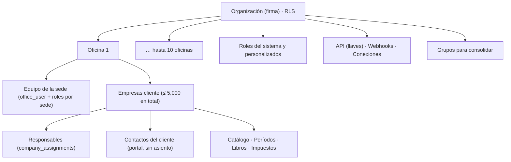
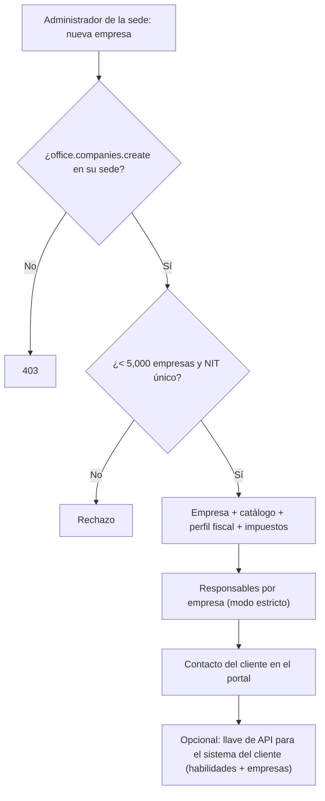
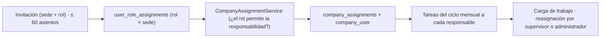
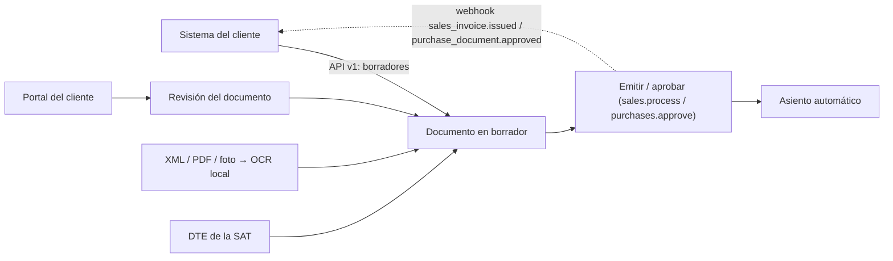
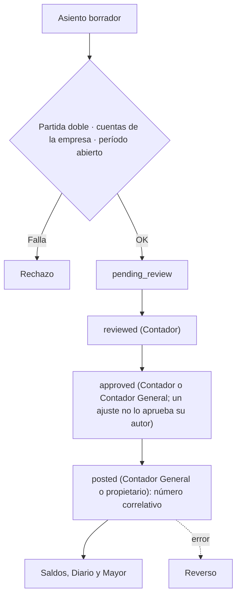
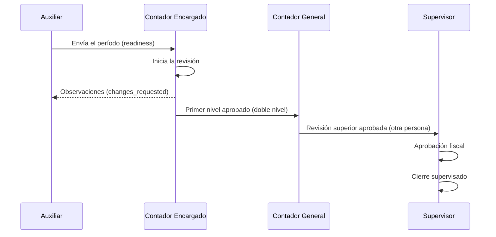
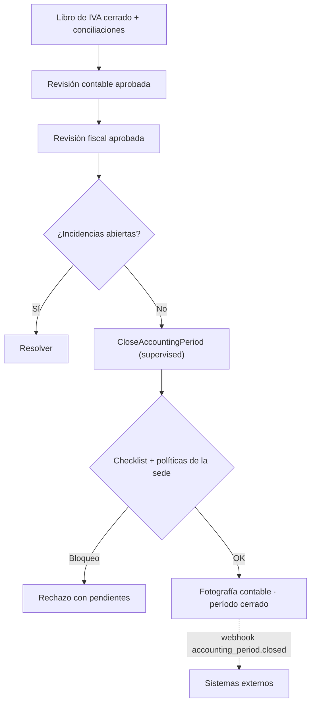
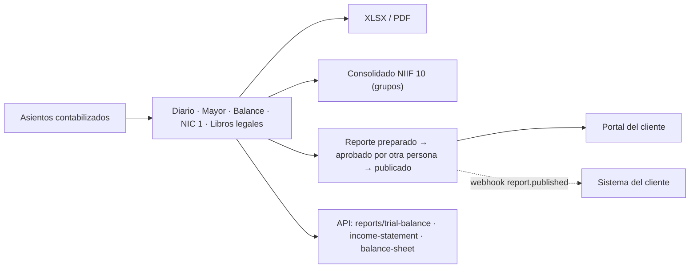

# Funcionamiento del Plan Corporativo — Atlantia Finance

> Documento técnico, funcional y operativo elaborado leyendo el código fuente (rama `main`, noviembre de 2026). Las funciones se clasifican así:
>
> - **Implementado**: existe en el código y el servidor lo aplica.
> - **Parcial**: existe con limitaciones o depende de configuración externa.
> - **Pendiente**: no existe en el código.
>
> Las referencias indican el archivo donde vive la lógica. Para no repetir, se remite a `FUNCIONAMIENTO_PLAN_MULTIEMPRESA.md` y `FUNCIONAMIENTO_PLAN_PROFESIONAL.md` en los procesos que el Corporativo comparte con esos planes.

---

## 1. Descripción del Plan Corporativo

### 1.1 Qué es y para quién

El Plan Corporativo (código `corporate`) tiene el lema *«Para firmas de gran escala»*. El catálogo lo describe como *«Para firmas de gran escala con procesos avanzados»* (`PlanCatalogSeeder`) y lo resume así:

- contabilidad, inventario y nómina;
- **API y webhooks** para integrar sus sistemas;
- soporte preferente y auditoría extendida.

Está dirigido a firmas contables con **varias sedes (hasta 10)**, equipos grandes y clientes con sistemas propios que necesitan intercambiar información automáticamente con Atlantia.

### 1.2 Precio y límites (aplicados por el servidor)

| Métrica | Corporativo | Dónde se aplica |
|---|---|---|
| Precio | Q2,999 al mes · Q29,990 al año | `plan_prices` |
| Oficinas (`offices`) | **10** | `WorkManagementController::storeOffice` → 403 *«Tu plan activo alcanzó el límite de oficinas.»* |
| Usuarios (`users`) | **60** | `OfficeInvitationService` (los usuarios del cliente no ocupan asiento) |
| Empresas cliente (`active_cases`) | **5,000** | `CompanyAdministrationService::create` |
| Almacenamiento | **120 GB** | `UsageMeterService::assertCanAdd` |
| Consultas a Luzma IA | **1,500 al mes** | `LuzmaService` |
| **Solicitudes de API** (`api_requests`) | **100,000 al mes** | `AuthenticateApiToken` → 429 `monthly_quota_exceeded` |

**Límite por minuto de la API:** cada llave tiene además un límite por minuto, `config('integrations.api.rate_limit_per_minute')`, de 120 por defecto (*rate limiter* `atlantia-api`).

Todos los límites son estrictos, con alertas al 80 % y al 95 % (`plans:limit-alerts`, `LimitAlertService`, que también vigila `api_requests`).

### 1.3 Funcionalidades incluidas

`basic_accounting`, `basic_invoicing`, `fel`, `case_management`, `task_management`, `obligation_management`, `inventory`, `payroll`, `advanced_reports`, `roles_and_permissions`, `approval_workflows`, `ocr`, `multi_office`, `consolidated_dashboard`, `office_permissions`, `centralized_audit`, **`api_access`**, **`webhooks`**, `audit_log`, `automatic_backups`, `priority_support`, `initial_training`.

**No incluye** (exclusivo del plan Empresarial): `dedicated_infrastructure`, `custom_integrations`, `custom_migrations`, `custom_ai_limits`, `service_level_agreement`.

### 1.4 Diferencias frente a los demás planes

| Aspecto | Esencial | Profesional | Multi-oficina | **Corporativo** | Empresarial |
|---|---|---|---|---|---|
| Oficinas / usuarios / empresas | 1 / 2 / 150 | 1 / 8 / 500 | 5 / 25 / 1,500 | **10 / 60 / 5,000** | Sin límite |
| Almacenamiento / IA al mes | 2 GB / 20 | 10 GB / 120 | 40 GB / 500 | **120 GB / 1,500** | Sin límite |
| Espacio de trabajo | Panel único | Panel por rol | Panel por rol y sede | **Panel por rol y sede** | Igual |
| Varias sedes y permisos por sede | No | No | Sí | **Sí** | Sí |
| Consolidación (NIIF 10) | No | No | Sí | **Sí** | Sí |
| **API pública** | No | No | No | **Sí** | Sí |
| **Webhooks salientes** | No | No | No | **Sí** | Sí |
| Infraestructura dedicada, integraciones a la medida, acuerdo de servicio | No | No | No | **No** | Sí |
| Contratación | Autoservicio | Autoservicio | Autoservicio | **Autoservicio** | Solo por cotización (`contact_only`) |

En la práctica, el Corporativo es el **Multi-oficina con el doble de capacidad, más la API y los webhooks**. El resto de los módulos y flujos es el mismo.

---

## 2. Estructura administrativa

| Estructura | ¿Existe? | Implementación |
|---|---|---|
| **Organización** (la firma) | Sí | `organizations`. Aislada por RLS de PostgreSQL. Una persona puede pertenecer a varias firmas (`organization-switcher.tsx`) |
| **Oficinas o sucursales** | Sí, hasta 10 | `offices` con código, dirección, plazos fiscales internos, políticas de cierre (`*_close_policy`) y flujo de revisión (`review_workflow`: un nivel o dos) |
| **Empresas** (clientes de la firma) | Sí, hasta 5,000 | `companies`, cada una en **una** oficina (`office_id`); se pueden trasladar entre sedes |
| **Clientes de cada empresa** | Sí | `sales_customers` y `purchase_suppliers` de cada empresa. Los usuarios del cliente acceden por el portal (`client_company_access`) |
| **Departamentos o áreas de la firma** | **No** (Pendiente) | No hay una tabla de departamentos de la oficina. Solo existe `department` como texto en los empleados de **nómina** de cada empresa |
| **Contadores, supervisores y administradores** | Sí, como roles | `user_role_assignments` con `workspace_role_id` y `office_id` (`null` = toda la firma) |
| **Roles personalizados** | Sí | `POST /office/roles` → `WorkManagementController::storeRole`: nombre, código y permisos elegidos de `workspace_permissions`. Los roles del sistema (`is_system`) no se editan. Quien no tiene permisos de alto privilegio no puede otorgarlos (`assertCanGrantRolePermissions`, `grantsHighPrivilege`) |

**Relaciones:**

```
organización ─┬─ oficinas (≤ 10) ─┬─ empresas (≤ 5,000 en total) ─┬─ catálogo, períodos, libros, impuestos
              │                   │                                ├─ terceros (clientes y proveedores de la empresa)
              │                   │                                └─ contactos del cliente (portal)
              │                   └─ office_user (personas de la sede)
              ├─ organization_user (≤ 60 internos; owner | member)
              ├─ workspace_roles (sistema + personalizados) ─ permisos
              ├─ user_role_assignments (rol × oficina o toda la firma)
              ├─ company_assignments (responsabilidad × empresa)
              ├─ company_groups (grupos para consolidar)
              └─ api_tokens · webhook_endpoints · integration_connections
```

---

## 3. Activación y configuración inicial

1. **Contratación:**
   - autoservicio con `/register?plan=corporate` (usuario, organización, oficina principal y suscripción `incomplete`), verificación de correo, datos de facturación y cobro en Recurrente; el webhook la deja en `active`;
   - o alta desde el Control Center (`OrganizationManagementService::onboard`) con prueba opcional e invitación firmada al titular.
2. **Organización:** el titular queda como `owner` con el rol `owner_director`. Su inicio es el **panel ejecutivo** (`/office/executive-dashboard`).
3. **Guía de inicio:** `/office/setup` (`SetupChecklistService`, en su variante de varias oficinas) muestra el avance real: oficinas, clientes, contadores, administradores, FEL y demás pasos.
4. **Oficinas:** `POST /office/offices`. Solo la administración general puede crearlas (`office.manage` sin restricción de sede), hasta 10.
5. **Empresas:** `CompanyAdministrationService::create` instala, por empresa, el catálogo, el perfil fiscal, los impuestos de Guatemala y los responsables. Valida el límite, el NIT único y la papelera.
6. **Clientes:**
   - terceros de cada empresa: `…/sales/customers` y `…/purchases/suppliers`, o por la API;
   - contactos del portal: `ClientAccessAdminService::createContact`, sin asiento y con contraseña temporal, cambio obligatorio y doble autenticación.
7. **Usuarios:** `POST /office/invitations` con oficina y rol; la invitación reserva un asiento.
8. **Roles y permisos:**
   - roles del sistema o personalizados, por sede o de toda la firma;
   - responsabilidades por empresa (`CompanyAssignmentService`, que en modo estricto valida que el rol permita la responsabilidad).
9. **Configuración fiscal y contable:** parámetros fiscales, mapeo contable, FEL por empresa, políticas contables, centros de costo, configuración regional y tasas de BANGUAT.
10. **Catálogo de cuentas:** instalado al crear la empresa; se edita por empresa.
11. **Períodos:** se crean a mano (`periods.manage`) o con el ciclo mensual (`month:cycle`), que abre el mes de cada empresa y crea sus tareas.

---

## 4. Flujo completo de administración contable

El flujo por empresa es el mismo del Profesional y del Multi-oficina. El Corporativo agrega la **entrada y salida automática por API y webhooks**.

| Etapa | Implementación |
|---|---|
| **Recepción de documentación** | Captura manual; **OCR** local de XML, PDF o foto (`InvoiceReader`, Tesseract); carga masiva de DTE de la SAT; portal del cliente (documentos, solicitudes); **API**: `POST /api/v1/companies/{uuid}/sales-invoices` y `…/purchase-documents` registran **borradores** desde el sistema del cliente |
| **Registro y clasificación** | Cada línea con cuenta de la empresa y tratamiento fiscal; reglas bancarias; plantillas recurrentes |
| **Asignación de actividades** | `month:cycle` y plantillas de tareas; asignaciones por empresa; reasignación por el supervisor o el administrador (`tasks.reassign`); carga de trabajo (`/office/team-workload`) |
| **Procesamiento** | Ventas, compras, cobros y pagos con retenciones, bancos, inventario y producción, nómina, activos fijos, gastos de empleados |
| **Asientos** | Automáticos e idempotentes (`AccountingAutomationService`) o manuales; siempre nacen como **borrador** |
| **Cargos y abonos** | Partida doble estricta en centavos; cuentas activas de la misma empresa; período abierto |
| **Revisión y supervisión** | Flujo de asientos `draft → pending_review → reviewed → approved → posted`; revisión del período (`CompanyPeriodReviewService`) en uno o dos niveles según la oficina, con aprobación fiscal y cierre supervisado |
| **Correcciones** | Rechazo con motivo, descarte de borradores, **reverso** de lo contabilizado, anulaciones con reverso (también por la API: `…/void`), observaciones de revisión ligadas al registro de origen |
| **Saldos** | Calculados desde las líneas contabilizadas (`LedgerService`); fotografía al cierre |
| **Libros** | Diario, Mayor, balance de comprobación, libros legales foliados (`LegalBooksService`) |
| **Reportes** | NIC 1, ISR y retenciones, otros impuestos, presupuestos, NIIF, **todos** los archivos SAT, **consolidado NIIF 10**, reportes de la API (`reports/trial-balance`, `income-statement`, `balance-sheet`) |
| **Cumplimiento fiscal** | Libros de IVA, cruce con la SAT, obligaciones con checklist, revisión por otra persona y constancia |
| **Cierre** | Directo (propietario) o supervisado (Supervisor o Contador, con las revisiones aprobadas y sin incidencias abiertas) con `CloseAccountingPeriod`; reapertura en tres pasos; cierre anual |
| **Entrega al cliente** | Reportes publicados en el portal (preparados, aprobados por otra persona y publicados); **webhook `report.published`** al sistema del cliente |

---

## 5. Gestión de equipos y trabajo colaborativo

| Capacidad | Implementación |
|---|---|
| **Asignación de tareas** | `WorkTaskService::create` (manual, ciclo mensual, obligaciones, FEL fallido); `office/tasks/{id}/assign`, `supervisor/tasks/{id}/reassign` |
| **Distribución de carga** | `/office/team-workload`, `/office/workload`, `/office/productivity` y tareas sin asignar (`/office/unassigned-tasks`). Alertas de personal: `office:staffing-alerts` (08:00) |
| **Participación por rol** | Paneles propios: auxiliar, contador, contador general, supervisor, gerente (`/operations`), fiscal, tesorería, cuentas por cobrar, cuentas por pagar, nómina y auditoría |
| **Responsabilidades** | `company_assignments` con un titular principal por responsabilidad; al cambiarlo se termina la asignación anterior y se conserva el historial |
| **Supervisión** | Revisiones de período, reasignación de revisores, incidencias (`OperationalIncidentService`), cierre supervisado, aprobación de declaraciones |
| **Observaciones** | `review_observations` (por registro, con el ciclo corregido → validado) y comentarios de tareas (`task_comments`: comentario, observación, bloqueo, espera) |
| **Avance** | Estados de tareas y revisiones; `CompanyPeriodProgressService`; panel ejecutivo |
| **Permisos** | Roles del sistema y personalizados, por sede; separación de funciones (revisor distinto obligatorio, ajustes no aprobados por quien los creó, nómina aprobada por quien no la calculó); el Director queda en solo lectura cuando hay un Administrador General |
| **Trazabilidad** | `audit_logs` de solo inserción; historial de tareas y obligaciones; registro de la API (`api_request_logs`); registro de entregas de webhooks (`webhook_deliveries`) |

---

## 6. Gestión contable de múltiples clientes

- **Cada cliente es una empresa** con su catálogo, períodos, libros, impuestos, documentos y obligaciones.
- **Separación de registros:**
  - RLS por organización;
  - validación de la empresa en cada petición (`AccountingService::company`, que da 404 si el usuario no tiene acceso);
  - cuentas, períodos y terceros siempre de la misma empresa;
  - bloqueo por empresa en las escrituras.
- **Documentos:** archivos de compras, soportes de asientos, documentos del portal y constancias, todos ligados a la empresa y medidos contra los 120 GB.
- **Información fiscal:** perfil, impuestos y versiones por empresa; Libro de IVA y obligaciones por empresa.
- **Reportes y cierre:** individuales por empresa, con folios propios y cierre propio.
- **Resultados globales:**
  - **Consolidación NIIF 10** de grupos de empresas (`ConsolidationService`, *Implementado*): suma por cuenta, elimina operaciones intercompañía identificadas por NIT y calcula la participación no controladora;
  - **panel ejecutivo** con indicadores agregados de la firma (`ExecutiveDashboardService`);
  - por la API, cada consulta es por empresa: no hay un consolidado vía API (Pendiente).

---

## 7. Módulos y funcionamiento interno

Los módulos contables, fiscales, de inventario, de nómina, del portal y de supervisión funcionan como se describe en `FUNCIONAMIENTO_PLAN_PROFESIONAL.md` (secciones 4 a 6). Los de varias sedes y consolidación están en `FUNCIONAMIENTO_PLAN_MULTIEMPRESA.md` (secciones 2, 3.10 y 6). Aquí se detallan los módulos **exclusivos** del Corporativo y se resume el resto.

### 7.1 API pública v1 (exclusivo)

- **Objetivo:** que los sistemas del cliente o de la firma lean y registren información.
- **Rutas** (`routes/api.php`, prefijo `/api/v1`, middleware `api.token` y `throttle:atlantia-api`):

| Recurso | Operaciones |
|---|---|
| `me`, `companies`, `companies/{uuid}` | Consulta |
| `customers` | Listar, crear, ver, actualizar, eliminar |
| `suppliers` | Listar, crear, ver, actualizar, eliminar |
| `sales-invoices` | Listar, crear **borrador**, ver, anular con reverso |
| `purchase-documents` | Listar, crear **borrador**, ver, anular con reverso |
| `receivables`, `payables` | Saldos |
| `accounts` | Catálogo de cuentas |
| `reports/{trial-balance, income-statement, balance-sheet}` | Reportes |
| `fel-documents` | Documentos FEL certificados |

- **Llaves** (`/office/integrations/tokens`, `ApiTokenService`):
  - formato `atl_…`, con nombre, **habilidades** (por ejemplo `sales:write`, `purchases:void`, `reports:read`), empresas permitidas y vencimiento opcional;
  - **una llave nunca supera a su creador**: solo puede tener las habilidades cuyo permiso y función del plan tiene quien la crea, y deja de funcionar si esa persona pierde el acceso;
  - se revocan con `tokens/{id}/revoke`.
- **Validaciones por llamada** (`AuthenticateApiToken`, `ApiController`):
  - errores 401 por llave inválida, revocada, vencida o de un dueño inactivo;
  - 402 si la suscripción está inactiva;
  - 403 sin `api_access` o sin la habilidad;
  - 429 por la cuota mensual o el límite por minuto;
  - el contexto de RLS se fija a la organización de la llave;
  - se registra cada llamada en `api_request_logs`, que se depura a los 90 días.
- **Reglas:** la API respeta las mismas validaciones de negocio que la pantalla. Crea borradores, no emite: la emisión o aprobación la hace un usuario con `sales.process` o `purchases.approve`.

### 7.2 Webhooks salientes (exclusivo)

- **Objetivo:** avisar a sistemas externos de lo que ocurre en Atlantia.
- **Configuración:** `/office/integrations/webhooks` permite crear, editar, activar, desactivar, rotar el secreto, eliminar y probar un *endpoint*, con los eventos elegidos (`WebhookEndpointService`, que exige `webhooks`).
- **Eventos** (`WebhookEvents`):

| Grupo | Eventos |
|---|---|
| Ventas | `customer.created`, `customer.updated`, `sales_invoice.created`, `sales_invoice.issued`, `sales_invoice.voided`, `payment.received`, `credit_note.issued` |
| Compras | `supplier.created`, `supplier.updated`, `purchase_document.created`, `purchase_document.approved`, `purchase_document.voided`, `payment.sent` |
| FEL | `fel_document.certified`, `fel_document.cancelled` |
| Contabilidad | `accounting_period.closed`, `accounting_period.reopened` |
| Portal del cliente | `report.published`, `client_document.received` |

- **Funcionamiento:**
  1. Cada acción auditada pasa por `WebhookDispatcher::fromAudit`.
  2. La entrega se escribe **en la misma transacción** que la acción, así que si la acción se revierte no se envía nada.
  3. Un trabajo en cola la envía después de confirmada la transacción.
  4. La entrega va firmada: `Atlantia-Signature: t=…,v1=HMAC-SHA256(t.body, secreto)`.
  5. Si falla, se reintenta a los 60 s, 5 min, 30 min, 2 h, 6 h y 12 h (`webhooks:deliver` cada minuto). Tras varias fallas consecutivas el *endpoint* se desactiva y se avisa a su creador.
  6. Se bloquean las URL `http://` y las de redes internas, salvo en desarrollo.
- **Restricción:** si la organización pierde `webhooks`, las entregas se detienen.

### 7.3 Conexiones de la firma (no exclusivas del plan)

`office/integrations/connections/{provider}` permite conectar Slack, Teams, Calendar, SMTP, Google Drive (con respaldo) y Luzma. Gmail, Outlook, Dropbox y HubSpot quedan ocultos por `INTEGRATIONS_HIDDEN_PROVIDERS` (Parcial). En el código estas conexiones no exigen una función del plan.

### 7.4 Resumen del resto de módulos

| Módulo | Función del plan | Permisos clave | Automatización |
|---|---|---|---|
| Contabilidad general | `basic_accounting` | `journal.*`, `periods.manage` | Asientos de origen, recurrentes, reversión programada |
| Ventas, FEL y cuentas por cobrar | `basic_invoicing`, `fel` | `sales.manage`, `sales.process`, `fel.certify` | `fel:recover`, `fel:sat-alerts`, `collections:auto-remind` |
| Compras y cuentas por pagar (con OCR) | `basic_accounting`, `ocr` | `purchases.manage`, `purchases.approve` | Propuestas de pago |
| Bancos y tesorería | `basic_accounting` | `banks.manage`, `treasury.*` | Reglas bancarias, clasificación |
| Inventario y producción | `inventory` (`plan.feature`) | `journal.create` | `postCosts`, tomas físicas |
| Nómina | `payroll` (`plan.feature`) | `payroll.*` (quien calcula no aprueba) | — |
| Fiscal | `basic_accounting`, `obligation_management`, `advanced_reports` | `fiscal.*`, `vat_books.*` | Calendario, `month:cycle` |
| Supervisión y operaciones | `approval_workflows` (módulos operativos) | `reviews.*`, `supervision.*` | `tasks:sync`, `tasks:remind`, `alerts:dispatch` |
| Varias sedes | `multi_office`, `office_permissions` | `office.*` | `office:staffing-alerts` |
| Consolidación | `consolidated_dashboard` | Propietario (grupos) y acceso a todas las empresas del grupo | — |
| Auditoría | `audit_log`, `centralized_audit` | `audit.*` | — |
| Portal del cliente | — | `client_portal.*`, `client.*` | `clients:remind` |
| Capacitación | `initial_training` | `training.*` | — |

---

## 8. Seguridad, auditoría y trazabilidad

| Control | Implementación |
|---|---|
| **Aislamiento** | RLS (`tenant_isolation`) en unas 159 tablas; el *trigger* `atlantia_enforce_organization` deriva `organization_id`; `hide_deleted_companies`; la API fija el contexto de RLS por llave; el rol de base de datos no tiene `BYPASSRLS` |
| **Segregación de funciones** | Revisor distinto obligatorio (`REQUIRED_SEPARATE_REVIEWER`); un ajuste no lo aprueba quien lo creó; la revisión superior la hace una persona distinta de quien aprobó el primer nivel; quien calcula o envía la nómina no la aprueba; quien prepara un reporte publicado no lo aprueba; quien prepara una obligación no la aprueba |
| **Permisos por rol** | `WorkAuthorizationService::can` y `AccountingService::canModule`, sobre los permisos persistidos del rol; alcance por sede (`OfficeScopeService`) y por empresa |
| **Restricciones de acceso** | `subscription.active`, `plan.feature:*`, doble autenticación por oficina (`EnforceOfficeTwoFactor`), aceptación legal, el Director en solo lectura cuando hay un Administrador General (`RestrictSupervisingDirector`), usuarios del cliente limitados al portal (`RestrictClientPortalUsers`) |
| **Registros de actividad** | `audit_logs` de solo inserción; `api_request_logs`; `webhook_deliveries`; exportación de reportes auditada |
| **Historial** | Los asientos contabilizados son inmutables (*trigger*) y se corrigen con reversos; las asignaciones se terminan sin borrarse; cada cierre deja una fotografía contable; la reapertura queda auditada; los documentos del portal guardan sus versiones |
| **Validaciones** | Partida doble, período abierto, Libro de IVA abierto, NIT único, número fiscal único por proveedor, límites del plan, URL seguras de webhooks |
| **Concurrencia** | `lockForUpdate` sobre la empresa en toda escritura contable; idempotencia por `request_id` y `posting_key`; el *rate limiter* de la API; la entrega de webhooks dentro de la transacción de la acción |

---

## 9. Análisis técnico

- **Rutas:** `routes/web.php` (pantallas, paneles por rol, `office/*`, `accounting/companies/{uuid}/*`, `client/*`, `work/client-portal/*`), `routes/api.php` (API v1) y `routes/console.php` (tareas programadas).
- **Controladores exclusivos del plan:** `Api\V1\{CompanyController, CustomerController, SupplierController, SalesInvoiceController, PurchaseDocumentController, BalanceController, AccountingController}` e `IntegrationsController`. Los demás son los mismos del Profesional y el Multi-oficina.
- **Modelos y tablas propios del plan:** `api_tokens`, `api_request_logs`, `webhook_endpoints`, `webhook_deliveries` e `integration_connections`. Se suman a las tablas contables, de inventario, de nómina, del portal, de supervisión y de consolidación ya documentadas.
- **Servicios:** `ApiTokenService`, `ApiAbilities`, `WebhookEndpointService`, `WebhookDispatcher`, `WebhookDeliveryService`, `WebhookEvents` e `IntegrationConnectionService`, más los servicios contables y de supervisión comunes.
- **Middleware:** `AuthenticateApiToken` (`api.token`), `subscription.active`, `plan.feature`, `EnforceOfficeTwoFactor`, `EnsureLegalAcceptance`, `RestrictSupervisingDirector`, `RestrictClientPortalUsers` y `SetTenantDatabaseContext`.
- **Autorización:** se resuelve en servicios (`can`, `canModule`, `requireFeature`, `OfficeScopeService`, `roleAllowedByPlan`) y en la base de datos (RLS y *triggers*). No hay *Policies* de Laravel para estos módulos.
- **Procesos automáticos:**

| Comando | Frecuencia |
|---|---|
| `webhooks:deliver` | Cada minuto (también depura el registro de la API) |
| `fel:recover` | Cada 5 min |
| `tasks:sync` | Cada 15 min |
| `billing:run`, `alerts:dispatch` | Cada hora |
| `usage:snapshot` / `plans:limit-alerts` | 01:15 / 01:45 |
| `backup:create` | 02:30 (si está habilitado) |
| `recurring:run` | 06:10 |
| `month:cycle` | 06:40 |
| `luzma:morning-brief` | 07:20 |
| `tasks:remind` | 07:45 |
| `office:staffing-alerts` | 08:00 |
| `crm:alerts` | 08:15 |
| `clients:remind` | 08:25 |
| `fel:sat-alerts` | 08:30 |
| `collections:auto-remind` | 08:40 |
| `budgets:alerts` | 09:10 |

- **Reportes:** `ReportExportService` (XLSX y PDF), `LegalBooksService`, `SatFileController`, exportación del consolidado y reportes de la API.
- **Integraciones:** Recurrente, certificador FEL, BANGUAT, Tesseract (OCR local), SMTP, Slack, Teams, Calendar, Google Drive, API v1 y webhooks.

---

## 10. Diagramas Mermaid

### 10.1 Estructura administrativa



### 10.2 Alta de clientes y empresas



### 10.3 Asignación de responsabilidades



### 10.4 Flujo documental



### 10.5 Procesamiento contable



### 10.6 Revisión y validación del período



### 10.7 Cierre contable



### 10.8 Generación y entrega de reportes



---

## 11. Caso práctico completo

**Firma:** *Grupo Contable Atlántico Norte*, Plan Corporativo, con 3 de sus 10 sedes posibles: Puerto Barrios, Morales y Santo Tomás de Castilla. Tiene 42 usuarios internos.

**Equipo de la sede Puerto Barrios** (fragmento):

| Persona | Rol |
|---|---|
| Lic. Ricardo Paz | Propietario |
| Silvia Ochoa | Administradora General (el propietario queda en solo lectura) |
| Ana Hernández | Contadora General de la sede |
| Jorge Cardona | Supervisor |
| Carlos Méndez | Contador Encargado |
| Andrea Pineda | Auxiliar |
| Marta Bol | Cuentas por Cobrar |
| Edwin Pérez | Cuentas por Pagar |
| Gabriela Solís | Encargada Fiscal |
| Óscar Villeda | Tesorería |

**Clientes** (5 de los 3,100 de la firma):

- **Distribuidora El Progreso, S.A.**, con ERP propio integrado por API;
- **Comercializadora del Caribe**;
- **Transportes y Logística del Norte**;
- **Inversiones Puerto del Sol** (controladora del grupo);
- **Ferretería El Martillo**.

### Octubre de 2026, empresa *Distribuidora El Progreso*

| Día | Etapa | Usuario o sistema | Lo que registra Atlantia |
|---|---|---|---|
| 1 | El ciclo mensual abre el período y crea las tareas | Automático | `accounting_periods` y `work_tasks` asignadas a Andrea, Carlos y Gabriela |
| 1–30 | El ERP del cliente envía cada factura con `POST /api/v1/…/sales-invoices` (llave con `sales:write` limitada a esta empresa) | Sistema del cliente | Ventas en **borrador** y `api_request_logs`; webhook `sales_invoice.created` |
| 1–30 | Marta revisa y **emite** los borradores (`sales.process`) | Cuentas por Cobrar | Asientos automáticos: cargo a Clientes, abono a Ingresos y a IVA débito; webhook `sales_invoice.issued` |
| 3 | El cliente sube sus facturas de compra al portal | Contacto del cliente | `client_documents`; webhook `client_document.received` |
| 4 | Andrea registra las compras con OCR; Edwin las **aprueba** (`purchases.approve`) | Auxiliar · Cuentas por Pagar | Asientos de compra con IVA crédito |
| 15 | Edwin paga a proveedores; Marta registra los cobros | Cuentas por Pagar · Cuentas por Cobrar | Asientos de pago y cobro; webhooks `payment.sent` y `payment.received` |
| 31 | Óscar registra el estado de cuenta, clasifica la comisión y concilia; Carlos revisa | Tesorería · Contador | Asiento de la comisión y `account_reconciliations` |
| 31 | La planilla la calcula Nómina y la aprueba Carlos | Nómina · Contador | Asiento de planilla |
| 31 | Ana **contabiliza** los borradores | Contadora General | Asientos `posted` y numerados |
| 6 nov. | Gabriela cruza con la SAT y cierra el Libro de IVA | Encargada Fiscal | Liquidación del IVA |
| 7 nov. | Andrea envía el período a revisión; Carlos lo revisa y pide una corrección | Auxiliar · Contador | `company_period_reviews` en `changes_requested`, con su observación ligada al asiento |
| 8 nov. | Andrea corrige el asiento con un reverso y uno nuevo; Carlos aprueba el primer nivel | Auxiliar · Contador | Asiento `reversed` y aprobación `first_level_approved` |
| 9 nov. | Ana hace la revisión superior; Jorge aprueba lo fiscal | Contadora General · Supervisor | Revisión `approved` con fiscal aprobado |
| 10 nov. | Jorge cierra el período (cierre supervisado) | Supervisor | Checklist, fotografía contable y período `closed`; webhook `accounting_period.closed` al ERP |
| 25 nov. | Gabriela presenta el IVA y registra la constancia (Carlos aprueba antes) | Fiscal · Contador | Obligación `completed` |
| 26 nov. | Ana prepara el estado de resultados; Silvia lo aprueba y publica | Contadora General · Administradora | `published_reports` disponible en el portal; webhook `report.published` |

### Las otras empresas y el resultado global

- Cada empresa sigue el mismo circuito con **sus propios** libros, períodos y responsables. Las de la sede Morales las atiende su propio equipo, y su administrador **no ve** las empresas de Puerto Barrios.
- **Consolidado del grupo:** Inversiones Puerto del Sol, Distribuidora El Progreso y Comercializadora del Caribe forman un grupo. En `/accounting/consolidation`, `ConsolidationService` suma sus cuentas, elimina los alquileres y saldos entre ellas (identificados por NIT) y calcula la participación no controladora. El consolidado se exporta en XLSX o PDF.
- **Indicadores de la firma:** el propietario y la Administradora General ven el avance de toda la firma en el panel ejecutivo y en la carga de trabajo.

---

## 12. Riesgos y deficiencias identificados

1. **La API solo registra borradores.** La emisión y la aprobación siguen siendo manuales (`sales.process` y `purchases.approve`). Es un control deliberado, pero un volumen grande de borradores por API depende de pocas personas.
2. **API sin consolidado.** Los reportes de la API son por empresa; no hay un endpoint de consolidación ni de libros de IVA (Pendiente).
3. **Eventos de webhook limitados.** No hay eventos de revisión, nómina, inventario ni obligaciones fiscales.
4. **Roles personalizados no condicionados al plan.** `storeRole` exige `office.roles.manage`, pero no verifica `roles_and_permissions`. Esto se compensa porque `roleAllowedByPlan` limita qué roles se pueden asignar.
5. **Sin departamentos o áreas internas de la firma.** La organización del equipo depende de sedes, roles y asignaciones.
6. **Director en solo lectura.** Al delegar en un Administrador General, el Director pierde los permisos de acción (`isExecutiveReadOnly`). Es intencional, pero hay que tenerlo en cuenta al planificar las aprobaciones.
7. **Aislamiento entre empresas de la misma firma.** Depende de la capa de aplicación; RLS separa organizaciones, no empresas.
8. **Conexiones ocultas.** Gmail, Outlook, Dropbox y HubSpot están construidas pero ocultas por configuración.
9. **Dependencias externas:** el certificador FEL, Recurrente y los respaldos (`backup.enabled`). No hay conexión directa con los bancos.
10. **Expediente formal de alta del cliente** (contrato, credenciales SAT): no está en `main`.

---

## 13. Resumen de estado

| Estado | Funcionalidades |
|---|---|
| **Implementado** | Límites del plan (10 / 60 / 5,000 / 120 GB / 1,500 IA / 100,000 API al mes); varias sedes con alcance por sede; roles del sistema y personalizados; responsabilidades por empresa; paneles por rol; revisión de asientos y del período en uno o dos niveles con aprobación fiscal y cierre supervisado; contabilidad, ventas, compras, bancos, inventario, producción, nómina, activos fijos y fiscal completos; consolidación NIIF 10; portal del cliente; **API v1 con llaves, habilidades, cuotas y registro**; **webhooks firmados con reintentos**; auditoría y trazabilidad |
| **Parcial** | Conexiones ocultas por configuración; el aislamiento entre empresas de una firma depende de la aplicación; los roles personalizados no se condicionan al plan al crearlos; FEL y respaldos dependen de configuración externa |
| **Pendiente** | Departamentos o áreas de la firma; consolidado y libros de IVA por la API; eventos de webhook de revisión, nómina, inventario y obligaciones; expediente formal de alta del cliente en `main`; conexión directa con los bancos; funciones a la medida del plan Empresarial |

---

*Fuentes principales: `config/atlantia-plans.php`, `database/seeders/PlanCatalogSeeder.php`, `config/integrations.php`, `routes/api.php`, `routes/web.php`, `routes/console.php`, `app/Http/Middleware/AuthenticateApiToken.php`, `app/Providers/AppServiceProvider.php`, `app/Services/Integrations/{ApiTokenService,ApiAbilities,WebhookDispatcher,WebhookDeliveryService,WebhookEvents,WebhookEndpointService}.php`, `app/Http/Controllers/{IntegrationsController,WorkManagementController,ConsolidationController}.php`, `app/Services/WorkManagement/*`, `app/Services/Operations/*`, `app/Services/AccountingService.php`, `app/Services/Accounting/ConsolidationService.php`, `app/Services/Platform/{EntitlementResolverService,LimitAlertService}.php`.*
