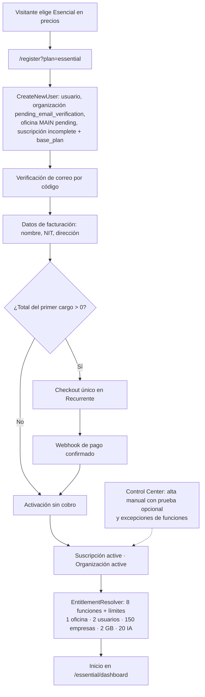
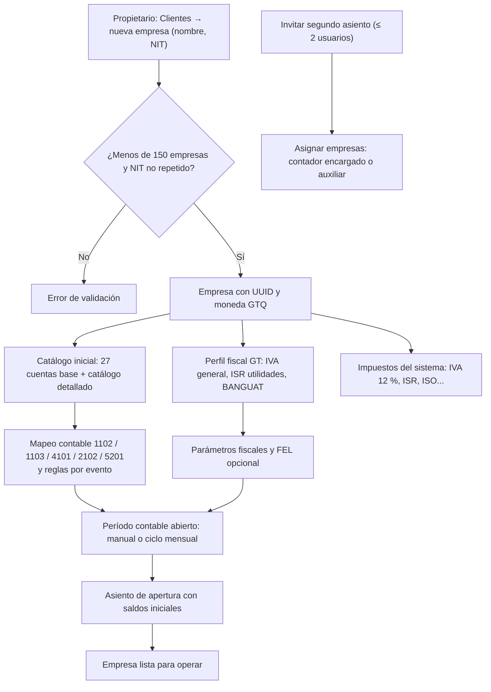
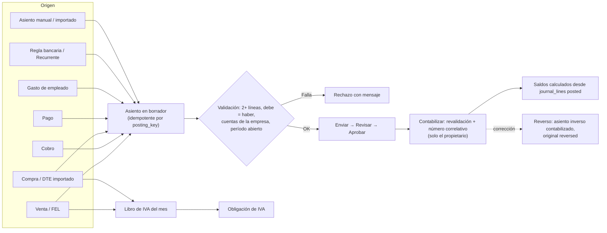
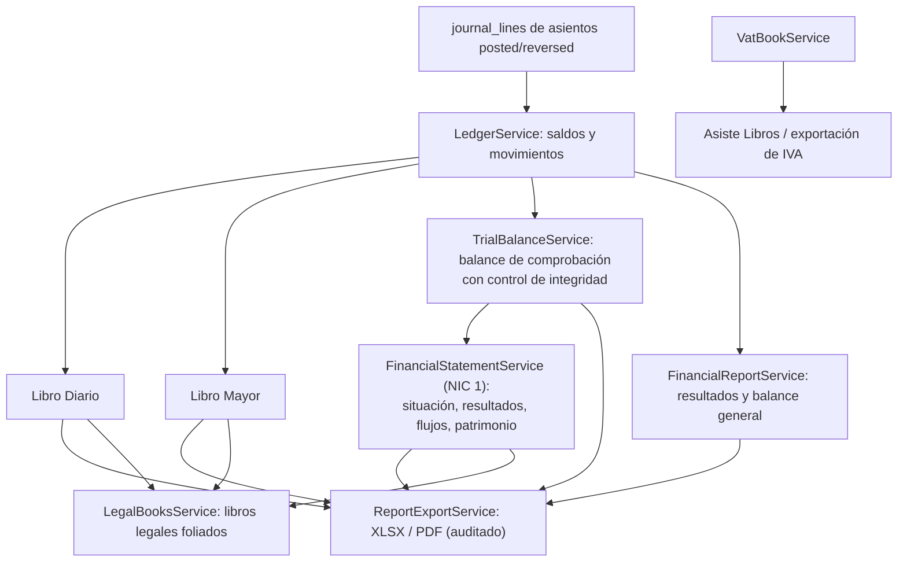
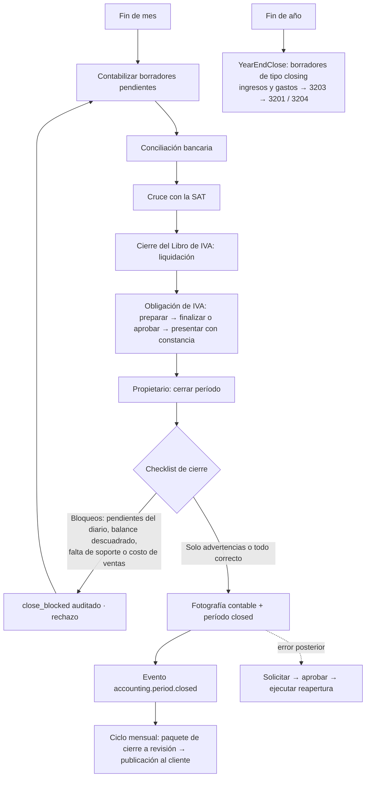

# Funcionamiento del Plan Esencial — Atlantia Finance

> Documento técnico, funcional y operativo. Se elaboró leyendo el código fuente del repositorio (rama `main`, noviembre de 2026). Cada afirmación cita el archivo donde vive la lógica. Las funciones se clasifican así:
>
> - **Implementado**: existe en el código y el servidor lo aplica.
> - **Parcial**: existe, pero con limitaciones, incoherencias entre interfaz y servidor, o depende de configuración externa.
> - **Pendiente**: no existe en el código.

---

## Índice

1. [Descripción general](#1-descripción-general)
2. [Funcionamiento desde el inicio](#2-funcionamiento-desde-el-inicio)
3. [Flujo contable completo](#3-flujo-contable-completo)
4. [Funcionamiento de cada módulo](#4-funcionamiento-de-cada-módulo)
5. [Flujo de trabajo del usuario](#5-flujo-de-trabajo-del-usuario)
6. [Funcionamiento técnico](#6-funcionamiento-técnico)
7. [Diagramas del flujo completo](#7-diagramas-del-flujo-completo)
8. [Ejemplo de principio a fin](#8-ejemplo-de-principio-a-fin)
9. [Resumen de estado: implementado, parcial y pendiente](#9-resumen-de-estado-implementado-parcial-y-pendiente)

---

## 1. Descripción general

### 1.1 ¿Qué es el Plan Esencial?

El Plan Esencial (código interno `essential`) es el plan de entrada de Atlantia Finance y el **plan por defecto** del registro (`config/atlantia-plans.php` → `'default' => 'essential'`). El catálogo lo describe como *«Para profesionales independientes y oficinas pequeñas»* (`database/seeders/PlanCatalogSeeder.php`).

| Concepto | Valor | Fuente |
|---|---|---|
| Precio mensual | Q399 | `PlanCatalogSeeder`, `config/atlantia-plans.php` |
| Precio anual | Q3,990 | ídem |
| Moneda | GTQ | `plan_prices.currency_code` |
| Lema comercial | «Para comenzar con orden» | `PlanCatalogSeeder::fillPresentation()` |
| Destacados | Contabilidad, libros de IVA y FEL · Expedientes, tareas y obligaciones · Seguridad, auditoría y copias de respaldo | ídem |

El sistema no compara nombres de plan para decidir permisos. Toma la **versión de plan** que se vendió a la suscripción (`plan_versions.entitlements` y `plan_versions.limits`), le aplica las excepciones activas (`entitlement_overrides`) y después las dependencias entre funciones (`features.requires`). Así lo hace `app/Services/Platform/EntitlementResolverService.php`. Por eso un cambio posterior al catálogo no altera lo que un cliente ya compró.

### 1.2 Tipo de cliente para el que está diseñado

Por sus límites y por la lógica de la interfaz, el plan está pensado para:

- un **contador independiente** que trabaja solo (*«solo office»*, `EssentialPanelService::soloOffice()`);
- o una **oficina pequeña de dos personas**: el propietario y un colaborador.

El código lo dice expresamente:

> «Workspace of the Esencial plan. The owner runs the whole practice; the second seat works the clients, tasks and obligations assigned to them.» — `app/Http/Controllers/EssentialController.php`

### 1.3 Límites del plan

Todos se aplican como límite **estricto** (`enforcement = 'hard'`), con avisos al 80 % y al 95 % de uso.

| Métrica | Límite | Dónde se aplica |
|---|---|---|
| `offices` (oficinas) | 1 | `OfficeAdminService` (línea ~586), `SetupChecklistService` |
| `users` (usuarios) | 2 | `OfficeInvitationService::invite()`: cada invitación reserva un asiento |
| `active_cases` (empresas cliente) | 150 | `CompanyAdministrationService::create()` |
| `storage_bytes` (almacenamiento) | 2 GB | `UsageMeterService::assertCanAdd()`, en cada carga de archivos |
| `ai_queries` (consultas a Luzma IA) | 20 al mes | `LuzmaService` (línea ~306) |

### 1.4 Funcionalidades incluidas (*features*)

| Código | Nombre | Módulo de catálogo |
|---|---|---|
| `basic_accounting` | Contabilidad básica | contabilidad |
| `basic_invoicing` | Facturación básica | ventas |
| `fel` | Facturación Electrónica en Línea (requiere `basic_invoicing`) | fiscal |
| `case_management` | Gestión de expedientes | operación |
| `task_management` | Gestión de tareas | operación |
| `obligation_management` | Gestión de obligaciones | fiscal |
| `audit_log` | Registro de auditoría | auditoría |
| `automatic_backups` | Copias de seguridad automáticas | infraestructura |

### 1.5 Funcionalidades NO incluidas

`inventory`, `payroll`, `advanced_reports`, `roles_and_permissions`, `approval_workflows`, `ocr`, `multi_office`, `consolidated_dashboard`, `office_permissions`, `centralized_audit`, `api_access`, `webhooks`, `priority_support`, `initial_training` y todas las funciones exclusivas del plan Empresarial.

### 1.6 Módulos habilitados y restringidos

La siguiente tabla separa lo que **el servidor bloquea** de lo que **solo oculta el menú**. Es una distinción importante. El middleware `EnsurePlanFeature` lo explica así: *«hiding the menu is a courtesy, this is the control»*.

#### Restricciones que aplica el servidor (Implementado)

| Restricción | Mecanismo | Resultado en Esencial |
|---|---|---|
| Inventario, kardex, conteos físicos y producción | `->middleware('plan.feature:inventory')` en `routes/web.php` (líneas 280–291) | HTTP 403 |
| Nómina (todo el prefijo `payroll`) | `->middleware('plan.feature:payroll')` | HTTP 403 |
| Lectura de facturas con OCR | `PurchaseController::readInvoice()` → `requireFeature('ocr')`. Luzma también verifica `ocr` | HTTP 403 |
| Archivos SAT `retenisr` e `inventarios` | `SatFileController` exige `advanced_reports`. `asiste-libros` solo exige `basic_accounting` | Solo se descarga Asiste Libros |
| Consolidación de estados | `ConsolidationController` → `consolidated_dashboard` | HTTP 403 |
| API pública y webhooks | `AuthenticateApiToken`, `ApiTokenService`, `WebhookEndpointService` | HTTP 403 o sin entregas |
| Roles asignables | `WorkAuthorizationService::roleAllowedByPlan()`: sin `roles_and_permissions` solo `accountant_in_charge` y `accounting_assistant` | Solo dos roles para el segundo asiento |
| Rol de nómina | `ROLE_FEATURES = ['payroll' => 'payroll']` | No se puede asignar |
| Espera de documentos del cliente desde una tarea | `TaskWaitService` exige `advanced_reports` y contactos del portal | No disponible |
| Más de 1 oficina, 2 usuarios o 150 empresas | Límites de la sección 1.3 | Error de validación con mensaje para cambiar de plan |

#### Pantallas disponibles en Esencial

Casi todas las pantallas contables usan el *trait* `ScopesAccountingCompany`, cuya función por defecto es `basic_accounting`. Como Esencial incluye esa función, estas pantallas **están disponibles**:

- **Contabilidad general:** catálogo de cuentas, períodos contables, Libro Diario, Libro Mayor, balance de comprobación, reportes y exportaciones.
- **Ventas y cobros:** ventas, clientes, cuentas por cobrar, recibos, notas de crédito y automatización de cobros (`basic_invoicing`).
- **FEL:** emisión y certificación (`fel` y `basic_invoicing`).
- **Compras y pagos:** compras, proveedores, cuentas por pagar, pagos y notas de crédito de proveedor.
- **Bancos:** cuentas bancarias, estado de cuenta y conciliación bancaria.
- **Fiscal:** parámetros fiscales (impuestos, tasas de cambio), Libros de IVA, cruce con la SAT, obligaciones fiscales.
- **Estados y cierre:** estados financieros, cierre anual y libros legales.
- **Contabilidad avanzada:** activos fijos, centros de costo, políticas contables, conciliación de cuentas, ISR y retenciones, otros impuestos (IUSI, ISO, timbres), presupuestos, NIIF 16/9 y NIC 12, cheques y configuración regional.
- **Herramientas nuevas:** automatización (reglas bancarias, plantillas recurrentes, reversión programada), cotizaciones y órdenes, y gastos de empleados.

#### Incoherencias detectadas entre el menú y el servidor (Parcial)

1. **«Inventario y kardex» y «Producción y costos»** aparecen en el grupo *Contabilidad avanzada* del menú de la empresa (`app-sidebar.tsx`, `advancedItems`), pero el servidor responde 403 en Esencial. El menú no filtra esos dos enlaces por plan.
2. **Cotizaciones, órdenes de compra, notas de crédito y reglas bancarias.** `resources/js/lib/plan-capabilities.ts` asocia los módulos *futuros* `cotizaciones`, `ordenes-compra` y `notas-credito` a `approval_workflows`, y `reglas` a `advanced_reports`, por lo que esos accesos se ocultan en Esencial. Sin embargo, las **pantallas reales** «Cotizaciones y órdenes», «Automatización» (que contiene las reglas bancarias) y las notas de crédito de ventas y compras **sí están disponibles**, porque solo exigen `basic_accounting`.
3. **Módulos avanzados no anunciados.** Presupuestos, NIIF, activos fijos, cheques y otros no figuran en la oferta comercial del plan, pero funcionan porque solo exigen `basic_accounting`.
4. **`case_management`** está en el catálogo, pero ningún controlador lo verifica. En la práctica, los «expedientes» son las empresas cliente y su información.
5. **Portal del cliente.** No está bloqueado por el plan en el servidor. Solo el bloque FEL del portal verifica la función `fel`. Pero el enlace «Portal Cliente» del menú se oculta (`portal-cliente` → `advanced_reports`) y las esperas de documentos desde una tarea no están disponibles.
6. **Cierre de período como registro operativo.** El módulo `cierre-periodo` de `OperationalRecordService` exige `approval_workflows`. En Esencial el cierre se hace directamente desde **Períodos contables** (sección 3.11).

### 1.7 Roles y permisos que intervienen

| Actor | Rol en `organization_user` | Rol de trabajo (`ROLE_PRESETS`) | Panel de inicio |
|---|---|---|---|
| **Propietario** (primer usuario, quien registra la oficina) | `owner` | `owner_director`, con permisos `['*']` | `/essential/dashboard` |
| **Segundo asiento** (colaborador invitado) | `member` | `accountant_in_charge` (Contador Encargado) o `accounting_assistant` (Auxiliar Contable) | `/essential/dashboard` |
| **Usuario del cliente** (opcional, no consume asiento) | — | `client_user` | `/client` |
| **Personal de Atlantia** | — | Roles SaaS del Control Center | `/control-center` |

`WorkAuthorizationService::dashboardPathFor()` envía a `/essential/dashboard` a los roles `owner_director`, `office_admin`, `accountant_in_charge` y `accounting_assistant` cuando el plan es `essential`: *«The Esencial plan has no per-role panels»*.

**Alcance de datos:**

- El propietario ve **todas** las empresas de la organización.
- El segundo asiento ve solo las empresas que tiene asignadas en `company_assignments` (`EssentialPanelService::companyIds()`) y las tareas donde es responsable o revisor.
- Auditoría, respaldos, equipo, seguridad, suscripción y configuración son **solo del propietario** (`EssentialController::resolve($request, true)`).

**Permisos contables relevantes** (predeterminados en `ROLE_PRESETS`; la tabla de permisos persistida puede ajustarlos):

| Acción | Propietario | Contador Encargado | Auxiliar Contable |
|---|---|---|---|
| Crear, importar y enviar asientos (`journal.create`, `journal.import`, `journal.submit`) | Sí | Sí | Sí |
| Revisar y rechazar asientos (`journal.review`, `journal.reject`) | Sí | Sí | No |
| Aprobar asientos (`journal.approve`) | Sí | Sí | No |
| **Contabilizar** asientos (`journal.post`) | Sí | **No** | **No** |
| Revertir asientos (`journal.reverse`) | Sí | No | No |
| Crear, cerrar y reabrir períodos (`periods.manage`) | Sí | No (solo puede *solicitar* cierre o reapertura) | No |
| Ventas, compras, bancos y FEL (`*.manage`, `fel.certify`) | Sí | Sí (`fel.certify` incluido) | Sí (sin `fel.certify`) |
| Revisar obligaciones fiscales | Sí | Sí | No |

**Consecuencia operativa:** en Esencial, **solo el propietario contabiliza asientos y cierra períodos**. El colaborador prepara el trabajo y el propietario lo valida. Además, `CloseAccountingPeriod::execute()` aborta con 403 si quien cierra no es `owner`, salvo el flujo de supervisión, que Esencial no tiene.

**Política de revisión:** `ReviewPolicyService::policy()` devuelve `SELF_REVIEW_ALLOWED` cuando el límite de usuarios es ≤ 2, como en Esencial. El propietario puede terminar y aprobar su propio trabajo sin un segundo revisor, y la auditoría lo registra. El colaborador nunca puede autoaprobarse: `mayFinishOwnWork()` exige ser `owner`.

---

## 2. Funcionamiento desde el inicio

### 2.1 Contratación o asignación del plan

Hay dos vías:

**A. Autoservicio (Implementado)**

1. El visitante elige el plan en la página de precios (`resources/js/components/landing/pricing.tsx`) o entra a `/register?plan=essential&billing=monthly|annual`. Si no indica plan, se usa `essential`.
2. `Fortify::registerView` muestra el resumen del plan con los precios del catálogo vigente (`PublicPlanCatalog`).
3. `app/Actions/Fortify/CreateNewUser.php` crea, en una sola transacción:
   - el **usuario** y la **organización**, con `status = 'pending_email_verification'`;
   - el vínculo `organization_user` con `role = 'owner'`;
   - la **oficina principal** (`code = 'MAIN'`, nombre igual al de la firma, `country_code = GT`, `timezone = America/Guatemala`, `status = 'pending'`) y su vínculo `office_user`;
   - una **suscripción** con `status = 'incomplete'` y un `subscription_item` de tipo `base_plan` que apunta al precio elegido (`plan_prices`).

   También registra la aceptación de los documentos legales (`LegalDocumentService`).
4. El usuario verifica su correo con un código (`EmailVerificationCodeController`).
5. Completa sus **datos de facturación** (`organization_billing_profiles`: nombre, NIT y dirección), que son obligatorios antes de pagar.
6. `CreateCheckoutController` crea un cobro único en **Recurrente**. El primer cargo descuenta los créditos y descuentos de la suscripción (`SaaSBillingService::firstChargeBreakdown`). Si el total es 0, la suscripción se activa sin cobro.
7. El *webhook* de Recurrente confirma el pago. La suscripción pasa a `active` con su período vigente y la organización a `active`.
8. Las renovaciones las factura Atlantia (comando `billing:run`, cada hora) y se pagan con el *checkout* de la factura abierta.

**B. Asignación desde el Control Center (Implementado)**

El personal de Atlantia puede crear la organización y su suscripción desde `OrganizationManagementService` (`createSubscription`), con opción de **período de prueba** (`trial`). La prueba **no existe en el autoservicio**: el registro siempre empieza en `incomplete`. También puede conceder funciones adicionales con `entitlement_overrides`.

**Acceso:** el middleware `subscription.active` (`EnsureActiveSubscription`) permite entrar solo con la suscripción en `active`, `trialing`, `past_due` o `grace_period` (`PlatformStatus::SUBSCRIPTION_ACCESS`).

### 2.2 Registro del cliente (la empresa cliente de la oficina)

En Atlantia, el «cliente» de la oficina es una **empresa** (`companies`). El propietario la registra desde **Clientes** (`/office/companies`):

- `POST office/companies` → `OfficeAdminController::storeCompany()`;
- o, desde la contabilidad, `AccountingController::storeCompany()`.

**Validación:**

- `name`: obligatorio, hasta 150 caracteres.
- `tax_id` (NIT): obligatorio, hasta 30 caracteres; solo letras, números y guiones.
- `email`: opcional.
- `office_id`: obligatorio.
- `accountant_id` y `assistant_id`: opcionales.

**Proceso** (`CompanyAdministrationService::create()`, en transacción y con bloqueo de la organización):

1. Verifica el permiso `office.companies.create` y que la oficina esté activa.
2. Verifica el **límite de 150 empresas**.
3. Verifica que el NIT no esté repetido en la organización ni en la **papelera** (`company_deletions`).
4. Inserta la empresa con un `public_id` aleatorio (UUID) y `currency = 'GTQ'`.
5. **Instala el catálogo de cuentas inicial** (`AccountingService::installDefaultChart`).
6. **Crea el perfil fiscal y los impuestos de Guatemala** (`FiscalConfigurationService::ensureDefaults`).
7. Audita `company.created`.
8. Si se indicaron, asigna al contador encargado o al auxiliar (`CompanyAssignmentService::assign`).

**Expediente de alta del cliente (Pendiente en `main`):** en `main` no existe una pantalla para el contrato de servicios, las credenciales SAT, el RTU, la patente ni los libros autorizados. Esa funcionalidad (`ClientOnboardingService`, `onboarding.tsx`, credenciales cifradas y enlace de pago en la factura) está desarrollada en una rama aún no integrada. Hoy, los saldos iniciales se registran con un asiento de apertura (sección 2.7).

### 2.3 Creación y configuración de la empresa

Después del alta, la empresa se configura en:

| Pantalla | Ruta | Qué se configura |
|---|---|---|
| Panel de la empresa | `/accounting/companies/{uuid}/dashboard` | Indicadores y accesos (`CompanyDashboardController`, exige `basic_accounting`) |
| Contabilidad general | `/accounting/companies/{uuid}` | Catálogo, períodos, diario y mayor |
| Parámetros fiscales | `/accounting/companies/{uuid}/fiscal-settings` | Régimen de IVA e ISR, impuestos, versiones de tasa, tasas de cambio |
| Mapeo contable | `PATCH …/accounting-mapping` | Cuentas por defecto de bancos, clientes, ingresos, proveedores y gastos |
| Configuración FEL | `/accounting/companies/{uuid}/fel/settings` | Certificador, establecimiento y credenciales FEL |
| Bancos | `/accounting/companies/{uuid}/banks` | Cuentas bancarias de la empresa |
| Configuración regional | `/accounting/companies/{uuid}/regional` | Plantilla de país e impuestos regionales |

### 2.4 Registro de los datos fiscales

`FiscalConfigurationService::ensureDefaults()` crea automáticamente el **perfil fiscal** (`company_fiscal_profiles`):

| Campo | Valor inicial |
|---|---|
| `country_code` | GT |
| `base_currency` | GTQ |
| `timezone` | America/Guatemala |
| `vat_regime` | `general` |
| `income_tax_regime` | `utilities` (ISR sobre utilidades) |
| `accounting_template` | `guatemala_general` |
| `exchange_rate_source` | BANGUAT |
| `fiscal_year_starts_in` | 1 (enero) |

También crea los **impuestos del sistema** (`fiscal_taxes`) con su regla vigente (`fiscal_tax_rules`):

- `IVA_GENERAL`: 12 %, precio con IVA incluido, recuperable. Cuentas 1301 (IVA crédito) y 2201 (IVA débito). Formulario SAT-2237. Base legal: Decreto 27-92.
- `IVA_PEQUENO`: régimen de pequeño contribuyente.
- `ISR_UTILIDADES`: ISR sobre utilidades.
- `ISR_SIMPLIFICADO_BASE` y `ISR_SIMPLIFICADO_EXCESO`: régimen opcional simplificado, primer tramo y excedente.
- Otros que define `GUATEMALA_TAXES`.

El usuario puede cambiar el régimen, crear impuestos propios, versionar tasas con vigencias (`storeTaxVersion`), anular versiones, sincronizar tasas de cambio con BANGUAT (`exchange-rates:sync`, dos veces al día) y registrar tasas manuales.

### 2.5 Establecimiento del período contable

Hay dos formas:

- **Manual (Implementado):** `POST /accounting/companies/{uuid}/periods` → `AccountingController::period()`. Requiere `periods.manage`, que en la práctica tiene solo el propietario. Valida nombre, `starts_on` y `ends_on` (`Y-m-d`, con fin igual o posterior al inicio) y **rechaza períodos que se superpongan**. El período nace abierto.
- **Automática (Implementado):** el **ciclo mensual** (`MonthlyCycleService`, comando `month:cycle` a las 06:40 hora de Guatemala) abre el mes anterior de cada empresa el día que la oficina configura, crea las tareas del mes con las plantillas y pide al cliente sus documentos recurrentes. La oficina lo configura en su administración (`office.offices.monthlyCycle`).

Estados de un período (`accounting_periods.status`): `open`, `closed`, `reopen_requested` y `reopen_approved`. Un asiento solo puede crearse o contabilizarse en un período **abierto que contenga su fecha** (`AccountingService::openPeriod`).

### 2.6 Configuración del catálogo de cuentas

Al crear la empresa se instala un catálogo inicial idempotente (`installDefaultChart`, con `insertOrIgnore`). Incluye las 27 cuentas base de `AccountingService::DEFAULT_CHART` y el catálogo detallado de `ChartOfAccountsCatalog::ACCOUNTS` (unas 200 cuentas). Entre las cuentas base están:

| Código | Cuenta | Tipo |
|---|---|---|
| 1101 | Caja | Activo |
| 1102 | Bancos | Activo |
| 1103 | Cuentas por cobrar | Activo |
| 1301 | IVA crédito fiscal | Activo |
| 1401 / 1402 | Propiedad, planta y equipo / Depreciación acumulada | Activo |
| 2101 / 2102 | Proveedores / Cuentas por pagar | Pasivo |
| 2201 | IVA débito fiscal | Pasivo |
| 3101 | Capital aportado | Patrimonio |
| 3201 / 3203 / 3204 | Resultados acumulados / Resultado del ejercicio / Pérdidas acumuladas | Patrimonio |
| 4101 / 4201 | Ingresos por servicios / Ventas | Ingreso |
| 5101 / 5103 | Costo de ventas / Compras | Gasto |
| 5201…5209 | Gastos administrativos, sueldos, alquileres, servicios básicos, gastos bancarios, depreciación, amortización, honorarios e intereses | Gasto |

**Acciones disponibles:**

- Crear cuenta (`POST …/accounts`): código único por empresa (`^[0-9A-Za-z.-]+$`), nombre y tipo (`asset`, `liability`, `equity`, `income` o `expense`).
- Editar cuenta (`PATCH …/accounts/{id}`).
- Reinstalar la plantilla (`POST …/accounts/template`): agrega las cuentas que falten sin tocar las existentes.

Solo aceptan movimientos las cuentas activas (`is_active`), de detalle (`is_group = false`) y con `accepts_movements = true`.

**Mapeo contable automático:** `AccountingAutomationService::ensureMapping()` enlaza:

| Rol del mapeo | Cuenta por defecto |
|---|---|
| Efectivo y bancos | 1102 |
| Cuentas por cobrar | 1103 |
| Ingresos | 4101 |
| Cuentas por pagar | 2102 |
| Gasto por defecto | 5201 |

Además crea las reglas de contabilización por evento:

| Evento | Cargo | Abono |
|---|---|---|
| `sales_invoice.origin` (venta) | Cuentas por cobrar | Ingresos |
| `sales_receipt.origin` (cobro) | Bancos | Cuentas por cobrar |
| `purchase_document.origin` (compra) | Gasto | Cuentas por pagar |
| `purchase_payment.origin` (pago) | Cuentas por pagar | Bancos |

### 2.7 Información obligatoria para comenzar a operar

| Requisito | Por qué es obligatorio | Validación que lo exige |
|---|---|---|
| Suscripción activa | Acceso a la aplicación | `EnsureActiveSubscription` |
| Datos de facturación de la oficina | Para pagar la suscripción | `CreateCheckoutController` |
| Empresa con nombre y NIT | Toda la operación cuelga de la empresa | `storeCompany` |
| Período contable abierto que incluya la fecha | Sin período no hay asientos | `AccountingService::openPeriod` → «Selecciona un período abierto que incluya la fecha del asiento.» |
| Mapeo contable | Para emitir ventas o compras automáticas | «Configura el mapeo contable antes de emitir.» |
| Cuenta de IVA débito asignada al impuesto IVA | Para emitir ventas con IVA | «Asigna la cuenta de IVA débito fiscal al impuesto IVA en Parámetros fiscales antes de emitir.» |
| Libro de IVA del mes abierto | Para emitir o modificar documentos del mes | `VatBookService::assertOpen` |
| Configuración FEL (certificador) | Solo para certificar DTE electrónicos | `FelSettingsController` |
| Saldos iniciales | Recomendado: asiento `opening` en la fecha de inicio del período | `createDraft`: «Los saldos iniciales deben registrarse al inicio del período.» |

---

## 3. Flujo contable completo

### 3.1 Recepción e ingreso de la documentación contable

| Canal | Implementación | Estado |
|---|---|---|
| Captura manual de ventas, compras, cobros y pagos | Pantallas de Ventas y Compras | Implementado |
| Facturas emitidas por FEL desde Atlantia | `FelDocumentController` (certificar, PDF, correo, anular, contabilizar) | Implementado (requiere certificador) |
| **Carga masiva de DTE del mes** (CSV, XLSX, XML o ZIP del portal SAT) | `SatDteImportService::parse()` e `import()`, en «Cruce con la SAT» | Implementado |
| Registro de compras faltantes desde los DTE importados | `SatDteImportService::registerPurchases()` | Implementado |
| Importación de asientos desde plantilla | `entries/import/template`, `preview` e `import` | Implementado |
| Documentos soporte adjuntos a asientos | `AccountingDocumentController` | Implementado (cuenta contra los 2 GB) |
| Documentos subidos por el cliente en el portal | `ClientDocumentService` | Parcial (portal no anunciado en Esencial) |
| Lectura de facturas con OCR | `PurchaseController::readInvoice()` | **No disponible** en Esencial |
| Gastos y reembolsos de empleados con recibos | `ExpenseReportService` | Implementado |
| Estado de cuenta bancario | Registro de movimientos en Bancos | Implementado (manual; sin conexión con el banco) |

### 3.2 Registro de ingresos y egresos

**Ingresos (ventas):**

1. Se crea el **cliente** de la empresa (`POST …/sales/customers`, con nombre, NIT o «CF», correo y días de crédito).
2. Se crea la **factura en borrador** (`POST …/sales/invoices` → `SalesInvoiceDraftService`). Cada línea tiene descripción, cantidad, precio unitario y tratamiento (`goods`, `services` o `exempt`). El IVA se calcula por línea con `DocumentVatCalculator`; con el IVA general, los precios **incluyen IVA**: `IVA = total × 12 / 112`.
3. Al **emitir** (`POST …/invoices/{id}/process`, `action=issue`), `SalesController::process()` hace lo siguiente dentro de una transacción con bloqueo de la empresa:
   - comprueba que el Libro de IVA del mes esté abierto;
   - comprueba que la factura sea un borrador;
   - si tiene IVA, usa el mapeo contable y la cuenta de IVA débito del impuesto, y construye tres líneas con `ruleLinesWithTax`: **cargo a Cuentas por cobrar** por el total, **abono a Ingresos** por la base y **abono a IVA débito fiscal** por el impuesto;
   - crea el **asiento en borrador** con `source_type = 'sales_invoice'` y `posting_key` idempotente;
   - asigna el número correlativo y deja la factura en `issued`.
4. El **cobro** (`POST …/receipts`) genera un borrador `sales_receipt`: cargo a Bancos, abono a Cuentas por cobrar.
5. Las retenciones recibidas (`…/withholdings`) y las notas de crédito (`…/credit-notes`, `SalesCreditNoteService`) tienen sus propios asientos.

**Egresos (compras y gastos):**

1. Se crea el **proveedor** (`POST …/purchases/suppliers`).
2. Se crea la **compra** (`POST …/purchases/documents` → `PurchaseDocumentDraftService`). Cada línea lleva una cuenta de gasto o activo; el documento lleva tipo fiscal (FACT, NDEB, etc.), serie, número y autorización.
3. Al **procesar**, `PurchaseController` arma el asiento: **cargo a la cuenta de gasto** por la base, **cargo a IVA crédito fiscal** y **abono a Cuentas por pagar** por el total.
4. El **pago** (`…/payments`) genera un borrador `purchase_payment`: cargo a Cuentas por pagar, abono a Bancos. Si hay moneda extranjera, `RealizedExchangeService` calcula el diferencial cambiario.
5. Las notas de crédito de proveedor (`PurchaseCreditNoteService`) y los créditos a favor (`supplierCredit`) generan anticipos o reducen el saldo.
6. Los **gastos de empleados** pasan por estados (enviar, aprobar, contabilizar, reembolsar). Generan asientos `expense_report` y `expense_reimbursement`.

### 3.3 Generación de las partidas contables

Todas las partidas se guardan en `journal_entries` (encabezado) y `journal_lines` (detalle). Hay tres orígenes:

1. **Manual:** `POST …/entries` → `AccountingController::entry()`. Valida:
   - `request_id`: UUID de idempotencia.
   - `period_id` y `entry_date`.
   - `description`, hasta 500 caracteres.
   - `kind`: `standard`, `opening`, `adjustment`, `reclassification`, `provision`, `closing`, `reversal` o `automatic`.
   - De 2 a 100 líneas, con cuenta, debe, haber y dimensiones opcionales (tercero, centro de costo, proyecto).
2. **Automático desde documentos:** `AccountingAutomationService::draft()` y `draftFromRule()`. Es **idempotente**: si ya existe un asiento para ese documento (en `accounting_source_entries` o por `posting_key = "{tipo}:{id}:origin"`), devuelve el existente.
3. **Automatizaciones:**
   - plantillas recurrentes (`RecurringTemplateService`, comando `recurring:run` a las 06:10);
   - reglas bancarias (`BankRuleService::apply()`);
   - reversión programada (`auto_reverse_on`);
   - depreciación de activos fijos y revaluación cambiaria (`ExchangeRevaluationService`);
   - cierre anual (`YearEndCloseService`).

**Toda partida nace como borrador** (`status = 'draft'`). Un *trigger* de base de datos de `journal_entries` impide insertar asientos que no sean borradores y modificar los contabilizados.

### 3.4 Funcionamiento de cargos y abonos

- Cada línea tiene `debit_cents` o `credit_cents`, **nunca ambos y nunca ninguno** (`($d > 0) === ($c > 0)` se rechaza).
- Los importes se manejan en **centavos enteros**. `AccountingService::cents()` convierte cadenas decimales (hasta 10 enteros y 2 decimales) sin usar números de punto flotante.
- La naturaleza de las cuentas sigue la convención: activo y gasto aumentan con cargos; pasivo, patrimonio e ingreso aumentan con abonos. `LedgerService` marca como *«unusual»* los saldos contrarios a la naturaleza.

### 3.5 Validación de los asientos

**Al crear** (`AccountingService::lines()`):

- Cada cuenta debe pertenecer a la **misma empresa**, estar activa, aceptar movimientos y no ser de grupo.
- Debe haber al menos **2 líneas**, un total distinto de cero y **debe = haber**. Si no: «El asiento necesita al menos dos líneas y el debe debe ser igual al haber.»
- Se validan las dimensiones de centro de costo (`CostCenterService::validateLines`).
- El `request_id` y el `posting_key` deben ser únicos: no se duplican solicitudes ni documentos.
- Un asiento de apertura solo puede llevar la fecha de inicio del período.

**Flujo de estados** (`AccountingController::process()`):

```
draft ──submit──▶ pending_review ──review──▶ reviewed ──approve──▶ approved ──post──▶ posted
  │                    │                       │                     │                  │
  └──void (descarta)   └────────── reject (con motivo) ──────────────┘          reverse ▼
                                                                                     reversed
```

- `approve`: un asiento de ajuste (`adjustment`, `reclassification`, `provision` o `closing`) **no puede aprobarlo quien lo creó**. En una oficina de una sola persona, esto obliga a que los ajustes los cree otra persona o a usar asientos estándar.
- `post`: **revalida la integridad** completa (cuentas válidas, balance, ninguna línea con debe y haber a la vez), exige el período abierto y asigna el **número correlativo dentro del período**.
- Cada transición se audita en `audit_logs`, lo que también dispara los *webhooks* en los planes que los incluyen.

### 3.6 Actualización de los saldos de las cuentas

Los saldos **no se guardan**: se calculan siempre a partir de los movimientos contabilizados. `LedgerService::accountBalances()` suma `journal_lines` de los asientos en estado `posted` o `reversed`, por cuenta y rango de fechas. No hay tablas de saldos que puedan desincronizarse. Los cierres de período guardan una **fotografía** (`accounting_period_close_snapshots`) con totales de debe y haber, activo, pasivo, patrimonio, ingresos, gastos y resultado.

### 3.7 Correcciones y anulaciones

| Situación | Mecanismo | Efecto |
|---|---|---|
| Borrador con error | `action=void` | El borrador pasa a `void`. Solo se permite con borradores |
| Asiento enviado a revisión con error | `action=reject` con motivo | Pasa a `rejected` con motivo, usuario y fecha |
| Asiento contabilizado con error | `action=reverse` con período, fecha y motivo | Crea un asiento `reversal` con cargos y abonos invertidos, lo **contabiliza de inmediato** y marca el original como `reversed`. No se permite revertir dos veces ni con fecha anterior al original |
| Factura de venta emitida | `action=void` → `DocumentAnnulmentService::annulSale` | Anula la venta con reverso contable (requiere `sales.void`) |
| Compra contabilizada | Anulación en compras → `reverseSource` | Reverso automático del asiento de origen |
| Cobro o pago | `…/receipts/{id}/void`, `…/payments/{id}/void` | Reverso del asiento del cobro o pago |
| Nota de crédito | `…/credit-notes/{id}/void` | Reverso |
| Cheque | `checks/{id}/void` | Anulación con reverso |
| Período cerrado | Solicitud de reapertura → aprobación → ejecución | Ver sección 3.11 |
| Libro de IVA cerrado | `vat-books/reopen` con motivo | Solo si el mes siguiente no está cerrado, porque su remanente depende de este |

El principio es que **un asiento contabilizado nunca se edita ni se borra; se revierte**.

### 3.8 Libro Diario y Libro Mayor

- **Libro Diario en pantalla:** `/accounting/companies/{uuid}` (sección del diario). Muestra los asientos por período con su estado, número, origen y totales.
- **Libro Mayor:** `LedgerService::overview()`, `accountSummary()` y `movements()`. Muestra el saldo por cuenta y sus movimientos paginados, con filtros por fechas, tercero, centro de costo, proyecto, origen y tipo de asiento.
- **Exportación:** `GET …/export?kind=journal|ledger|accounts|trial|income|balance&format=xlsx|pdf` → `AccountingReportController::export()` y `FinancialReportService::book()`. La exportación queda auditada (`accounting_report.exported`).
- **Libros legales** para las hojas autorizadas por la SAT: `GET …/legal-books/{diario|mayor|inventarios|estados}` → `LegalBooksService`. Cada página lleva empresa, NIT, libro y **folio correlativo** que continúa desde la última impresión. Cada impresión se registra con sus folios y el *hash* del archivo.

### 3.9 Balance de comprobación

`TrialBalanceService::build()` produce, por cuenta: saldo inicial (debe y haber), movimientos del rango (debe y haber) y saldo final (deudor y acreedor). Además verifica la **integridad**: que cuadren el saldo inicial, los movimientos y el saldo final (`opening_balanced`, `movement_balanced`, `closing_balanced`). Admite filtros por grupo, nivel, naturaleza, tercero, centro de costo, proyecto, origen y tipo. Se exporta con `kind=trial`. El cierre del período se **bloquea** si el balance no cuadra.

### 3.10 Estados financieros

Hay dos niveles:

- **Reportes básicos** (`/accounting/companies/{uuid}/reports` → `FinancialReportService::statements()`): estado de resultados y balance general del rango elegido.
- **Estados completos NIC 1 / NIIF** (`/financial-statements` → `FinancialStatementService`):
  - estado de situación financiera **clasificado**, con comparativo;
  - estado de resultado integral **por función**;
  - estado de flujos de efectivo por el **método indirecto**;
  - estado de cambios en el patrimonio;
  - notas (`StatementNoteService`), firmantes (`saveSigners`) y certificación (`StatementCertificationService`).

La clasificación usa el código de cuenta:

| Prefijo | Clasificación |
|---|---|
| 11, 12, 13 | Activo corriente |
| 14, 15 | Activo no corriente |
| 21, 22 | Pasivo corriente |
| 23, 24 | Pasivo no corriente |
| 31 | Capital |
| 32 | Resultados y reservas |
| 51 | Costo de ventas |

Los asientos de cierre anual (`kind = closing`) **se excluyen**, para que un año cerrado conserve su resultado.

### 3.11 Cierre del período contable

**Cierre mensual** (`POST …/periods/{id}/close` → `App\Actions\Accounting\CloseAccountingPeriod`):

1. Solo el **propietario** puede cerrar (`abort(403)` para los demás).
2. Bloquea la empresa y verifica que el período esté abierto.
3. Ejecuta el **checklist de cierre** (`AccountingPeriodCloseChecklistService::forPeriod`). Se puede consultar antes con `GET …/periods/{id}/checks`.

| Control | Resultado si falla |
|---|---|
| Período iniciado | **Bloquea** |
| Asientos pendientes del Libro Diario (borradores o en revisión) | **Bloquea** |
| Balance de comprobación cuadrado | **Bloquea** |
| Soporte documental de los asientos que lo requieren | **Bloquea** |
| Costo de ventas faltante | **Bloquea** |
| Kardex de inventario pendiente | **Bloquea** (no aplica en Esencial) |
| Movimientos registrados | Advertencia |
| Depreciación del período | Advertencia |
| Ventas y compras sin contabilizar | Advertencia |
| Conciliación bancaria | Advertencia |
| Cuentas por cobrar y por pagar contra el Mayor | Advertencia |
| Información pendiente del cliente | Advertencia |
| Nómina contra el Mayor | Advertencia |
| Conciliación de auxiliares | Advertencia |
| Cumplimiento fiscal | Advertencia |

4. Si hay controles bloqueantes, audita `accounting_period.close_blocked` y rechaza el cierre con la lista de pendientes.
5. Si no, guarda la **fotografía contable** (`accounting_period_close_snapshots`), deja el período en `closed`, audita y emite el evento `accounting.period.closed`.
6. El cierre mensual **no genera asientos de cierre**: solo impide contabilizar más en ese período.
7. Con el ciclo mensual activo, al cerrar se prepara automáticamente el **paquete de cierre** (estado de resultados y balance) y se envía a revisión antes de publicarlo al cliente (`MonthlyCycleService`).

**Reapertura** (tres pasos auditados): `periods/{id}/reopen/request` (con motivo de al menos 10 caracteres) → `period-reopenings/{id}/approve` → `period-reopenings/{id}/execute`.

**Cierre del Libro de IVA mensual** (`VatBookService::close`): calcula la liquidación (IVA débito, IVA crédito, remanente anterior, IVA por pagar y remanente a trasladar), verifica sus controles y congela el mes. Mientras está cerrado no se pueden emitir ni modificar documentos de ese mes.

**Cierre anual** (`/year-end` → `YearEndCloseService`):

- `preview()` muestra el asiento que se generaría y lo que lo impide (por ejemplo, asientos pendientes).
- `closeYear` crea dos **borradores** de tipo `closing`:
  - el último día del año, un asiento que lleva a cero todas las cuentas de ingreso y gasto contra **3203 Resultado del ejercicio**;
  - el primer día del año siguiente, otro que traslada el resultado a **3201 Resultados acumulados** o a **3204 Pérdidas acumuladas**.
- Ambos siguen el flujo normal de revisión y contabilización. También están disponibles la revaluación cambiaria de saldos y de bancos.

---

## 4. Funcionamiento de cada módulo

> Se describen los módulos **realmente disponibles** en Esencial. Para cada uno se indican el objetivo, el funcionamiento interno, las entradas, los procesos, las salidas, sus relaciones y las acciones del usuario.

### 4.1 Panel Esencial (Inicio)

- **Objetivo:** dar una vista única de la oficina pequeña.
- **Interno:** `EssentialController::dashboard()` → `EssentialPanelService::dashboard()`. Lee las mismas tablas que escriben los módulos, sin estimaciones.
- **Recibe:** el usuario y las empresas de su alcance.
- **Genera:**
  - indicadores: clientes, tareas abiertas y vencidas, tareas por revisar, obligaciones de los próximos 7 días y vencidas, DTE pendientes en el portal SAT, facturado en el mes y número de facturas;
  - las próximas 6 obligaciones y las 6 tareas más urgentes;
  - el uso del plan (empresas, usuarios, almacenamiento, IA);
  - el estado y la renovación de la suscripción;
  - el último respaldo;
  - la actividad reciente (solo el propietario).
- **Relación:** tareas, obligaciones, FEL, uso del plan y respaldos.
- **Acciones:** navegar a cada sección.

### 4.2 Clientes (empresas) y Equipo

- **Objetivo:** alta y administración de empresas y del segundo asiento.
- **Interno:** `OfficeAdminController` y `CompanyAdministrationService` (sección 2.2). Las invitaciones usan `OfficeInvitationService`, que reserva un asiento contra el límite de 2 usuarios.
- **Acciones del propietario:**
  - crear empresa y asignarle responsable;
  - invitar, reenviar, cancelar, desactivar y reactivar usuarios;
  - revocar sesiones;
  - cambiar el rol del colaborador (solo entre los dos roles permitidos);
  - enviar empresas a la papelera y restaurarlas (`companies:deletions`).
- **El colaborador** ve «Mis clientes»: solo las empresas que tiene asignadas.

### 4.3 Tareas

- **Objetivo:** coordinar el trabajo mensual.
- **Interno:** `EssentialTaskService`, `WorkTaskService`, `TaskSourceService` y `TaskSyncService`. Una tarea **coordina**; el módulo correspondiente **ejecuta**. Cuando la tarea está ligada a un objeto de negocio (obligación, conciliación, cierre, cobranza), su estado se lee de ese objeto, nunca se escribe a mano. Una tarea manual requiere al menos una **nota de avance** del responsable para avanzar.
- **Estados:** pendiente, en proceso, lista para revisión, en revisión, cambios solicitados, aprobada, completada, cancelada, bloqueada, esperando al cliente, esperando a un tercero, no aplica.
- **Acciones** (`tasks/{id}/{action}`): `start`, `note`, `submit`, `finish`, `review`, `approve`, `changes`, `complete`, `block`, `unblock`, `resume`, `cancel`, `wait_client`, `wait_external`, `receive`. También dependencias (`REQUIRES`, `BLOCKS`, `RELATED_TO`).
- **Automatizaciones:**
  - `tasks:sync` cada 15 minutos;
  - `tasks:remind` a las 07:45;
  - tareas generadas por obligaciones y por FEL fallido;
  - tareas del mes creadas por el ciclo mensual.

### 4.4 Obligaciones fiscales

- **Objetivo:** calendario y cumplimiento tributario de cada empresa.
- **Interno:** `FiscalObligationService` calcula el calendario según el régimen; `FiscalObligationGenerationService` lo materializa y crea una tarea de preparación por obligación abierta. Al abrir la pantalla se regenera la ventana de 3 meses atrás a 2 meses adelante.
- **Obligaciones que genera:**
  - Declaración de IVA (general o de pequeño contribuyente): mensual, vence el último día del mes siguiente.
  - ISR sobre utilidades: pago trimestral dentro de los 10 días hábiles posteriores al trimestre.
  - ISR opcional simplificado: mensual, dentro de los 10 días hábiles del mes siguiente.
  - ISO trimestral (régimen de utilidades).
  - Declaración anual de ISR o declaración anual informativa.
  - Planilla IGSS, IRTRA e INTECAP (día 20 del mes siguiente). Depende de la nómina, que Esencial no incluye.
- **Asignación:** en oficinas de 1 o 2 personas, las obligaciones sin especialista asignado las prepara el propietario.
- **Flujo:** `start` → checklist de requisitos (`FiscalObligationChecklistService`, con notas y archivos) → `submit` (a revisión) o `finalize` (el propietario cierra su propio trabajo) → `approve` o `changes` (las observaciones pueden apuntar a una compra, una venta o un asiento concreto) → `recalculate` → `complete`.
- **Presentación:** `complete` exige fecha de presentación, número de formulario o referencia y **constancia** en PDF o imagen.
- **Paquete de pago para el cliente (fase A):** monto, número de acceso y envío al cliente (`ClientPaymentPackageService`).
- **Control de concurrencia:** versión del checklist y aviso de presencia cuando otra persona tiene abierta la misma obligación en los últimos 3 minutos.

### 4.5 Facturación (vista Esencial) y FEL

- **Objetivo:** ver toda la facturación de la oficina y lo que falta en el portal SAT.
- **Interno:** `EssentialPanelService::invoicing()`, que exige `basic_invoicing`. La emisión se hace dentro de cada empresa (Ventas y FEL): certificar, generar PDF, enviar por correo, anular y contabilizar. Para los DTE emitidos en el portal SAT hay acciones de registro, devolución y asignación (`sat/register`, `sat/return`, `sat/assign`).
- **Automatizaciones:** `fel:recover` cada 5 minutos (reintento de certificaciones) y `fel:sat-alerts` a las 08:30.
- **Estado:** Implementado; requiere contratar un certificador FEL externo.

### 4.6 Contabilidad general

- **Objetivo:** catálogo, períodos, diario, mayor y balance.
- **Interno:** `AccountingController`, `AccountingService`, `LedgerService` y `TrialBalanceService`.
- **Acciones:** crear y editar cuentas; abrir, cerrar y reabrir períodos; crear, importar, enviar, revisar, aprobar, contabilizar, rechazar, descartar y revertir asientos; adjuntar soportes. Detalle en la sección 3.

### 4.7 Ventas, clientes y cuentas por cobrar

- **Interno:** `SalesController`, `SalesInvoiceDraftService`, `SalesCreditNoteService` y `CollectionAutomationService`.
- **Recibe:** clientes, facturas, cobros, retenciones y notas de crédito.
- **Genera:** asientos de venta y cobro, antigüedad de saldos y recordatorios de cobro (vista previa y envío).
- **Automatización:** `collections:auto-remind` a las 08:40, con pausa por cliente.
- **Relación:** Libro de IVA, contabilidad, FEL y cotizaciones.

### 4.8 Compras, proveedores y cuentas por pagar

- **Interno:** `PurchaseController`, `PurchaseDocumentDraftService` y `PurchaseCreditNoteService`.
- **Recibe:** proveedores, documentos con tipo fiscal, archivos adjuntos (PDF del DTE), pagos, notas de crédito y notas de débito (NDEB).
- **Genera:** asientos de compra y pago, saldos por pagar y la exportación de compras y proveedores.
- **Relación:** Libro de IVA, cruce con la SAT y órdenes de compra.

### 4.9 Bancos y conciliación bancaria

- **Interno:** `BankController`, `TreasuryBankService` y `BankRuleService`.
- **Movimientos bancarios:** registrar un movimiento (`banks/transactions`) solo actualiza el **estado de cuenta del banco**. **No genera un asiento**: queda «pendiente de conciliación». La contrapartida contable viene de los cobros y pagos o de un asiento manual o de una regla bancaria.
- **Conciliación:** compara los movimientos bancarios con los asientos de la cuenta de bancos. Las partidas en tránsito (cheques en circulación, comisiones sin registrar) se documentan como partidas de conciliación (`AccountReconciliationService`).
- **Reglas bancarias:** clasifican y contabilizan movimientos recurrentes por descripción, rango de monto y cuenta (pantalla «Automatización»).
- **Estado:** Implementado. **No hay conexión directa con los bancos** (pendiente, sin API abierta en Guatemala).

### 4.10 Parámetros fiscales, Libros de IVA y Cruce con la SAT

- **Parámetros fiscales:** sección 2.4.
- **Libros de IVA** (`VatBookService::book`):
  - **Recibe:** el mes.
  - **Genera:** filas de ventas y compras, totales, liquidación, conciliación con el Mayor y controles de cierre.
  - **Acciones:** consultar, exportar, cerrar y reabrir.
- **Cruce con la SAT** (`SatReconciliationService::compare`):
  - **Recibe:** los DTE descargados del portal SAT.
  - **Genera:** diferencias entre lo que reporta la SAT y lo registrado (documentos faltantes, sobrantes y montos distintos).
  - **Acciones:** registrar como compras los DTE faltantes, anotar el pago de la obligación (monto y número de acceso) y enviar el paquete de pago al cliente.
- **Archivos para la SAT:** en Esencial solo **Asiste Libros**.

### 4.11 Estados financieros, reportes y cierre anual

Secciones 3.8 a 3.11. Además, `FinancialRatioService` calcula indicadores y `FinancialStatementReviewService` gestiona la revisión de los estados.

### 4.12 Automatización

- **Interno:** `BookAutomationController`, `BankRuleService` y `RecurringTemplateService`.
- **Funciones:**
  - reglas bancarias: crear, activar o desactivar, eliminar y aplicar;
  - plantillas recurrentes de asientos y facturas, que se ejecutan a diario a las 06:10;
  - reversión automática programada de un asiento (`auto_reverse_on`), útil para provisiones de fin de mes.
- **Relación:** bancos, ventas y contabilidad.

### 4.13 Cotizaciones y órdenes

- **Interno:** `CommercialDocumentService`.
- **Documentos:** cotizaciones (COT-), órdenes de venta (OV-) y órdenes de compra (OC-).
- **Estados:** borrador, enviada, aceptada, rechazada, convertida y anulada.
- **Contabilidad:** **no generan asientos**. Al convertirse, una cotización se vuelve orden de venta o factura en borrador, una orden de venta se vuelve factura en borrador y una orden de compra se vuelve compra en borrador. Cada documento se convierte **una sola vez** y conserva el vínculo.

### 4.14 Gastos de empleados

- **Interno:** `ExpenseReportService`.
- **Recibe:** líneas con monto, cuenta y recibo adjunto (guardado en `expense-receipts/…`).
- **Genera:** el asiento del gasto y el asiento del reembolso.
- **Limitación:** el IVA queda dentro del gasto; no se separa como crédito fiscal.

### 4.15 Contabilidad avanzada (disponible sin anunciarse)

Activos fijos y depreciación, centros de costo, políticas contables, conciliación de cuentas, ISR y retenciones, otros impuestos (IUSI, ISO, timbres), presupuesto contra real (`budgets:alerts` a las 09:10), NIIF 16 (arrendamientos), NIIF 9 (pérdida esperada), NIC 12 (impuesto diferido), cheques y chequeras, y configuración regional. Todos exigen solo `basic_accounting`.

### 4.16 Auditoría (solo el propietario)

- **Interno:** `EssentialPanelService::audit()` sobre `audit_logs`. Exige `audit_log`.
- **Filtros:** acción, usuario, fechas y texto.
- **Exportación:** XLSX o PDF (`audit/export`) con fecha, usuario, acción, registro, detalle e IP.

### 4.17 Respaldos (solo el propietario)

- **Interno:** `EssentialPanelService::backups()`. Exige `automatic_backups`.
- **Funcionamiento:** el comando `backup:create` se ejecuta a diario a las 02:30, si `config('backup.enabled')` está activo. La pantalla muestra el historial.
- **Estado:** Parcial; depende de la configuración del servidor.

### 4.18 Luzma IA

- **Funciones:** asistente contextual, informe matutino (`luzma:morning-brief`, días hábiles a las 07:20) y herramientas de tareas y reportes.
- **Límite:** 20 consultas al mes.
- **Restricción:** las funciones de OCR no están disponibles en Esencial.

### 4.19 Plan y suscripción, Seguridad y Configuración (solo el propietario)

- **Plan y suscripción** (`/office/subscription`): uso del plan, vista previa y cambio de plan, cancelación y facturas.
- **Seguridad** (`/office/security`): políticas de la oficina y doble factor (`EnforceOfficeTwoFactor`).
- **Configuración** (`/office/settings`): datos de la oficina, plazos fiscales internos (`fiscal_internal_lead_days`, `fiscal_review_lead_days`) y ciclo mensual.

---

## 5. Flujo de trabajo del usuario

### 5.1 Propietario (contador independiente)

1. **Inicia sesión.** Fortify con límite de intentos; doble factor si la oficina lo exige; aceptación legal vigente. Llega a `/essential/dashboard`.
2. **Revisa el Inicio:** obligaciones que vencen en 7 días, tareas vencidas y DTE pendientes en la SAT.
3. **Da de alta un cliente nuevo:** Clientes → nueva empresa (nombre y NIT). El catálogo y los impuestos quedan instalados.
4. **Configura la empresa:** régimen fiscal, mapeo contable y, si factura electrónicamente, el certificador FEL.
5. **Abre el período:** Contabilidad general → Períodos → «Octubre 2026», o deja que lo abra el ciclo mensual.
6. **Registra los saldos iniciales:** asiento `opening` con fecha del primer día del período, que después contabiliza.
7. **Durante el mes:**
   - registra clientes y proveedores;
   - emite ventas (FEL o borrador → emitir);
   - registra compras (manualmente o con la carga masiva de DTE);
   - registra cobros y pagos;
   - registra el estado de cuenta del banco.
   Cada documento crea su **asiento en borrador**.
8. **Contabiliza:** revisa los borradores del diario y los contabiliza (`post`).
9. **Concilia el banco** y documenta las partidas en tránsito.
10. **Cruza con la SAT:** importa los DTE del mes y registra las compras faltantes.
11. **Cierra el Libro de IVA** del mes; queda la liquidación.
12. **Prepara la obligación de IVA:** checklist, finalizar (como oficina pequeña puede autoaprobarse), presentar en Declaraguate y registrar la presentación con la constancia.
13. **Envía al cliente el paquete de pago** del impuesto.
14. **Cierra el período contable:** checklist y fotografía contable.
15. **Emite los reportes:** balance de comprobación, estado de resultados, balance general y libros legales.

### 5.2 Segundo asiento (Contador Encargado o Auxiliar)

1. Entra a `/essential/dashboard` y ve solo sus clientes, tareas y obligaciones.
2. Trabaja en los módulos de la empresa: ventas, compras, bancos y borradores de asientos.
3. Envía los asientos a revisión. El Contador Encargado también puede revisarlos y aprobarlos, pero **no contabilizarlos**.
4. Prepara las obligaciones y las envía a revisión (`submit`). No puede autoaprobarse.
5. Solicita el cierre o la reapertura de períodos. El propietario los ejecuta.

### 5.3 Ejemplos prácticos y su impacto contable

| Operación | Registro | Efecto en las cuentas |
|---|---|---|
| Venta a crédito de Q1,120 con IVA | Factura emitida → asiento borrador `sales_invoice` | Cargo 1103 Q1,120.00 · Abono Ingresos Q1,000.00 · Abono 2201 IVA débito Q120.00 |
| Cobro de esa venta | Recibo → borrador `sales_receipt` | Cargo 1102 Bancos Q1,120 · Abono 1103 Q1,120 |
| Compra de Q560 con IVA (servicios) | Compra procesada | Cargo gasto Q500 · Cargo 1301 IVA crédito Q60 · Abono 2102 Q560 |
| Pago de la compra | Pago → borrador `purchase_payment` | Cargo 2102 Q560 · Abono 1102 Q560 |
| Comisión bancaria Q35 | Movimiento bancario (sin asiento) + asiento manual o regla bancaria | Cargo 5205 Q35 · Abono 1102 Q35 |
| Venta anulada | `void` → reverso | Asiento inverso contabilizado; el original queda `reversed` |

---

## 6. Funcionamiento técnico

### 6.1 Rutas y controladores

**Espacio Esencial** (`routes/web.php`, prefijo `essential`, `EssentialController`):

| Método | Ruta | Acción |
|---|---|---|
| GET | `/essential/dashboard` | `dashboard` |
| GET | `/essential/tasks`, `/essential/tasks/{task}` | `tasks`, `task` |
| POST | `/essential/tasks/{task}/links` · DELETE `…/links/{dependency}` | `taskLink`, `taskUnlink` |
| POST | `/essential/tasks/{task}/{action}` | `taskAction` (15 acciones permitidas) |
| GET | `/essential/obligations`, `/essential/obligations/{id}` | `obligations`, `obligation` |
| POST | `/essential/obligations/refresh` | `refreshObligations` |
| POST/DELETE | `/essential/obligations/{id}/checks/{key}` | `obligationCheck`, `obligationCheckReopen` |
| POST | `/essential/obligations/{id}/observations/{obs}/corrected` | `obligationObservationCorrected` |
| POST | `/essential/obligations/{id}/{action}` | `obligationAction` (`start`, `submit`, `finalize`, `approve`, `changes`, `recalculate`, `complete`) |
| GET | `/essential/invoicing` | `invoicing` |
| GET | `/essential/audit`, `/essential/audit/export` | `audit`, `exportAudit` (solo el propietario) |
| GET | `/essential/backups` | `backups` (solo el propietario) |

Todas las acciones de escritura tienen límite de peticiones (`throttle`), por ejemplo `60,1` para acciones de tareas y `10,1` para exportaciones.

**Contabilidad por empresa** (prefijo `accounting`, middleware `subscription.active`; la empresa se identifica por su UUID público):

| Controlador | Responsabilidad |
|---|---|
| `AccountingController` | Empresa, cuentas, períodos, cierres, reaperturas, asientos e importación |
| `AccountingDocumentController` | Soportes de asientos |
| `AccountingReportController` | Reportes y exportaciones |
| `CompanyDashboardController` | Panel de la empresa |
| `SalesController` | Ventas, clientes, cobros, retenciones y notas de crédito |
| `CollectionAutomationController` | Automatización de cobros |
| `PurchaseController` | Compras, proveedores, pagos, notas, archivos y mapeo contable |
| `BankController` | Cuentas bancarias, movimientos y exportación |
| `FelDocumentController`, `FelSettingsController` | FEL |
| `FiscalSettingsController` | Perfil fiscal, impuestos y tasas de cambio |
| `VatBookController` | Libros de IVA |
| `SatReconciliationController` | Cruce con la SAT y paquete de pago |
| `SatFileController` | Archivos SAT |
| `FinancialStatementController` | Estados financieros, notas y firmantes |
| `YearEndController` | Cierre anual, revaluación y libros legales |
| `AccountReconciliationController` | Conciliación de cuentas |
| `BookAutomationController` | Reglas, recurrentes y reversiones |
| `CommercialDocumentController` | Cotizaciones y órdenes |
| `ExpenseReportController` | Gastos de empleados |
| `FixedAssetController`, `AccountingStructureController`, `TaxReportController`, `OtherTaxesController`, `BudgetController`, `IfrsController`, `CheckController`, `RegionalController` | Contabilidad avanzada |
| `InventoryController`, `ProductionController` | **Bloqueados** en Esencial |

**Oficina:** `OfficeAdminController` (clientes, equipo, invitaciones, seguridad, configuración) y `SubscriptionController`. **Facturación SaaS:** `CheckoutController`, `CreateCheckoutController` y `BillingDetailsController`.

### 6.2 Modelos y relaciones

El código usa sobre todo el *query builder* (`DB::table`) y pocos modelos Eloquent (`Organization`, `User`, `Office`, `Subscription`, `PlanPrice`, `Payment`, `OperationalRecord`…). Las relaciones principales:

```
organizations 1─N organization_user N─1 users          (role: owner | member)
organizations 1─N offices 1─N office_user
organizations 1─N subscriptions 1─N subscription_items N─1 plan_prices N─1 plans 1─N plan_versions
plans N─M features (feature_plan) · organizations 1─N entitlement_overrides
offices 1─N companies
companies 1─N company_assignments (user_id, assignment_role) · company_user (permission)
companies 1─1 company_fiscal_profiles · 1─N fiscal_taxes 1─N fiscal_tax_rules
companies 1─N ledger_accounts · 1─1 company_accounting_mappings · 1─N accounting_posting_rules
companies 1─N accounting_periods 1─N journal_entries 1─N journal_lines N─1 ledger_accounts
journal_entries 1─N accounting_source_entries (source_type, source_id)
companies 1─N sales_customers 1─N sales_invoices (receipts, credit notes)
companies 1─N purchase_suppliers 1─N purchase_documents (payments, credit notes, files)
companies 1─N bank_accounts 1─N bank_transactions
companies 1─N vat_book_periods · fiscal_obligations · sat_dte_records · client_payment_packages
companies 1─N commercial_documents · expense_reports 1─N expense_report_lines
companies 1─N bank_rules · recurring_templates
organizations 1─N work_tasks (task_comments, dependencies) · audit_logs
```

### 6.3 Servicios y lógica de negocio

| Servicio | Responsabilidad |
|---|---|
| `EntitlementResolverService` | Funciones y límites efectivos (versión de plan + excepciones + dependencias), con caché de 15 s |
| `WorkspaceContext` | Organización activa, precio, `hasFeature`, `requireFeature` y `limit` |
| `WorkAuthorizationService` | Roles, permisos, panel de inicio y roles permitidos por plan |
| `EssentialPanelService` / `EssentialTaskService` | Datos y acciones del espacio Esencial |
| `CompanyAdministrationService` | Alta, traslado y límites de empresas |
| `AccountingService` | Núcleo de partida doble: validación, borradores, flujo, contabilización, reversos y auditoría |
| `AccountingAutomationService` | Mapeo, reglas por evento y asientos automáticos idempotentes |
| `FiscalConfigurationService` | Perfil fiscal e impuestos de Guatemala |
| `DocumentVatCalculator` | IVA por línea y tipo de documento |
| `VatBookService` | Libro de IVA, liquidación, cierre y reapertura |
| `FiscalObligationService` / `…GenerationService` / `…WorkflowService` / `…ChecklistService` | Calendario y cumplimiento fiscal |
| `SatDteImportService` / `SatReconciliationService` / `ClientPaymentPackageService` | DTE de la SAT, cruce y paquete de pago |
| `LedgerService` / `TrialBalanceService` / `FinancialReportService` / `FinancialStatementService` / `LegalBooksService` | Reportes |
| `AccountingPeriodCloseChecklistService` + `CloseAccountingPeriod` | Cierre mensual |
| `YearEndCloseService` | Cierre anual |
| `DocumentAnnulmentService` | Anulaciones con reverso |
| `MonthlyCycleService` / `RecurringTemplateService` / `BankRuleService` | Automatizaciones |
| `UsageMeterService` | Medición y aplicación de límites |

### 6.4 Tablas de base de datos (principales)

| Grupo | Tablas |
|---|---|
| Plataforma | `plans`, `plan_prices`, `plan_versions`, `plan_limits`, `features`, `feature_plan`, `entitlement_overrides`, `subscriptions`, `subscription_items`, `payments`, `organization_billing_profiles` |
| Firma | `organizations`, `organization_user`, `offices`, `office_user`, `workspace_roles`, `workspace_permissions`, `user_role_assignments`, `office_invitations` |
| Empresas | `companies`, `company_assignments`, `company_user`, `company_deletions`, `company_fiscal_profiles` |
| Contabilidad | `ledger_accounts`, `accounting_periods`, `journal_entries`, `journal_lines`, `accounting_source_entries`, `company_accounting_mappings`, `accounting_posting_rules`, `accounting_period_close_snapshots` |
| Ventas y compras | `sales_customers`, `sales_invoices`, `purchase_suppliers`, `purchase_documents`, `purchase_payments`, `supplier_advances`, `commercial_documents`, `expense_reports`, `expense_report_lines` |
| Bancos | `bank_accounts`, `bank_transactions`, `bank_rules` |
| Fiscal | `fiscal_taxes`, `fiscal_tax_rules`, `vat_book_periods`, `fiscal_obligations`, `sat_dte_records`, `client_payment_packages`, `fel_documents` |
| Trabajo | `work_tasks`, `task_comments`, `review_observations`, `monthly_cycle_runs`, `recurring_templates` |
| Control | `audit_logs` |

**Aislamiento entre clientes (*multi-tenant*):** PostgreSQL con *Row Level Security*. Las políticas `tenant_isolation` y `hide_deleted_companies` y el *trigger* `atlantia_enforce_organization` hacen que una oficina nunca lea datos de otra, aunque la consulta tenga un error. El contexto lo fija el middleware `SetTenantDatabaseContext`; el catálogo de planes se escribe en modo sistema (`TenantDatabaseContext::runAsSystem`). La lista `accounting_source_entries.source_type` está restringida por un `CHECK`.

### 6.5 Validaciones (resumen)

- **De formulario** (`$request->validate`): NIT con `^[A-Za-z0-9-]+$`, fechas `Y-m-d`, UUID de idempotencia, importes como cadenas decimales, archivos de hasta 10 MB con extensiones permitidas (pdf, png, jpg, jpeg, xlsx, xls, csv).
- **De negocio:** partida doble, cuentas de la misma empresa, período abierto, Libro de IVA abierto, unicidad de NIT y de documentos, transiciones de estado permitidas, separación de funciones en ajustes, controles del checklist de cierre y límites del plan.
- **De concurrencia:** `lockForUpdate` sobre la empresa en toda escritura (`AccountingService::lock`), de modo que la numeración, la contabilización y el cierre no compitan entre sí; idempotencia por `request_id` y `posting_key`.
- **De base de datos:** inmutabilidad de los asientos contabilizados, `CHECK` de tipos de documento y origen, RLS.

### 6.6 Permisos y restricciones

Cada petición pasa por cuatro capas:

1. **Suscripción activa** (`subscription.active`).
2. **Función del plan** (`plan.feature:*`, `requireFeature`, `scopeCompany(..., $feature)`).
3. **Alcance de empresa** (`AccountingService::companies()`): el propietario ve todo; los demás, sus asignaciones dentro de su oficina.
4. **Permiso del rol** (`canModule`, `canJournal`): permisos persistidos del rol o, en su defecto, los de `ROLE_PRESETS`. Los roles de solo lectura (`auditor`, `read_only`) nunca escriben.

### 6.7 Generación de reportes

- `ReportExportService::download()` genera XLSX o PDF a partir de títulos, encabezados, columnas de dinero y filas.
- Reportes disponibles: plan de cuentas, Libro Diario, Libro Mayor, balance de comprobación, estado de resultados, balance general, estados financieros completos, Libros de IVA, compras, proveedores, bancos, centros de costo, retenciones, auditoría, libros legales foliados y Asiste Libros.
- Toda exportación queda auditada y aparece en «Exportaciones recientes» (`AccountingReportController::recentExports`).

### 6.8 Automatizaciones existentes (`routes/console.php`)

| Comando | Frecuencia | Efecto en Esencial |
|---|---|---|
| `fel:recover` | Cada 5 min | Reintenta certificaciones FEL |
| `tasks:sync` | Cada 15 min | Sincroniza el estado de las tareas con sus objetos de negocio |
| `billing:run` | Cada hora | Renovaciones y cobros de la suscripción |
| `usage:snapshot` / `plans:limit-alerts` | 01:15 / 01:45 | Uso del plan y alertas al 80 % y 95 % |
| `backup:create` | 02:30 (si está habilitado) | Respaldo automático |
| `recurring:run` | 06:10 (Guatemala) | Asientos y facturas recurrentes |
| `month:cycle` | 06:40 (Guatemala) | Abre el mes, crea tareas, pide documentos y prepara el paquete de cierre |
| `exchange-rates:sync` | 07:05 y 17:05 | Tasas de cambio de BANGUAT |
| `luzma:morning-brief` | Días hábiles, 07:20 | Informe matutino |
| `tasks:remind` | 07:45 | Recordatorios de tareas |
| `companies:deletions` | 08:05 | Purga de la papelera |
| `clients:remind` | 08:25 | Recordatorios configurables a los clientes |
| `fel:sat-alerts` | 08:30 | DTE pendientes en el portal SAT |
| `collections:auto-remind` | 08:40 | Recordatorios de cobro |
| `budgets:alerts` | 09:10 | Desviaciones de presupuesto |

---

## 7. Diagramas del flujo completo

### 7.1 Activación del plan



### 7.2 Configuración inicial



### 7.3 Procesamiento de la información contable



### 7.4 Generación de reportes



### 7.5 Cierre del período contable



---

## 8. Ejemplo de principio a fin

**Caso:** el contador independiente *Contabilidad Ruiz* contrata el Plan Esencial y lleva la contabilidad de **Panadería La Esperanza** (NIT 4455667-8, ficticio, tomado del *seeder* de demostración `EssentialPlanAccountingDemoSeeder`) durante **octubre de 2026**. Se usan IVA general, precios con IVA incluido y el ingreso mapeado a 4201 Ventas.

### 8.1 Activación y configuración

1. Se registra con `plan=essential&billing=monthly`, verifica su correo, ingresa sus datos de facturación y paga Q399 en Recurrente. Su suscripción y su organización quedan activas.
2. Crea la empresa *Panadería La Esperanza*. Quedan instalados el catálogo, el perfil fiscal (IVA general, ISR sobre utilidades) y los impuestos.
3. En el mapeo contable cambia la cuenta de ingresos de 4101 a **4201 Ventas**.
4. Abre el período **«Octubre 2026»** (01/10/2026 – 31/10/2026).
5. Registra la cuenta bancaria *Banco Agromercantil – Cuenta monetaria*.

### 8.2 Operaciones del mes

**Cálculo del IVA incluido:** IVA = total × 12 / 112.

| # | Fecha | Operación | Documento | Asiento generado |
|---|---|---|---|---|
| 1 | 01/10 | Aporte inicial de capital | Asiento manual `opening` | Cargo 1102 Bancos 60,000.00 · Abono 3101 Capital 60,000.00 |
| 2 | 01/10 | Alquiler del local (Inmobiliaria Los Álamos), servicios | Compra Q5,600.00 | Cargo 5203 Alquileres 5,000.00 · Cargo 1301 IVA crédito 600.00 · Abono 2102 CxP 5,600.00 |
| 3 | 03/10 | Harina de trigo, 40 quintales (Molinos del Sur), bienes | Compra Q9,800.00 | Cargo 5103 Compras 8,750.00 · Cargo 1301 IVA crédito 1,050.00 · Abono 2102 CxP 9,800.00 |
| 4 | 09/10 | Venta a Hotel Casa Antigua: 25 cientos de pan a Q95 + 3 pasteles a Q450 | Factura Q3,725.00 | Cargo 1103 CxC 3,725.00 · Abono 4201 Ventas 3,325.89 · Abono 2201 IVA débito 399.11 |
| 5 | 11/10 | Pago a Molinos del Sur | Pago Q9,800.00 | Cargo 2102 CxP 9,800.00 · Abono 1102 Bancos 9,800.00 |
| 6 | 15/10 | Cobro a Hotel Casa Antigua | Recibo Q3,725.00 | Cargo 1102 Bancos 3,725.00 · Abono 1103 CxC 3,725.00 |
| 7 | 28/10 | Ventas de mostrador a consumidor final (CF) | Factura Q18,650.00 | Cargo 1103 CxC 18,650.00 · Abono 4201 Ventas 16,651.79 · Abono 2201 IVA débito 1,998.21 |
| 8 | 28/10 | Cobro de las ventas de mostrador | Recibo Q18,650.00 | Cargo 1102 Bancos 18,650.00 · Abono 1103 CxC 18,650.00 |
| 9 | 31/10 | Comisión bancaria del mes | Movimiento bancario (sin asiento) + asiento manual | Cargo 5205 Gastos bancarios 35.00 · Abono 1102 Bancos 35.00 |

**Detalle de los cálculos de IVA:**

- Operación 2: 5,600 × 12/112 = **600.00**.
- Operación 3: 9,800 × 12/112 = **1,050.00**.
- Operación 4: 3,725 × 12/112 = **399.11**.
- Operación 7: 18,650 × 12/112 = **1,998.21**.

**Qué hace el sistema internamente:**

- Cada documento genera un **borrador** con `source_type` (`sales_invoice`, `sales_receipt`, `purchase_document` o `purchase_payment`) y su `posting_key`. Si se reenvía el mismo formulario, `request_id` lo impide; si se reprocesa el documento, se devuelve el asiento existente.
- Las ventas 4 y 7 quedan en el Libro de IVA de ventas; las compras 2 y 3, en el de compras.
- El propietario revisa el diario y **contabiliza** los 9 borradores. Reciben los números 1 a 9 del período.

**Corrección (ejemplo):** si la compra 3 se hubiera registrado por Q8,900 por error, el propietario la anula. `reverseSource` crea y contabiliza un asiento inverso y deja el original como `reversed`. Después registra la compra correcta por Q9,800. Ambos movimientos quedan en el Libro Diario y en la auditoría.

### 8.3 Libro Mayor (saldos al 31/10/2026)

| Cuenta | Debe | Haber | Saldo |
|---|---:|---:|---:|
| 1102 Bancos | 82,375.00 | 9,835.00 | **72,540.00** deudor |
| 1103 Cuentas por cobrar | 22,375.00 | 22,375.00 | **0.00** |
| 1301 IVA crédito fiscal | 1,650.00 | — | **1,650.00** deudor |
| 2102 Cuentas por pagar | 9,800.00 | 15,400.00 | **5,600.00** acreedor |
| 2201 IVA débito fiscal | — | 2,397.32 | **2,397.32** acreedor |
| 3101 Capital aportado | — | 60,000.00 | **60,000.00** acreedor |
| 4201 Ventas | — | 19,977.68 | **19,977.68** acreedor |
| 5103 Compras | 8,750.00 | — | **8,750.00** deudor |
| 5203 Alquileres | 5,000.00 | — | **5,000.00** deudor |
| 5205 Gastos bancarios | 35.00 | — | **35.00** deudor |

### 8.4 Balance de comprobación

| | Debe | Haber |
|---|---:|---:|
| Movimientos del período | 129,985.00 | 129,985.00 |
| Saldos finales | 87,975.00 | 87,975.00 |
| Integridad (`opening`, `movement`, `closing` balanced) | ✔ | ✔ |

- Saldos deudores: 72,540 + 1,650 + 8,750 + 5,000 + 35 = **87,975.00**.
- Saldos acreedores: 5,600 + 2,397.32 + 60,000 + 19,977.68 = **87,975.00**.

### 8.5 Conciliación bancaria

El estado de cuenta del banco muestra los mismos movimientos (60,000 + 3,725 + 18,650 − 9,800 − 35 = **Q72,540.00**). Saldo en libros = saldo en banco, sin partidas en tránsito, y la conciliación se aprueba. Si la comisión no se hubiera registrado, aparecería como partida de conciliación y el checklist de cierre mostraría una advertencia.

### 8.6 Cruce con la SAT, Libro de IVA y obligación

1. Se importa el archivo de DTE recibidos de octubre. Si apareciera una factura de Energía del Valle no registrada, se registra como compra desde el cruce.
2. **Liquidación del Libro de IVA de octubre:**
   - IVA débito: 399.11 + 1,998.21 = **2,397.32**
   - IVA crédito: 600.00 + 1,050.00 = **1,650.00**
   - Remanente anterior: 0.00
   - **IVA por pagar: Q747.32** (SAT-2237)
3. Se cierra el Libro de IVA de octubre. Desde ese momento no se pueden emitir ni modificar documentos de octubre sin reabrirlo.
4. La obligación **«Declaración IVA – Octubre 2026»** vence el **30/11/2026**. El propietario la inicia, completa el checklist, la **finaliza** (como oficina pequeña puede autoaprobarse), la presenta en Declaraguate y registra la presentación con su número de formulario y la constancia en PDF.
5. Envía al cliente el **paquete de pago** con el monto Q747.32 y el número de acceso.
6. El pago del IVA se registra cuando ocurre, en noviembre: cargo 2201 2,397.32 · abono 1301 1,650.00 · abono 1102 747.32.
7. El calendario también muestra el **Pago trimestral ISR** y el **ISO trimestral** del cuarto trimestre, que vencen en enero de 2027.

### 8.7 Estados financieros de octubre

**Estado de resultados (01/10 – 31/10/2026)**

| Concepto | Q |
|---|---:|
| Ventas (4201) | 19,977.68 |
| (−) Costo de ventas – Compras (5103) | 8,750.00 |
| **Utilidad bruta** | **11,227.68** |
| (−) Alquileres (5203) | 5,000.00 |
| (−) Gastos bancarios (5205) | 35.00 |
| **Utilidad del período** | **6,192.68** |

**Balance general al 31/10/2026**

| Activo | Q | Pasivo y patrimonio | Q |
|---|---:|---|---:|
| Bancos | 72,540.00 | Cuentas por pagar | 5,600.00 |
| IVA crédito fiscal | 1,650.00 | IVA débito fiscal | 2,397.32 |
| | | **Total pasivo** | **7,997.32** |
| | | Capital aportado | 60,000.00 |
| | | Resultado del período | 6,192.68 |
| | | **Total patrimonio** | **66,192.68** |
| **Total activo** | **74,190.00** | **Total pasivo + patrimonio** | **74,190.00** |

### 8.8 Cierre del período

1. El propietario abre **Períodos → Octubre 2026 → Revisar cierre** (`periodChecks`). El resultado es:
   - **sin bloqueos**: no hay borradores, el balance cuadra y los soportes están completos;
   - **advertencia de depreciación**: solo si la empresa tuviera activos fijos depreciables sin cargar.
2. Cierra el período. Se guarda la fotografía contable:
   - debe y haber totales: 129,985.00 / 129,985.00;
   - activo 74,190.00, pasivo 7,997.32 y patrimonio 60,000.00;
   - ingresos 19,977.68, gastos 13,785.00 y resultado 6,192.68.

   El período queda `closed` y se audita `accounting_period.closed`.
3. Con el ciclo mensual activo, se genera el **paquete de cierre** (estado de resultados y balance), que pasa a revisión antes de publicarse al cliente.
4. Exporta en PDF el Libro Diario, el Libro Mayor y el balance de comprobación, e imprime los libros legales foliados en las hojas autorizadas.
5. En diciembre, el **cierre anual** generará los borradores de tipo `closing` que llevan las cuentas de resultados a 3203 y luego a 3201.

---

## 9. Resumen de estado: implementado, parcial y pendiente

### Implementado

- Contratación por autoservicio con Recurrente y alta desde el Control Center.
- Funciones y límites aplicados en el servidor por versión de plan.
- Espacio Esencial: inicio, tareas, obligaciones, facturación, auditoría y respaldos.
- Alta de empresas con catálogo, perfil fiscal e impuestos automáticos, y límite de 150 empresas.
- Segundo asiento con dos roles posibles y alcance por asignación.
- Partida doble completa: validación, flujo de estados, contabilización numerada, inmutabilidad y reversos.
- Asientos automáticos idempotentes desde ventas, cobros, compras, pagos y gastos.
- Libro Diario, Libro Mayor, balance de comprobación, estados financieros NIC 1, libros legales foliados y exportaciones en XLSX y PDF.
- Libros de IVA con liquidación y cierre; cruce con la SAT y carga masiva de DTE; paquete de pago.
- Calendario fiscal de Guatemala y flujo de obligaciones con constancia.
- Cierre mensual con checklist y fotografía contable, reapertura en tres pasos y cierre anual.
- Ciclo mensual automático, plantillas recurrentes, reglas bancarias y reversión programada.
- Cotizaciones y órdenes, notas de débito, créditos de proveedor y gastos de empleados.

### Parcial

- **Menú contra servidor:** «Inventario y kardex» y «Producción y costos» se muestran, pero responden 403.
- **Módulos disponibles pero ocultos o no anunciados:** cotizaciones, reglas, notas de crédito, presupuestos, NIIF, activos fijos y otros, por la asignación de `plan-capabilities.ts` (sección 1.6).
- **Portal del cliente:** no está bloqueado por el plan, pero se oculta y no tiene esperas de documentos (`advanced_reports`).
- **`case_management`:** no tiene ningún control propio en el servidor.
- **Respaldos:** dependen de `backup.enabled` en el servidor.
- **FEL:** depende de un certificador externo contratado y configurado.
- **Movimientos bancarios:** son manuales y no generan asiento por sí mismos.
- **Gastos de empleados:** el IVA queda dentro del gasto.
- **Oficina de una sola persona:** los ajustes (`adjustment`, `reclassification`, `provision`) no pueden aprobarse por quien los creó, lo que obliga a usar asientos estándar.

### Pendiente

- Conexión directa con los bancos (no existe una API abierta en Guatemala).
- Expediente de alta del cliente (contrato, credenciales SAT cifradas, RTU, patente, libros) y enlace de pago en la factura: desarrollados en una rama aún no integrada en `main`.
- Período de prueba en el autoservicio (hoy solo desde el Control Center).
- Generación automática de asientos de cierre mensual (por diseño, el cierre mensual solo bloquea el período; los asientos de cierre son anuales).
- Que el colaborador contabilice o cierre períodos: no puede hacerlo por permisos; solo lo hace el propietario.

---

*Fuentes principales: `config/atlantia-plans.php`, `database/seeders/PlanCatalogSeeder.php`, `app/Services/Platform/EntitlementResolverService.php`, `app/Http/Controllers/EssentialController.php`, `app/Services/Operations/EssentialPanelService.php`, `app/Services/WorkManagement/WorkAuthorizationService.php`, `app/Services/AccountingService.php`, `app/Services/AccountingAutomationService.php`, `app/Actions/Accounting/CloseAccountingPeriod.php`, `app/Services/Accounting/*`, `app/Services/Fiscal/*`, `routes/web.php`, `routes/console.php`, `resources/js/components/app-sidebar.tsx`, `resources/js/lib/plan-capabilities.ts`, `database/seeders/EssentialPlanAccountingDemoSeeder.php`.*
