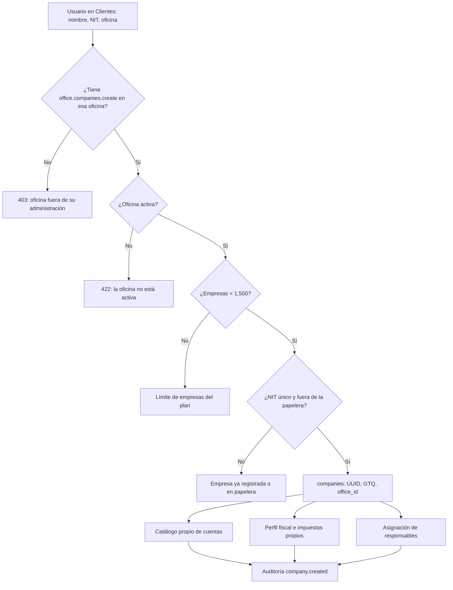
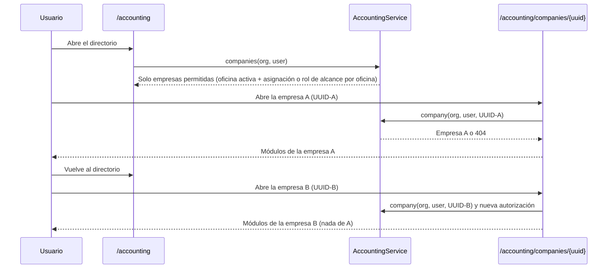
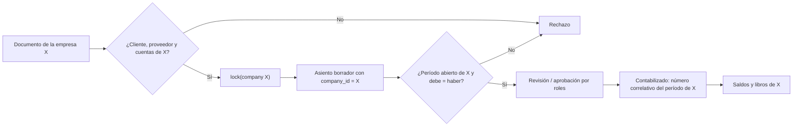
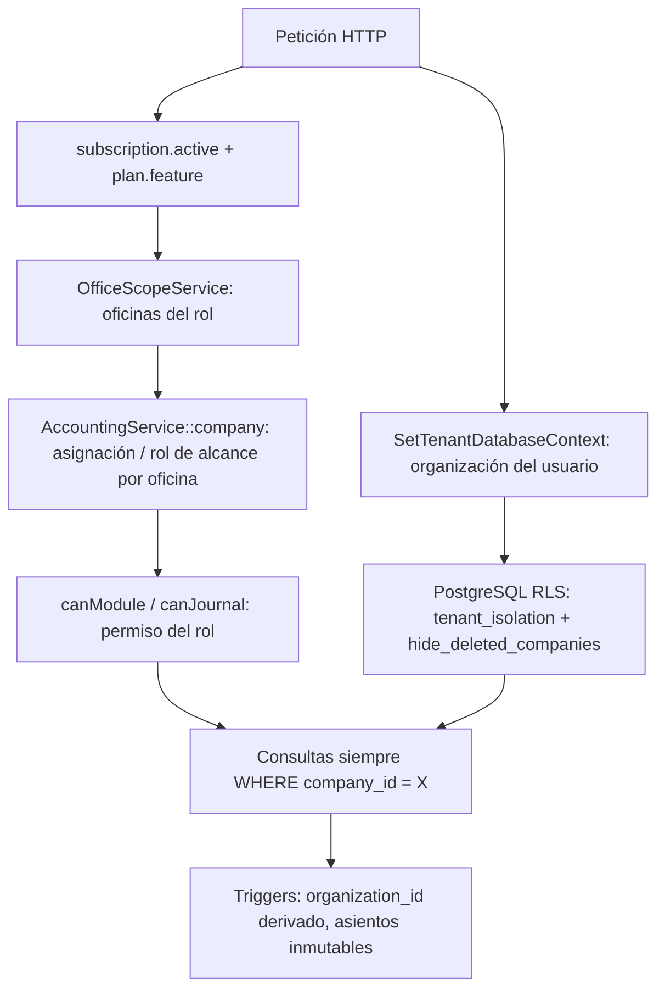
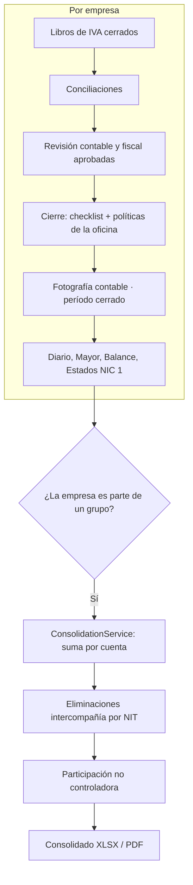

# Funcionamiento multiempresa — Plan Multi-oficina de Atlantia Finance

> Documento técnico y funcional, elaborado leyendo el código fuente (rama `main`, noviembre de 2026). Cada afirmación indica el archivo donde vive la lógica. Las funciones se clasifican así:
>
> - **Implementado**: existe en el código y el servidor lo aplica.
> - **Parcial**: existe con limitaciones o depende de configuración.
> - **Pendiente**: no existe en el código.

---

## 0. Aclaración previa: no existe un plan llamado «Multiempresa»

El catálogo de planes (`config/atlantia-plans.php` y `database/seeders/PlanCatalogSeeder.php`) define cinco planes:

| Código | Nombre comercial | Empresas cliente (`active_cases`) |
|---|---|---|
| `essential` | Esencial | 150 |
| `professional` | Profesional | 500 |
| `multi_office` | **Multi-oficina** | **1,500** |
| `corporate` | Corporativo | 5,000 |
| `enterprise` | Empresarial | Sin límite |

En el código **no hay** un plan `multiempresa`, ni la palabra «multiempresa» como plan. La única mención es descriptiva: el texto de Luzma presenta a Atlantia como *«un sistema contable multiempresa de Guatemala»* (`LuzmaPromptService`).

Dos hechos importantes:

1. **La administración de varias empresas es común a todos los planes.** Toda organización es una oficina contable que lleva la contabilidad de varias empresas cliente (`companies`). Cada empresa tiene su propio catálogo, períodos, libros, IVA y estados financieros. Lo que cambia entre planes es el **límite** de empresas y las **funciones** disponibles.
2. **El plan diseñado para administrar varias sedes y grupos de empresas es Multi-oficina (`multi_office`).** Es el primero que incluye las funciones `multi_office`, `consolidated_dashboard` (estados consolidados), `office_permissions` y `centralized_audit`.

Por eso este documento describe el **Plan Multi-oficina** como el plan multiempresa del sistema. También describe el mecanismo multiempresa que comparten todos los planes. Si «Plan Multiempresa» se refiere a otro producto comercial, ese producto no está implementado en el código.

---

## 1. Descripción del plan

### 1.1 Qué es

El Plan Multi-oficina tiene el lema *«Para propietarios de varias sedes»*. El catálogo lo describe como *«Para propietarios que administran múltiples oficinas»* y destaca tres cosas:

- contabilidad, inventario y planilla en varias oficinas;
- panel consolidado y permisos por sede;
- auditoría central y capacitación inicial.

### 1.2 A quién está dirigido

- Firmas contables con **varias sedes**, cada una con su administrador y su equipo. Por ejemplo, Puerto Barrios, Morales y Livingston.
- Propietarios que administran **grupos de empresas** y necesitan estados financieros **consolidados**.

### 1.3 Precio, límites y cantidad de empresas

| Concepto | Valor | Dónde se aplica |
|---|---|---|
| Precio | Q1,499 al mes · Q14,990 al año | `plan_prices` |
| Oficinas (`offices`) | **5** | `WorkManagementController::storeOffice()`: `abort_if($current >= $limit, 403, 'Tu plan activo alcanzó el límite de oficinas.')` |
| Usuarios (`users`) | **25** | `OfficeInvitationService`: cada invitación reserva un asiento |
| Empresas cliente (`active_cases`) | **1,500** | `CompanyAdministrationService::create()` |
| Almacenamiento | 40 GB | `UsageMeterService::assertCanAdd()` |
| Consultas a Luzma IA | 500 al mes | `LuzmaService` |

Todos los límites son estrictos (`enforcement = 'hard'`) y se resuelven con la versión del plan vendida a la suscripción (`EntitlementResolverService`). La prueba `tests/Feature/MultiOfficePlanTest.php` verifica que se crean 5 oficinas, que la sexta responde **403** y que las cuotas son `officeQuota.limit = 5`, `userQuota.limit = 25` y `companyQuota.limit = 1500`.

**Cómo se cuentan las empresas:** se cuentan **todas** las filas de `companies` de la organización, sin importar la oficina:

```php
DB::table('companies')->where('companies.organization_id', $organization->id)->count()
```

Las empresas en la papelera siguen existiendo como filas, por lo que en la práctica también cuentan (Parcial: no hay una regla explícita que las excluya del conteo).

### 1.4 Funcionalidades incluidas

**Funciones del catálogo** (`PlanCatalogSeeder`, más la migración `2026_10_28_204503_include_vat_books_and_payroll_in_plans.php`, que agrega `payroll`):

`basic_accounting`, `basic_invoicing`, `case_management`, `task_management`, `obligation_management`, `inventory`, **`payroll`**, `advanced_reports`, `roles_and_permissions`, `approval_workflows`, `fel`, `ocr`, **`multi_office`**, **`consolidated_dashboard`**, **`office_permissions`**, **`centralized_audit`**, `audit_log`, `automatic_backups`, `priority_support`, `initial_training`.

**No incluye:** `api_access`, `webhooks`, `dedicated_infrastructure`, `custom_integrations`, `custom_migrations`, `custom_ai_limits` ni `service_level_agreement`.

### 1.5 Restricciones que aplica el servidor

| Restricción | Mecanismo |
|---|---|
| Máximo 5 oficinas, 25 usuarios y 1,500 empresas | Sección 1.3 |
| API pública y webhooks | `AuthenticateApiToken` y `WebhookEndpointService` → 403 |
| Un módulo retirado de la versión del plan se cierra | `plan.feature:*` y `requireFeature` (la prueba lo verifica con `payroll`) |
| Roles ligados a un módulo ausente | `WorkAuthorizationService::roleAllowedByPlan()` |
| Estados consolidados | Requiere `consolidated_dashboard` (incluido en este plan) |

### 1.6 Roles y permisos

Con `roles_and_permissions`, todos los roles predeterminados de `WorkAuthorizationService::ROLE_PRESETS` están disponibles. Cada asignación de rol (`user_role_assignments`) puede llevar una **oficina** (`office_id`), lo que limita su alcance a esa sede.

| Rol | Alcance típico | Panel de inicio |
|---|---|---|
| `owner_director` (Director / Socio) | Toda la firma (`*`) | `/office/executive-dashboard` (panel ejecutivo consolidado) |
| `office_admin` (Administrador de Oficina) | Toda la firma o **una sola sede** | `/office/dashboard` |
| `accounting_manager` (Gerente Contable) | Todas las empresas de su oficina | `/operations/dashboard` |
| `general_accountant` (Contador General) | Todas las empresas de su oficina | `/work/accounting-review` |
| `accounting_supervisor` (Supervisor Contable) | Empresas asignadas | `/supervisor/dashboard` |
| `accountant_in_charge` (Contador Encargado) | Empresas asignadas | `/accountant/dashboard` |
| `accounting_assistant` (Auxiliar Contable) | Empresas asignadas | `/assistant/dashboard` |
| `tax_specialist`, `treasury`, `accounts_receivable`, `accounts_payable`, `payroll` | Empresas asignadas | Su panel |
| `auditor` y `read_only` | Solo lectura | `/audit/dashboard` |
| `client_user` (usuario del cliente) | Las empresas a las que se le da acceso | `/client` |

Reglas relevantes:

- **Supervisión del Director.** Cuando existe un Administrador de Oficina con alcance de toda la firma, el Director / Socio queda en **solo lectura** (`isExecutiveReadOnly`): conserva ver y exportar, pero no ejecuta acciones.
- **Roles de alcance por oficina.** `general_accountant` y `accounting_manager` (`AccountingService::OFFICE_WIDE_ROLE_CODES`) ven todas las empresas de su oficina sin asignación individual. Los demás roles necesitan asignación empresa por empresa.
- **Separación de funciones.** Un ajuste no lo aprueba quien lo creó. Con 25 usuarios, la política de revisión es `REQUIRED_SEPARATE_REVIEWER`: nadie se autoaprueba (`ReviewPolicyService`).

---

## 2. Incorporación de empresas

### 2.1 Activación del plan

Hay dos vías:

- **Autoservicio:** `/register?plan=multi_office`. `CreateNewUser` crea la organización, la oficina principal (`MAIN`), al propietario (`owner`) y la suscripción `incomplete`. Se activa al confirmarse el pago en Recurrente. El proceso es igual para todos los planes; solo el Empresarial se cotiza.
- **Control Center:** `OrganizationManagementService::onboard()` crea la organización con el precio `multi_office`, la oficina («Oficina Central») y la suscripción, con prueba opcional. Envía al titular una **invitación firmada** (`WorkspaceInvitation`) para que defina su contraseña. Es el flujo que valida `MultiOfficePlanTest`.

### 2.2 Registro del titular

El titular queda en `organization_user` con `role = 'owner'` y en `office_user` de la oficina principal. Su rol de trabajo es `owner_director` y su inicio es el **panel ejecutivo** (`/office/executive-dashboard`). La guía de inicio (`/office/setup`, `SetupChecklistService`) tiene 7 pasos con avance real:

1. Oficinas.
2. Clientes.
3. Contadores.
4. Administradores.
5. Facturación electrónica (FEL).
6. y 7. Los demás pasos de configuración.

### 2.3 Creación de oficinas (sedes)

`POST /office/offices` → `WorkManagementController::storeOffice()`:

- Solo la **administración general** puede crear oficinas: el permiso `office.manage` con alcance de toda la firma. Un administrador de sede recibe 403.
- Verifica el límite de 5 oficinas.
- La oficina tiene código único por organización, nombre, dirección, ciudad, plazos fiscales internos y políticas de cierre propias (`fiscal_close_policy`, `treasury_close_policy`, etc.).

### 2.4 Creación de la primera empresa y de las siguientes

Todas las empresas se crean con el mismo servicio, `CompanyAdministrationService::create()`, desde la pantalla Clientes (`POST /office/companies`) o desde Contabilidad (`POST /accounting/companies`).

**Datos que se piden:** nombre, NIT (`^[A-Za-z0-9-]+$`), correo opcional, **oficina** obligatoria y, opcionalmente, contador encargado y auxiliar.

**Proceso**, en una transacción con bloqueo de la organización:

1. Verifica el permiso `office.companies.create` **en esa oficina** (`OfficeScopeService::authorize`). Un administrador de sede solo crea empresas en su sede.
2. Verifica que la oficina exista y esté activa.
3. Verifica el **límite de empresas** (1,500).
4. Verifica que el NIT no esté repetido en la organización ni en la papelera.
5. Crea la empresa con UUID público (`public_id`) y moneda GTQ.
6. Instala el **catálogo de cuentas propio** de la empresa.
7. Crea el **perfil fiscal** y los **impuestos de Guatemala** de la empresa.
8. Audita la creación y asigna a los responsables indicados.

No hay diferencia entre la primera empresa y las siguientes: cada una nace igual de completa e independiente.

### 2.5 Datos fiscales de cada empresa

Cada empresa tiene su propio `company_fiscal_profiles`: régimen de IVA, régimen de ISR, plantilla contable, fuente de tasa de cambio e inicio del año fiscal. También tiene sus propios `fiscal_taxes` y `fiscal_tax_rules` con vigencias. Se editan en `/accounting/companies/{uuid}/fiscal-settings`. Cambiar el régimen de una empresa no afecta a las demás.

### 2.6 Asignación de usuarios y permisos

1. **Invitar** (`POST /office/invitations`) con nombre, correo, **oficina** y rol. El rol debe estar permitido por el plan, y la invitación reserva uno de los 25 asientos.
2. **Asignar empresas** (`CompanyAssignmentService::assign`) con uno de estos roles: contador encargado, auxiliar, supervisor, encargado fiscal, tesorería, cuentas por cobrar, cuentas por pagar, nómina, auditor o consulta. La asignación se guarda en `company_assignments` y sincroniza `company_user`. El servicio rechaza roles incompatibles: *«El rol del colaborador no le permite ser…»*.
3. **Asignar un administrador de sede:** `assignRole(..., 'office_admin', $officeId)`. Desde ese momento solo ve y administra su oficina. La prueba confirma que ve solo «Cliente Puerto» y recibe 403 al pedir otra oficina.
4. **Mover una empresa de sede** (`POST /office/companies/{id}/move`): conserva a los responsables que también trabajan en la oficina destino y termina las demás asignaciones, sin borrar el historial.

### 2.7 Cambio entre empresas

No existe un estado de «empresa activa» guardado en la sesión. **La empresa en contexto siempre viaja en la URL** como su UUID público:

```
/accounting/companies/{public_id}/...
```

- El directorio de empresas está en `/accounting` (`AccountingController::index`): lista paginada con búsqueda por nombre o NIT, limitada a lo que el usuario puede ver, más la cuota de empresas y el acceso a la consolidación.
- `HandleInertiaRequests` comparte con cada página la lista `companies` del usuario y una `currentCompany` por defecto (la primera en orden alfabético).
- Al abrir una empresa, el menú lateral muestra los módulos de **esa** empresa (`app-sidebar.tsx`, con `pageCompany`).
- Para cambiar de empresa se vuelve al directorio y se abre otra. Cada pantalla resuelve la empresa desde la URL y valida el acceso en cada petición.
- El selector `organization-switcher.tsx` cambia de **organización** (firma), no de empresa.

### 2.8 Qué ocurre al alcanzar el límite

| Límite | Resultado |
|---|---|
| Empresas (1,500) | `ValidationException`: *«Alcanzaste el límite de empresas cliente del plan. Usa «Cambiar plan» en Plan y suscripción para ampliarlo.»* |
| Oficinas (5) | HTTP 403: *«Tu plan activo alcanzó el límite de oficinas.»* El botón se oculta (`canCreateOffice = false`) |
| Usuarios (25) | La invitación se rechaza |
| Almacenamiento | La carga del archivo se rechaza |

Además, `plans:limit-alerts` (diario, 01:45) avisa al llegar al 80 % y al 95 % de cada límite.

---

## 3. Administración contable multiempresa

### 3.1 Contabilidad de cada empresa

Cada empresa es un libro contable independiente. Todas las tablas contables cuelgan de `company_id`, directamente o a través de su período:

- `ledger_accounts`
- `accounting_periods` → `journal_entries` → `journal_lines`
- `sales_*`, `purchase_*`, `bank_*`
- `vat_book_periods`, `fiscal_*`

### 3.2 Cómo se evita mezclar operaciones

| Control | Implementación |
|---|---|
| **La empresa sale de la URL y se valida en cada petición** | `AccountingService::company($org, $user, $uuid)` busca la empresa **dentro de las empresas que el usuario puede ver**; si no, 404 |
| **Cuentas de la misma empresa** | `AccountingService::lines()` rechaza cualquier cuenta que no sea de esa empresa: *«Cada línea necesita una cuenta activa de esta empresa…»* |
| **Período de la misma empresa** | `openPeriod($companyId, $periodId, $date)` filtra por `company_id` |
| **Clientes, proveedores y cuentas de los documentos** | Las ventas, compras y órdenes validan que el cliente, el proveedor y la cuenta pertenezcan a la empresa (`CommercialDocumentService`, `PurchaseDocumentDraftService`) |
| **Asientos automáticos** | Se generan con el `company_id` del documento de origen (`AccountingAutomationService::draft`) |
| **Bloqueo por empresa** | `AccountingService::lock($companyId)` serializa la numeración, la contabilización y el cierre de **cada** empresa |
| **Base de datos** | RLS por organización, *trigger* que deriva `organization_id` de la fila padre y claves foráneas (sección 6) |

### 3.3 Catálogo contable por empresa

Al crear la empresa se instala su propio catálogo: 27 cuentas base y el catálogo detallado de unas 200 cuentas (`installDefaultChart`). Los códigos son únicos **por empresa**, así que dos empresas pueden tener la cuenta 1102 sin conflicto. Cada empresa tiene su propio mapeo contable (`company_accounting_mappings`) y sus reglas por evento (`accounting_posting_rules`).

### 3.4 Períodos contables

Los períodos son propios de cada empresa. La validación de superposición se hace solo entre los períodos de esa empresa. Cerrar el período de octubre de una empresa no afecta a las demás.

### 3.5 Ingresos, egresos y partidas

El proceso es igual en todos los planes:

1. Los documentos se registran como borradores.
2. Al emitir o aprobar un documento se genera un asiento automático en borrador. Es idempotente por `posting_key`.
3. Los asientos manuales pasan por el flujo: `draft` → `pending_review` → `reviewed` → `approved` → `posted`, con `reject`, `void` y `reverse`.

En Multi-oficina, con varios roles, el flujo se reparte entre personas:

- el **Auxiliar** registra y envía;
- el **Contador Encargado** revisa y aprueba en primer nivel;
- el **Contador General** contabiliza (`journal.post`) y administra los períodos (`periods.manage`).

### 3.6 Saldos

Los saldos no se guardan: se calculan desde los movimientos contabilizados **de la empresa** (`LedgerService::accountBalances($companyId, …)`). Cada cierre guarda una fotografía (`accounting_period_close_snapshots`) por empresa y período.

### 3.7 Libros contables

Cada empresa tiene su Libro Diario, Libro Mayor, balance de comprobación y libros legales foliados. La numeración de folios es **por empresa y por libro** (`LedgerService`, `TrialBalanceService`, `LegalBooksService`). Las exportaciones (`/accounting/companies/{uuid}/export`) siempre van filtradas por la empresa.

### 3.8 Estados financieros individuales

`FinancialStatementService` genera, **para una empresa**, el estado de situación financiera, el de resultados, el de flujos de efectivo y el de cambios en el patrimonio (NIC 1), con notas, firmantes y certificación.

### 3.9 Cierre contable de cada empresa

- **Cierre mensual directo** (`AccountingController::close` → `CloseAccountingPeriod`): solo el propietario, con checklist bloqueante y fotografía contable.
- **Cierre supervisado:**
  - `SupervisorService` cierra con el permiso `supervision.periods.close` cuando están aprobadas la revisión contable y la revisión fiscal y no hay incidencias abiertas;
  - `AccountantService` cierra con `periods.manage` cuando ambas revisiones están aprobadas.

  Ambos llaman a `CloseAccountingPeriod::execute(..., supervised: true)`.
- **Políticas por oficina:** cada sede define si sus controles fiscales, de tesorería, de cuentas por cobrar y por pagar y de nómina **bloquean** el cierre o solo **advierten** (`*_close_policy`).
- **Reapertura** en tres pasos: solicitud, aprobación y ejecución. **Cierre anual** con asientos de tipo `closing`.

### 3.10 Reportes consolidados (Implementado)

La consolidación **sí existe** y está restringida a `consolidated_dashboard`, que este plan incluye:

- **Rutas:** `/accounting/consolidation` (ver), `POST` o `PUT /accounting/consolidation/{group}` (guardar el grupo) y `/accounting/consolidation/{group}/export` (XLSX o PDF).
- **Modelo:** `company_groups` (nombre, empresa controladora y cuenta de inversión opcional) y `company_group_members` (subsidiaria y participación en puntos base).
- **Cálculo** (`ConsolidationService`, NIIF 10):
  1. Suma, cuenta por cuenta (por código), los saldos de la controladora y de las subsidiarias.
  2. **Elimina** las operaciones intercompañía, que identifica **por NIT**:
     - lo que una empresa le cobra a otra del grupo (`sales_invoices.customer_tax_id`) contra lo que esa otra le debe (`purchase_documents.supplier_tax_id`);
     - las ventas del período entre ellas contra las compras o gastos registrados;
     - opcionalmente, la inversión de la controladora contra el capital de cada subsidiaria.
  3. Presenta la **participación no controladora** de las subsidiarias que no son 100 % propiedad de la controladora.
- **Seguridad:**
  - solo el **propietario** crea o edita grupos (`canManage`);
  - para ver un grupo, el usuario debe tener acceso a **todas** sus empresas (`abort_unless(array_diff($members, $companies) === [], 403)`);
  - la controladora no puede repetirse como subsidiaria y el grupo necesita al menos una subsidiaria.
- **Limitaciones (Parcial):**
  - las eliminaciones dependen de que los NIT registrados de clientes y proveedores coincidan con los de las empresas del grupo;
  - las operaciones intercompañía registradas solo con asientos manuales, sin documento de venta o compra, no se eliminan automáticamente.

**Panel ejecutivo consolidado:** `ExecutiveDashboardService::organization($companyIds)` agrega indicadores de todas las empresas visibles para el Director. Es un tablero de gestión, no un estado financiero consolidado.

---

## 4. Flujo completo de trabajo

| # | Paso del usuario | Qué ocurre internamente |
|---|---|---|
| 1 | **Ingresa** | Fortify autentica. Se aplican la doble autenticación (si la oficina la exige), la aceptación legal y la suscripción activa. `SetTenantDatabaseContext` fija la organización en la sesión de PostgreSQL. `dashboardPathFor()` lo envía al panel de su rol |
| 2 | **Selecciona una empresa** | En `/accounting`, `AccountingService::companies()` lista solo las empresas que puede ver: el propietario ve todas las de oficinas activas; los demás, las asignadas o las de su oficina si su rol es de alcance por oficina. Al abrir una, su UUID entra en la URL |
| 3 | **Consulta su información** | `AccountingController::show` valida `journal.view` en esa empresa. Muestra su catálogo, períodos con estadísticas, diario y mayor. El panel `/dashboard` exige `basic_accounting` |
| 4 | **Registra documentos** | Ventas (`sales.manage`), compras (`purchases.manage`) y bancos (`banks.manage`). Cada controlador vuelve a resolver la empresa con permiso de escritura y valida que clientes, proveedores y cuentas sean de esa empresa |
| 5 | **Genera partidas** | Emitir o aprobar un documento crea un borrador automático con `company_id`. Los asientos manuales pasan por `lines()` y `createDraft()` |
| 6 | **Verifica cargos y abonos** | En cada línea, debe o haber mayor que cero (nunca ambos). La suma del debe es igual a la del haber, con al menos 2 líneas, y se revalida al contabilizar |
| 7 | **Consulta movimientos** | `LedgerService::movements()` muestra el mayor por cuenta con filtros de tercero, centro de costo, proyecto y origen, siempre `where company_id` |
| 8 | **Genera libros y reportes** | `FinancialReportService::book()`, `TrialBalanceService` y `FinancialStatementService`. La exportación queda auditada con la empresa |
| 9 | **Cierra** | Libro de IVA → conciliaciones → revisión contable y fiscal → cierre (directo o supervisado) con checklist y fotografía contable |
| 10 | **Cambia a otra empresa** | Vuelve a `/accounting` y abre otra UUID. Ningún dato de la empresa anterior se arrastra, porque cada petición resuelve y autoriza de nuevo |

---

## 5. Módulos disponibles

| Módulo | Qué hace | Contexto de empresa | Restricciones |
|---|---|---|---|
| Contabilidad general | Catálogo, períodos, diario, mayor y balance de comprobación | `/accounting/companies/{uuid}` | `journal.*`, `periods.manage`, `accounts.manage` |
| Ventas, cuentas por cobrar y FEL | Facturas, cobros, notas, retenciones y certificación FEL | Por empresa; FEL con certificador propio de cada empresa | `basic_invoicing`, `fel`, `sales.*`, `fel.*` |
| Compras y cuentas por pagar | Documentos, pagos, notas y adjuntos; lectura de facturas con **OCR** | Por empresa | `ocr` incluido; `purchases.*` |
| Bancos y tesorería | Cuentas, estado de cuenta, conciliación, reglas, cheques y transferencias | Por empresa | `banks.*`, `treasury.*` |
| Fiscal | Parámetros, Libros de IVA, cruce con la SAT, obligaciones y archivos SAT (todos, por `advanced_reports`) | Por empresa | `fiscal.*`, `vat_books.*` |
| Inventario y producción | Artículos, kardex, conteos, recetas y órdenes de producción | Por empresa | `plan.feature:inventory` (incluido) |
| Nómina | Planilla, IGSS, libro de salarios | Por empresa | `plan.feature:payroll` (incluido) |
| Estados financieros, cierre anual, NIIF y presupuestos | Reportes avanzados por empresa | Por empresa | `basic_accounting` / `advanced_reports` |
| **Consolidación** | Estados consolidados NIIF 10 de un grupo | **Varias empresas** del grupo | `consolidated_dashboard`; acceso a todas las empresas del grupo |
| **Administración multi-oficina** | Oficinas, usuarios, roles por sede, asignaciones, carga de trabajo y seguridad | Por oficina (`office_id`) | `multi_office`, `office_permissions`, `office.*` |
| Panel ejecutivo | Indicadores agregados de la firma | Todas las empresas visibles | `office.executive.view` |
| Supervisión, operaciones y revisiones | Revisiones de dos niveles, incidencias y cierres supervisados | Empresas asignadas | `approval_workflows`, `supervision.*`, `reviews.*` |
| Auditoría | Bitácora y encargos de auditoría | Organización y oficinas | `audit_log`, `centralized_audit` |
| Portal del cliente | Documentos, solicitudes, reportes publicados y mensajes | Las empresas a las que el usuario cliente tiene acceso (`client_company_access`) | `client.*` |
| Capacitación | Rutas y certificaciones del equipo | Organización | `initial_training` |

---

## 6. Seguridad y aislamiento de datos

### 6.1 Capas

1. **Organización (PostgreSQL RLS).** Unas 159 tablas tienen la política `tenant_isolation`: solo se ven filas con `organization_id = atlantia_current_organization_id()`, salvo el modo sistema. Sin organización en contexto, la consulta no devuelve nada (*fail closed*). El rol de la aplicación no es `SUPERUSER` ni `BYPASSRLS` (`database/postgres/provision.sql`).
2. **Organización derivada de la fila padre.** El *trigger* `atlantia_enforce_organization` llena `organization_id` desde la empresa o el registro padre, por lo que una fila no puede quedar en otra organización ni apuntar a registros de otra (`DatabaseTenantIsolationTest`).
3. **Empresas en la papelera.** La política restrictiva `hide_deleted_companies` oculta en todas las tablas con `company_id` los datos de empresas eliminadas.
4. **Oficina.** `OfficeScopeService` limita la administración a las sedes del rol (`user_role_assignments.office_id`). El servidor responde *«Esta oficina no está bajo tu administración»* (403).
5. **Empresa.** `AccountingService::companies()` exige que la oficina esté activa y que el usuario tenga asignación (`company_user`) o un rol de alcance por oficina en esa sede, y además pertenencia a la oficina (`office_user` activo). Cualquier UUID ajeno devuelve 404.
6. **Permiso.** `canModule()` y `canJournal()` consultan los permisos del rol persistido; los roles `auditor` y `read_only` nunca escriben.
7. **Plan.** `requireFeature`, `plan.feature:*` y los límites.

### 6.2 Protecciones adicionales

- Los identificadores públicos son UUID aleatorios, nunca números consecutivos.
- Todo cambio queda en `audit_logs`, que es de solo inserción (*append-only*).
- La exportación de reportes queda auditada.
- Los asientos contabilizados son inmutables por *trigger*.
- Hay límites de peticiones (`throttle`) en todas las escrituras.

### 6.3 Qué no separa la base de datos (Parcial)

RLS aísla **organizaciones**, no **empresas** dentro de la misma organización. La separación entre las empresas de una firma depende de la capa de aplicación: el filtro por `company_id`, `AccountingService::company()` y las validaciones de cuentas y períodos. Esto es coherente con el modelo, porque la firma es el titular de los datos de sus clientes. Pero un error de programación que omitiera el filtro por empresa no sería detenido por la base de datos.

---

## 7. Funcionamiento técnico

### 7.1 Rutas principales

| Ruta | Controlador | Propósito |
|---|---|---|
| `GET /accounting` | `AccountingController@index` | Directorio de empresas y cuota |
| `POST /accounting/companies`, `POST /office/companies` | `AccountingController@storeCompany`, `OfficeAdminController@storeCompany` | Alta de empresa |
| `POST /office/companies/{id}/move` | `OfficeAdminController@moveCompany` | Traslado entre sedes |
| `GET/POST /office/offices` | `WorkManagementController@offices` / `@storeOffice` | Oficinas |
| `POST /office/invitations`, `POST /office/assignments` | `OfficeAdminController` | Equipo y asignaciones |
| `GET /office/executive-dashboard` | Panel ejecutivo | Indicadores de la firma |
| `GET /office/setup` | `SetupChecklistService` | Guía de inicio |
| `/accounting/companies/{uuid}/…` | Controladores contables | Todo lo de la empresa |
| `/accounting/consolidation…` | `ConsolidationController` | Grupos y consolidado |
| `/supervisor/…`, `/accountant/…` | `SupervisorController`, `AccountantController` | Revisión y cierre supervisado |

### 7.2 Tablas y relaciones

```
organizations 1─N offices 1─N companies
organizations 1─N organization_user (owner|member) · offices 1─N office_user
users 1─N user_role_assignments (workspace_role_id, office_id NULL = toda la firma)
companies 1─N company_assignments (user_id, assignment_role) · company_user (permission)
companies 1─1 company_fiscal_profiles · 1─N fiscal_taxes · ledger_accounts · accounting_periods
accounting_periods 1─N journal_entries 1─N journal_lines N─1 ledger_accounts (misma empresa)
organizations 1─N company_groups (parent_company_id) 1─N company_group_members (company_id, ownership_bp)
```

### 7.3 Servicios clave

| Servicio | Responsabilidad |
|---|---|
| `EntitlementResolverService` / `WorkspaceContext` | Funciones y límites efectivos |
| `CompanyAdministrationService` | Alta, límite y traslado de empresas |
| `OfficeScopeService` / `OfficeAdminService` | Alcance por sede y permisos del panel |
| `WorkAuthorizationService` | Roles, permisos y panel de inicio |
| `CompanyAssignmentService` | Responsables por empresa |
| `AccountingService` | Resolución y autorización de la empresa, partida doble y bloqueos |
| `ConsolidationService` | Consolidación NIIF 10 |
| `CloseAccountingPeriod`, `SupervisorService`, `AccountantService` | Cierre directo y supervisado |
| `TenantDatabaseContext` + `SetTenantDatabaseContext` | Contexto de RLS por petición |

### 7.4 Middleware

`subscription.active`, `plan.feature:*`, `EnforceOfficeTwoFactor`, `EnsureLegalAcceptance`, `RestrictClientPortalUsers`, `RestrictSupervisingDirector` (Director en solo lectura), `SetTenantDatabaseContext` y `throttle`.

---

## 8. Diagramas Mermaid

### 8.1 Creación de empresas



### 8.2 Selección y cambio de empresa



### 8.3 Procesamiento contable



### 8.4 Aislamiento de información



### 8.5 Reportes y cierre



---

## 9. Caso práctico con tres empresas

> Cifras ilustrativas, en quetzales con IVA del 12 % incluido. Los nombres y NIT son ficticios.

**Firma:** *Consultores del Atlántico*, Plan Multi-oficina, con 2 sedes (Puerto Barrios y Morales).

**Usuario:** Ana Lucía Hernández. Es **Contadora General** de la sede Puerto Barrios, por lo que ve todas las empresas de esa sede sin asignación individual y puede contabilizar y administrar períodos.

| Empresa | NIT | Sede | Relación |
|---|---|---|---|
| A. Inversiones del Atlántico, S.A. | 1000001-1 | Puerto Barrios | Controladora |
| B. Distribuidora Atlántico, S.A. | 2000002-2 | Puerto Barrios | Subsidiaria al 100 % |
| C. Servicios Logísticos del Puerto | 3000003-3 | Puerto Barrios | Subsidiaria al 80 % |

### Paso 1. Alta

El propietario crea las tres empresas en la sede Puerto Barrios. Cada una recibe su catálogo, su perfil fiscal y sus impuestos. La cuenta 1102 Bancos existe tres veces, **una por empresa**, con identificadores distintos.

### Paso 2. Octubre en la empresa A (`/accounting/companies/{uuid-A}`)

1. Abre el período «Octubre 2026» de A y registra el capital: cargo 1102 Q100,000 · abono 3101 Q100,000.
2. Crea al cliente «Distribuidora Atlántico, S.A.» con NIT 2000002-2.
3. Emite la factura por el alquiler de bodega: **Q11,200**. El asiento queda así: cargo 1103 Q11,200 · abono 4101 Q10,000 · abono 2201 Q1,200. Si Ana intentara usar una cuenta de la empresa B, `lines()` rechazaría la línea.
4. Contabiliza, cierra el Libro de IVA (IVA débito Q1,200) y cierra el período con su checklist.

### Paso 3. Cambio a la empresa B (`{uuid-B}`)

1. Vuelve al directorio y abre B. La URL y el contexto ahora son de B; los períodos de A no aparecen.
2. Registra el capital: Q50,000.
3. Registra la compra a «Inversiones del Atlántico, S.A.» (NIT 1000001-1): cargo 5203 Q10,000 · cargo 1301 Q1,200 · abono 2102 Q11,200.
4. Registra las ventas a terceros por Q56,000 (base Q50,000 · IVA Q6,000) y su cobro.
5. Contabiliza, cierra el Libro de IVA (débito Q6,000 − crédito Q1,200 = **Q4,800 por pagar**) y cierra el período.

### Paso 4. Cambio a la empresa C (`{uuid-C}`)

1. Registra el capital: Q20,000.
2. Registra los servicios a terceros por Q22,400 (base Q20,000 · IVA Q2,400) y su cobro.
3. Cierra el IVA (Q2,400 por pagar) y el período.

### Paso 5. Estados individuales

Cada empresa produce sus propios estados, sin cifras de las otras:

| | A | B | C |
|---|---:|---:|---:|
| Ingresos | 10,000 | 50,000 | 20,000 |
| Gastos | 0 | 10,000 | 0 |
| Resultado | 10,000 | 40,000 | 20,000 |
| Cuentas por cobrar | 11,200 | 0 | 0 |
| Cuentas por pagar | 0 | 11,200 | 0 |

### Paso 6. Consolidado del grupo (`/accounting/consolidation`)

1. El **propietario** crea el grupo «Grupo Atlántico» con A como controladora, B al 100 % y C al 80 %. Ana puede verlo porque tiene acceso a las tres empresas; un usuario sin acceso a C recibiría 403.
2. `ConsolidationService` suma las cuentas de A, B y C por código y **elimina**:
   - la cuenta por cobrar de A a B contra la cuenta por pagar de B a A (Q11,200), porque el NIT del cliente en A coincide con el de B y el del proveedor en B coincide con el de A;
   - la venta de A a B contra el gasto registrado en B por esa compra.
3. **Resultado consolidado ilustrativo:** ingresos de 80,000 − 10,000 (eliminación) = **70,000**; gastos de 10,000 − 10,000 = **0**; utilidad de **70,000**.
4. **Participación no controladora:** el 20 % del patrimonio de C (20,000 de capital + 20,000 de resultado = 40,000 × 20 % = **Q8,000**).
5. Se exporta en XLSX o PDF con las columnas por empresa, las eliminaciones y el consolidado.

### Paso 7. Lo que nunca se mezcla

- Los asientos, períodos, Libros de IVA, conciliaciones, obligaciones y folios de los libros legales siguen siendo **de cada empresa**.
- La consolidación **no crea asientos**: es un cálculo de lectura sobre los saldos contabilizados de las tres empresas.

---

## 10. Resumen de estado

### Implementado

- Varias empresas por organización con contabilidad independiente: catálogo, períodos, libros, IVA, estados y cierre.
- Límites reales del plan Multi-oficina: 5 oficinas, 25 usuarios, 1,500 empresas, 40 GB y 500 consultas de IA.
- Oficinas con administrador propio y alcance por sede.
- Roles y permisos completos, con asignación por empresa y traslado de empresas entre sedes.
- Aislamiento por RLS entre organizaciones y validación de empresa, cuentas y períodos en cada operación.
- Cierre directo y supervisado, con políticas de cierre por oficina.
- **Estados financieros consolidados NIIF 10**, con eliminaciones intercompañía por NIT y participación no controladora.
- Panel ejecutivo con indicadores agregados.
- Guía de inicio con avance real.

### Parcial

- **Cambio de empresa:** no hay un selector rápido; se hace desde el directorio `/accounting` y la empresa viaja en la URL. `currentCompany` es solo la primera empresa alfabética.
- **Eliminaciones intercompañía:** dependen de que los NIT registrados coincidan; las operaciones hechas solo con asientos manuales no se eliminan.
- **Aislamiento entre empresas de la misma firma:** depende de la aplicación, no de RLS.
- **Conteo del límite de empresas:** incluye también las empresas en la papelera.

### Pendiente

- Un plan con el nombre o el código «Multiempresa»: no existe en el catálogo.
- Asientos de consolidación persistidos o un libro consolidado: la consolidación es solo un reporte calculado.
- Consolidación en una moneda distinta de GTQ o con conversión de subsidiarias extranjeras: el cálculo no la contempla.

---

*Fuentes principales: `config/atlantia-plans.php`, `database/seeders/PlanCatalogSeeder.php`, `database/migrations/2026_10_28_204503_include_vat_books_and_payroll_in_plans.php`, `tests/Feature/MultiOfficePlanTest.php`, `tests/Feature/DatabaseTenantIsolationTest.php`, `app/Services/Platform/EntitlementResolverService.php`, `app/Services/WorkManagement/{CompanyAdministrationService,OfficeScopeService,OfficeAdminService,WorkAuthorizationService,CompanyAssignmentService}.php`, `app/Http/Controllers/{AccountingController,WorkManagementController,ConsolidationController}.php`, `app/Services/AccountingService.php`, `app/Services/Accounting/ConsolidationService.php`, `app/Actions/Accounting/CloseAccountingPeriod.php`, `app/Services/Operations/{SupervisorService,AccountantService}.php`, `app/Http/Middleware/HandleInertiaRequests.php`, `resources/js/components/app-sidebar.tsx`.*
