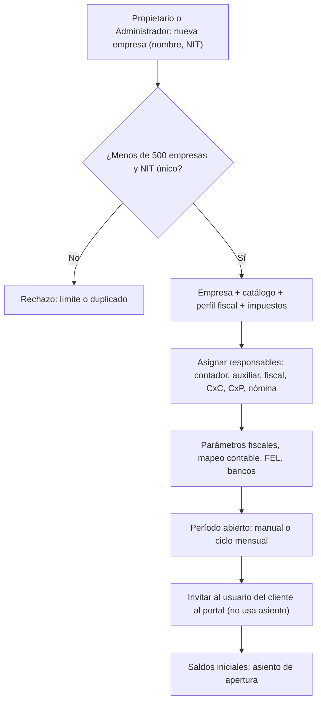
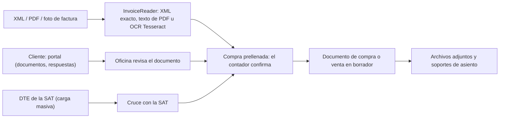
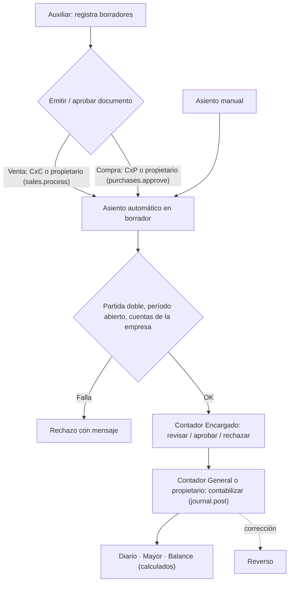
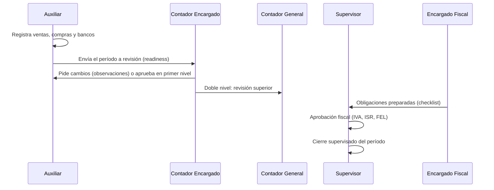
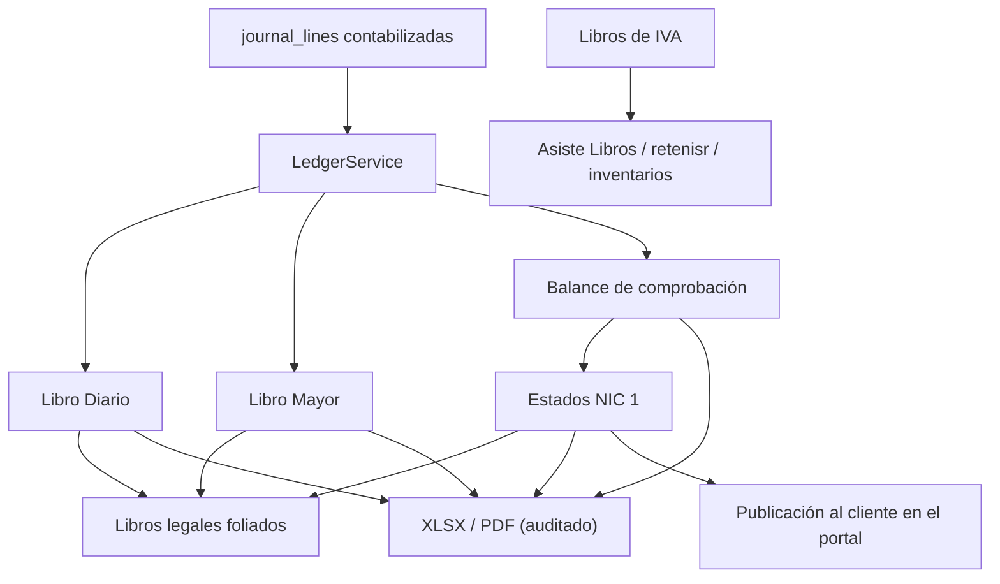
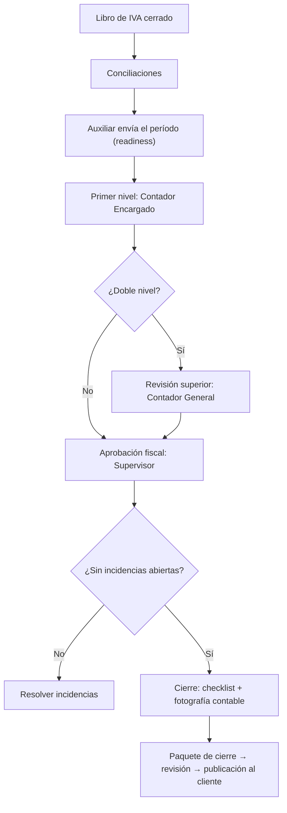

# Funcionamiento del Plan Profesional — Atlantia Finance

> Documento técnico y funcional, elaborado leyendo el código fuente (rama `main`, noviembre de 2026). Cada función se clasifica así:
>
> - **Implementado**: existe en el código y el servidor lo aplica.
> - **Parcial**: existe con limitaciones, incoherencias o dependencias externas.
> - **Pendiente**: no existe en el código.
>
> Las referencias indican el archivo donde vive la lógica.

---

## 1. Descripción general

### 1.1 Objetivo y destinatarios

El Plan Profesional (código `professional`) tiene el lema *«Para oficinas establecidas»*. El catálogo lo describe como *«Para oficinas establecidas y equipos contables en crecimiento»* y es el plan **recomendado** en la página de precios (`PlanCatalogSeeder::fillPresentation`, `is_recommended`).

Está pensado para una firma contable con **una sede** y un **equipo con funciones separadas**: dirección, contadores, auxiliares, encargados fiscales y de cuentas por cobrar o pagar, y nómina. A diferencia del Esencial, cada persona trabaja en el panel de su rol y existen revisiones y aprobaciones por personas distintas.

### 1.2 Precio y límites (aplicados por el servidor)

| Métrica | Valor | Dónde se aplica |
|---|---|---|
| Precio | Q799 al mes · Q7,990 al año | `plan_prices` |
| Oficinas | **1** | `WorkManagementController::storeOffice()`: 403 *«Tu plan activo alcanzó el límite de oficinas.»* |
| Usuarios de oficina | **8** | `OfficeInvitationService` (cada invitación reserva un asiento; los usuarios del cliente no cuentan) |
| Empresas cliente | **500** | `CompanyAdministrationService::create()` |
| Almacenamiento | 10 GB | `UsageMeterService::assertCanAdd()` |
| Consultas a Luzma IA | 120 al mes | `LuzmaService` |

Todos los límites son estrictos, con avisos al 80 % y al 95 % (`plans:limit-alerts`).

### 1.3 Funcionalidades (*features*) incluidas

Según `PlanCatalogSeeder`, más la migración `2026_10_28_204503_include_vat_books_and_payroll_in_plans.php`, que agrega **nómina** al Profesional:

`basic_accounting`, `basic_invoicing`, `fel`, `case_management`, `task_management`, `obligation_management`, **`inventory`**, **`payroll`**, **`advanced_reports`**, **`roles_and_permissions`**, **`approval_workflows`**, **`ocr`**, `audit_log`, `automatic_backups`, **`priority_support`**.

**No incluye:** `multi_office`, `consolidated_dashboard`, `office_permissions`, `centralized_audit`, `initial_training`, `api_access`, `webhooks` ni las funciones del plan Empresarial.

### 1.4 Diferencias frente al Esencial y al Multi-oficina

En el catálogo no existe un plan «Multiempresa»; el comparable es **Multi-oficina** (`multi_office`).

| Aspecto | Esencial | **Profesional** | Multi-oficina |
|---|---|---|---|
| Oficinas / usuarios / empresas | 1 / 2 / 150 | **1 / 8 / 500** | 5 / 25 / 1,500 |
| Almacenamiento / IA | 2 GB / 20 | **10 GB / 120** | 40 GB / 500 |
| Espacio de trabajo | Panel único `/essential/dashboard` | **Panel por rol** (`dashboardPathFor`) | Panel por rol |
| Roles asignables | Solo Contador Encargado y Auxiliar | **Todos los de `ROLE_PRESETS`** (salvo los ligados a módulos fuera del plan) | Todos, también por sede |
| Política de revisión | El propietario puede autoaprobarse | **Revisor distinto obligatorio** (`REQUIRED_SEPARATE_REVIEWER`, porque el límite de usuarios es mayor que 2) | Revisor distinto |
| Inventario, producción y kardex | No (403) | **Sí** | Sí |
| Nómina | No (403) | **Sí** | Sí |
| Lectura de facturas (OCR) | No | **Sí** | Sí |
| Archivos SAT `retenisr` e `inventarios`, esperas de documentos del cliente | No | **Sí** (`advanced_reports`) | Sí |
| Módulos operativos con aprobación (cotizaciones, notas de crédito, órdenes de compra, cierre de período) | No | **Sí** (`approval_workflows`) | Sí |
| Estados consolidados | No | **No** (403) | Sí |
| Varias sedes y permisos por sede | No | **No** | Sí |
| Soporte prioritario | No | **Sí** | Sí |
| Capacitación inicial | No | **No** | Sí |

---

## 2. Configuración inicial

### 2.1 Activación del plan

- **Autoservicio:** `/register?plan=professional`. `CreateNewUser` crea:
  - el usuario y la organización (`pending_email_verification`);
  - la oficina principal (`MAIN`, `pending`) y el vínculo del propietario (`owner`);
  - la suscripción `incomplete` con su `base_plan`.

  Después del correo verificado y los datos de facturación, `CreateCheckoutController` cobra en Recurrente. El webhook deja la suscripción y la organización en `active`.
- **Control Center:** `OrganizationManagementService::onboard()` crea la organización con prueba opcional y envía al titular una invitación firmada.
- **Acceso:** `EnsureActiveSubscription` deja entrar con la suscripción en `active`, `trialing`, `past_due` o `grace_period`.

### 2.2 Registro y panel del titular

El titular es `owner` y su rol de trabajo es `owner_director` (permisos `*`). Al no ser Esencial, su inicio es el **panel ejecutivo** `/office/executive-dashboard` (`WorkAuthorizationService::dashboardPathFor`), que muestra indicadores agregados de la firma (`ExecutiveDashboardService`). La guía de inicio `/office/setup` (`SetupChecklistService`) muestra el avance real de la configuración. Con una sola oficina omite los pasos propios de varias sedes.

### 2.3 Incorporación de clientes y empresas

`POST /office/companies` o `POST /accounting/companies` → `CompanyAdministrationService::create()`:

1. Valida el permiso `office.companies.create`, la oficina activa, el **límite de 500 empresas** y que el NIT no esté repetido ni en la papelera.
2. Crea la empresa con UUID público y moneda GTQ.
3. Instala el **catálogo de cuentas** (27 cuentas base y unas 200 del catálogo detallado).
4. Crea el **perfil fiscal** (IVA general, ISR sobre utilidades, BANGUAT, año fiscal desde enero) y los **impuestos de Guatemala**: IVA 12 % con precio con IVA incluido, ISR e ISO, entre otros.
5. Asigna, si se indican, al contador encargado y al auxiliar.
6. Audita la creación.

### 2.4 Configuración fiscal y contable

| Pantalla | Qué se configura |
|---|---|
| `/accounting/companies/{uuid}/fiscal-settings` | Régimen de IVA e ISR, impuestos propios, versiones de tasa con vigencia, tasas de cambio (`exchange-rates:sync`, dos veces al día) |
| `PATCH …/accounting-mapping` | Cuentas por defecto (bancos 1102, clientes 1103, ingresos 4101, proveedores 2102, gasto 5201) y reglas por evento |
| `…/fel/settings` | Certificador FEL de la empresa |
| `…/policies` | Políticas contables, como el monto mínimo para capitalizar activos fijos |
| `…/cost-centers` | Centros de costo |
| `…/regional` | Plantilla regional e impuestos |

### 2.5 Catálogo de cuentas

Cada empresa tiene su propio catálogo, con códigos únicos por empresa. Se pueden crear y editar cuentas (`POST/PATCH …/accounts`) y reinstalar la plantilla (`…/accounts/template`), que agrega lo que falte sin tocar lo existente. Solo aceptan movimientos las cuentas activas, de detalle y con `accepts_movements`.

### 2.6 Asignación de roles

Con `roles_and_permissions`, el propietario o el Administrador de Oficina invitan al equipo (`/office/users-roles`, `POST /office/invitations`) con el rol de su función. Los roles se administran en `/office/roles`. Cada persona se asigna a las empresas que atiende (`CompanyAssignmentService`, que valida que su rol permita la responsabilidad).

**Permisos clave por rol** (presets de `WorkAuthorizationService::ROLE_PRESETS`):

| Acción | Roles que la tienen |
|---|---|
| Emitir ventas (`sales.process`) | Propietario, **Cuentas por Cobrar** |
| Aprobar compras (`purchases.approve`) | Propietario, **Cuentas por Pagar** |
| Contabilizar asientos (`journal.post`) | Propietario, **Contador General** |
| Aprobar asientos (`journal.approve`) | Propietario, Contador General, Contador Encargado |
| Administrar períodos (`periods.manage`) | Propietario, Contador General |
| Cerrar período supervisado (`supervision.periods.close`) | Propietario, Supervisor Contable |
| Aprobación de primer nivel (`reviews.first_level_approve`) | Contador Encargado |
| Revisión superior (`reviews.upper_approve`) | Contador General |
| Aprobación fiscal (`supervision.fiscal.approve`) | Supervisor Contable |
| Certificar FEL (`fel.certify`) | Propietario, Contador Encargado, Encargado Fiscal |
| Aprobar nómina (`payroll.approve`) | Propietario, Gerente, Contador General, Contador Encargado |
| Registrar la presentación de obligaciones (`fiscal.obligations.mark_filed`) | Propietario, Contador General, Supervisor, Contador Encargado |

### 2.7 Períodos contables

- **Manual:** `POST …/periods` (requiere `periods.manage`) valida las fechas y rechaza períodos superpuestos.
- **Automático:** el ciclo mensual (`month:cycle`, 06:40) abre el mes anterior de cada empresa el día que la oficina configura y crea las tareas del mes.

### 2.8 Parámetros necesarios para operar

| Requisito | Validación que lo exige |
|---|---|
| Período abierto que contenga la fecha | `AccountingService::openPeriod` |
| Mapeo contable y cuenta de IVA débito | Al emitir ventas: *«Configura el mapeo contable…»*, *«Asigna la cuenta de IVA débito…»* |
| Libro de IVA del mes abierto | `VatBookService::assertOpen` |
| Certificador FEL | Solo para certificar DTE |
| Parámetros de nómina | `PayrollParameterSeeder`: tasas compartidas de la planilla |
| Personas con el permiso de cada paso | Ver tabla 2.6. Si nadie tiene `sales.process` o `purchases.approve`, solo el propietario puede emitir o aprobar |

---

## 3. Gestión de clientes

### 3.1 Registro y actualización

- **Empresa:** nombre, NIT, oficina y correo al crear. Después se agregan nombre comercial, teléfono, dirección, representante legal y contacto (columnas de `companies`).
- **Clientes y proveedores de la empresa:** `POST …/sales/customers` y `…/purchases/suppliers`, con NIT, correo, días de crédito y régimen de ISR para retenciones. Se editan con `PATCH`.
- **Cambios pedidos por el cliente:** el usuario del cliente propone cambios de datos (`client/company/change-requests`) y la oficina los revisa (`work/client-portal/changes/{id}/{action}`).
- **CRM de la firma** (`/office/crm`): prospectos y alertas (`crm:alerts`, 08:15). Está disponible en todos los planes.

### 3.2 Relación entre clientes, empresas y usuarios

```
organización (firma) ─ oficina ─ empresas (clientes de la firma)
   empresa ─ company_assignments (contador, auxiliar, fiscal, CxC, CxP, nómina, supervisor, auditor, consulta)
   empresa ─ client_company_access (usuarios del cliente con su rol de contacto)
   empresa ─ sales_customers / purchase_suppliers (terceros de la empresa)
```

### 3.3 Recepción de documentación

| Canal | Implementación | Estado |
|---|---|---|
| Captura de ventas y compras | Pantallas de Ventas y Compras | Implementado |
| **Lectura de facturas** desde XML FEL, PDF o foto | `PurchaseController::readInvoice` → `InvoiceReader`: lee el XML de forma exacta, el texto del PDF o la imagen con **OCR Tesseract en el mismo servidor**; el documento no sale del servidor. Solo prellena la compra y el contador confirma | Implementado |
| Carga masiva de DTE de la SAT | `SatDteImportService` (cruce con la SAT) | Implementado |
| Documentos subidos por el cliente | Portal: `client/documents` (subir y reemplazar). La oficina los revisa en `work/client-portal/documents/{id}/{action}` | Implementado |
| Solicitudes de documentos | `work/client-portal/requests`. El cliente responde en `client/document-requests/{id}/respond` | Implementado |
| Espera de documentos desde una tarea | `TaskWaitService`: requiere `advanced_reports` (incluido) y contactos del cliente en el portal | Implementado |
| Importación de asientos | Plantilla, vista previa e importación | Implementado |
| Soportes de asientos | `AccountingDocumentController` (PDF, JPG, PNG o WEBP de hasta 10 MB) | Implementado |

### 3.4 Organización de expedientes

El «expediente» de un cliente es su empresa con todo lo que cuelga de ella: documentos de compra y venta con sus archivos, soportes de asientos, documentos del portal, obligaciones con su constancia, períodos y reportes publicados. La función `case_management` no tiene un control propio en el servidor (Parcial). El expediente formal de alta (contrato, credenciales SAT, RTU, patente) **no está en `main`** (Pendiente).

### 3.5 Comunicación y notificaciones

- **Mensajes con el cliente:** el cliente escribe en `client/messages` y la oficina responde en `work/client-portal/messages` (`CommunicationService`).
- **Aprobaciones del cliente:** la oficina pide una aprobación (`work/client-portal/approvals`) y el cliente responde (`client/approvals/{id}/respond`).
- **Reportes publicados:** la oficina publica un reporte (`work/client-portal/reports`) y el cliente lo descarga (`client/reports/{id}/download`).
- **Recordatorios automáticos al cliente:** `clients:remind` (08:25), configurables por oficina (`office/offices/{id}/client-reminders`).
- **Recordatorios de cobro:** `collections:auto-remind` (08:40).
- **Notificaciones internas** (`WorkNotificationService`): bandeja de cada usuario (asignaciones, revisiones, obligaciones generadas) y alertas (`alerts:dispatch`).
- **Correo saliente de la firma:** `office/client-email` permite configurar el remitente y enviar una prueba.

### 3.6 Historial y seguimiento

- `audit_logs` registra cada acción con usuario, fecha e IP; es de solo inserción.
- La pantalla de Auditoría y la actividad por usuario del cliente (`office/client-access/{id}/activity`) leen esa bitácora.
- El cliente ve su propio historial en `client/history`.
- Cada tarea tiene comentarios y transiciones, y cada obligación su historial.

---

## 4. Proceso contable de principio a fin

1. **Recepción:** según la sección 3.3.
2. **Clasificación:**
   - cada línea de compra lleva una cuenta de gasto o activo de la empresa y un tratamiento fiscal (`goods`, `services` o `exempt`);
   - las ventas usan la cuenta de ingresos del mapeo;
   - las **reglas bancarias** clasifican movimientos recurrentes;
   - el **OCR** sugiere el proveedor y las líneas.
3. **Compras y ventas** (sección 6.2):
   - la venta se registra como borrador y al emitirla (`sales.process`) se crea su asiento: cargo a Clientes, abono a Ingresos y a IVA débito;
   - la compra se registra como borrador y al aprobarla (`purchases.approve`) se crea su asiento: cargo a Gasto o Activo y a IVA crédito, abono a Proveedores.
4. **Ingresos y egresos:** cobros y pagos (con retenciones de ISR o IVA cuando corresponden: `WithholdingService`, `FacturaEspecialService`), cheques, transferencias, caja chica y gastos de empleados.
5. **Partidas:** las genera la automatización (idempotente por `posting_key`) o se registran a mano (`POST …/entries`). Todas nacen como **borrador**.
6. **Cargos y abonos:** en cada línea, debe **o** haber mayor que cero; la suma del debe es igual a la del haber, con al menos 2 líneas; los importes se manejan en centavos enteros.
7. **Validación:**
   - flujo `draft` → `pending_review` → `reviewed` → `approved` → `posted`;
   - al contabilizar se revalida la integridad y se asigna el número correlativo del período;
   - un ajuste no lo aprueba quien lo creó;
   - un asiento contabilizado es inmutable (por *trigger*): se corrige con un reverso.
8. **Diario y Mayor:** no se guardan saldos. `LedgerService` y `TrialBalanceService` los calculan desde las líneas contabilizadas.
9. **Cuentas por cobrar y por pagar:** antigüedad de saldos (`/receivables`, `/payables`), recibos, pagos, notas de crédito, anticipos, propuestas de pago y castigos (según el rol). Paneles `/receivables/dashboard` y `/payables/dashboard`.
10. **Conciliación bancaria:** movimientos del estado de cuenta (manuales o importados), su clasificación (las comisiones e intereses generan su asiento) y la conciliación con partidas en tránsito (`AccountReconciliationService`). También hay conciliación de auxiliares.
11. **Reportes:**
    - Diario, Mayor, balance de comprobación, resultados y balance general;
    - estados NIC 1 con notas y firmantes;
    - libros legales foliados;
    - ISR y retenciones, otros impuestos, presupuestos y NIIF;
    - archivos SAT: **todos**, incluidos `retenisr` e `inventarios`, por `advanced_reports`.
12. **Validaciones fiscales:**
    - Libro de IVA con liquidación y controles;
    - cruce con la SAT;
    - obligaciones con checklist, revisión y constancia;
    - alertas de DTE pendientes en la SAT (`fel:sat-alerts`).
13. **Cierre:** mensual (directo o supervisado), cierre del Libro de IVA y cierre anual (secciones 5.2 y 6.10).

**Relación entre módulos:**

```
Ventas / Compras / Bancos / Inventario / Nómina / Activos  ──▶  Asientos (borrador) ──▶ Revisión ──▶ Contabilización
            │                                                                              │
            └──▶ Libro de IVA ──▶ Obligación de IVA                                         ▼
                                                                         Diario · Mayor · Balance · Estados
                                                                                           │
                                         Revisión del período (auxiliar → contador → fiscal) ──▶ Cierre
```

---

## 5. Flujos operativos por rol

### 5.1 Quién hace qué

| Etapa | Quién | Panel y acción real |
|---|---|---|
| Inicia el mes | Ciclo automático o propietario o administrador | `month:cycle` abre el período y crea las tareas; `/office/assignments` reparte el trabajo |
| Registra | **Auxiliar Contable** | `/assistant/dashboard`: borradores de ventas y compras, bancos, documentos y asientos; los envía a revisión |
| Emite y aprueba documentos | **Cuentas por Cobrar** (ventas), **Cuentas por Pagar** (compras) o el propietario | Emitir venta (`sales.process`), aprobar compra (`purchases.approve`) |
| Certifica FEL | Contador Encargado, Encargado Fiscal o propietario | `fel.certify` |
| Revisa movimientos | **Contador Encargado** | `/accountant/dashboard`: `entries/{id}/review·approve·reject`, observaciones y revisión del período |
| Contabiliza | **Contador General** o propietario | `journal.post` (`/accountant/entries/{id}/post` o la pantalla del diario) |
| Valida fiscalmente | **Encargado Fiscal** prepara; **Supervisor** aprueba en lo fiscal | `/tax/dashboard`, `supervisor/reviews/{id}/fiscal-approve` |
| Supervisa | **Supervisor Contable** | `/supervisor/dashboard`: revisiones, reasignaciones, incidencias, cierre de período y aprobación de declaraciones |
| Nómina | **Nómina** calcula y envía; un aprobador distinto aprueba | `/payroll/periods/{id}/{calculate·submit·approve·send·close}` |
| Tesorería | **Tesorería** | Bancos, conciliaciones, pagos y cobros |
| Consulta y audita | Auditor, Solo lectura, Director (en solo lectura si existe un Administrador de Oficina de toda la firma) | `/audit/dashboard`, reportes |

### 5.2 Revisión del período (Implementado; `CompanyPeriodReviewService`)

1. El **auxiliar** envía la empresa y el período a revisión (`assistant/companies/{c}/periods/{p}/submit`). `CompanyPeriodReadinessService` lista los bloqueos y advertencias; un bloqueo solo se salta con un motivo registrado (*override*) y auditado.
2. El **Contador Encargado** inicia la revisión y aprueba en **primer nivel** o pide cambios (observaciones con su registro de origen).
3. Si la oficina usa **doble nivel** (`offices.review_workflow = 'double_level'`), el **Contador General** hace la revisión superior. En **un nivel**, la aprobación del contador es la aprobación contable.
4. El **Supervisor** hace la aprobación **fiscal** (IVA, ISR y FEL) o pide cambios fiscales.
5. Con las dos revisiones aprobadas y sin incidencias abiertas, el **Supervisor** (`supervision.periods.close`) o el **Contador** (`periods.manage`) cierran el período: `CloseAccountingPeriod::execute(..., supervised: true)`, con el checklist y la fotografía contable.

Estados de la revisión: `not_started`, `in_progress`, `ready_for_review`, `in_review`, `changes_requested`, `first_level_approved`, `fiscal_pending`, `approved`, `ready_to_close` y `closed`.

### 5.3 Gestión de errores

| Error | Mecanismo |
|---|---|
| Documento o asiento en borrador mal registrado | Se descarta (`void`) o se rechaza con motivo |
| Asiento contabilizado | Reverso automático contabilizado; el original queda `reversed` |
| Venta, compra, cobro, pago o nota | Anulación con su reverso contable |
| Observaciones de revisión | `review_observations` apuntan al registro a corregir. El responsable lo corrige en su origen, lo marca como corregido y el revisor lo valida |
| Incidencias | `OperationalIncidentService`: tipo, severidad, responsable; la severidad crítica puede bloquear el período |
| Período o Libro de IVA cerrado | Reapertura en tres pasos auditados (período) o con motivo (IVA, si el mes siguiente no está cerrado) |

### 5.4 Consulta del estado y finalización

- Cada panel muestra sus colas: tareas con su estado, revisiones pendientes, obligaciones por vencer, incidencias y avance del período (`CompanyPeriodProgressService`).
- El Director ve el panel ejecutivo de la firma y el Gerente ve operaciones (`/operations/dashboard`).
- Las operaciones terminan con el período cerrado (fotografía contable), las obligaciones presentadas con su constancia, la nómina pagada y cerrada, y los reportes publicados al cliente.

---

## 6. Funcionamiento interno de los módulos

| Módulo | Propósito | Entradas → salidas | Reglas y restricciones | Automatización |
|---|---|---|---|---|
| **6.1 Contabilidad general** | Catálogo, períodos, diario, mayor y balance | Asientos → libros y saldos | Partida doble, período abierto, cuentas de la empresa, inmutabilidad, numeración por período, bloqueo por empresa | Asientos de origen, recurrentes y reversión programada |
| **6.2 Ventas y cuentas por cobrar** | Facturación y cartera | Clientes, facturas, cobros, notas, retenciones → asientos y antigüedad | Emitir requiere `sales.process`; Libro de IVA abierto; nota de crédito ≤ saldo | Recordatorios de cobro, automatización de cartera |
| **6.3 FEL** | DTE electrónicos | Factura → DTE certificado, PDF, correo | Certificador por empresa; `fel.certify` | `fel:recover` cada 5 min, `fel:sat-alerts` |
| **6.4 Compras y cuentas por pagar** | Gastos, compras y proveedores | Documentos (manuales u OCR), pagos, notas → asientos y saldos | Aprobar requiere `purchases.approve`; número fiscal único por proveedor (no se duplica el crédito fiscal) | Propuestas de pago |
| **6.5 Inventario y producción** | Kardex valorizado y costos | Productos, movimientos, recetas, órdenes, tomas físicas → costo de ventas | `plan.feature:inventory`; sin existencias negativas; no se registran movimientos anteriores a uno ya contabilizado | `postCosts` genera los asientos de costo; la toma física genera ajustes |
| **6.6 Nómina** | Planilla, IGSS y libro de salarios | Empleados, novedades → planilla, recibos y asiento | `plan.feature:payroll`; quien calcula o envía no aprueba; se cierra solo la planilla pagada | Envío a tesorería para el pago |
| **6.7 Bancos y tesorería** | Estado de cuenta y conciliación | Movimientos, importaciones → conciliación | Los movimientos no generan asiento salvo comisiones o intereses clasificados | Reglas bancarias |
| **6.8 Fiscal** | Cumplimiento | Documentos → Libros de IVA, liquidación, obligaciones, archivos SAT | Libro cerrado bloquea cambios; obligaciones con checklist y revisión por otra persona | Calendario fiscal, ciclo mensual, alertas |
| **6.9 Activos fijos** | Depreciación | Activo → asiento mensual | Monto mínimo de capitalización según la política | Depreciación del mes en borrador |
| **6.10 Estados y cierre** | Reportes y cierre | Saldos → NIC 1, libros legales, cierre anual | Checklist bloqueante; los asientos de cierre anual (`closing`) siguen la revisión | `accounting.period.closed`, paquete de cierre del ciclo mensual |
| **6.11 Portal del cliente** | Colaboración con el cliente | Solicitudes, documentos, aprobaciones, mensajes, reportes | Accesos por empresa y rol de contacto; no consumen asientos | `clients:remind` |
| **6.12 Tareas y supervisión** | Coordinación del trabajo | Tareas, revisiones, incidencias, observaciones | Revisor distinto obligatorio; el estado de una tarea ligada a un objeto se lee de ese objeto | `tasks:sync` cada 15 min, `tasks:remind` a las 07:45 |
| **6.13 Módulos operativos** (`OperationalWorkflowRegistry`) | Registros con flujo y aprobación: cotizaciones, notas de crédito, órdenes de compra, cierre de período, presupuestos, proyectos, normativa, portal y reportes | Registro → transiciones auditadas | Cada módulo exige su función: `approval_workflows` o `advanced_reports` (ambos incluidos); algunos validan el período | El módulo `cierre-periodo`, al cerrarse, cierra el período contable |
| **6.14 Auditoría y respaldos** | Trazabilidad | Bitácora → consulta y exportación | `audit_log`, `automatic_backups` | `backup:create` a las 02:30 (si está habilitado) |
| **6.15 Luzma IA** | Asistente | Preguntas → respuestas y herramientas | 120 consultas al mes; usa el OCR | Informe matutino |

---

## 7. Análisis técnico

**Controladores principales:**

- **Contabilidad y documentos:** `AccountingController`, `AccountingDocumentController`, `AccountingReportController`, `SalesController`, `PurchaseController`, `BankController`, `FelDocumentController`, `FelSettingsController`, `FiscalSettingsController`, `VatBookController`, `SatReconciliationController`, `SatFileController`.
- **Módulos contables especializados:** `InventoryController`, `ProductionController`, `PayrollController`, `FixedAssetController`, `FinancialStatementController`, `YearEndController`, `TaxReportController`, `OtherTaxesController`, `BudgetController`, `IfrsController`, `CheckController`, `AccountReconciliationController`, `BookAutomationController`, `CommercialDocumentController`, `ExpenseReportController`.
- **Paneles por rol:** `AssistantController`, `AccountantController`, `SupervisorController`, `TaxController`.
- **Oficina y portal:** `OfficeAdminController`, `WorkManagementController`, `OfficeClientPortalController`, `ClientPortalController`, `ClientAccessAdminController`, `ClientEmailController`, `SubscriptionController`.

**Servicios:**

- **Contabilidad:** `AccountingService`, `AccountingAutomationService`, `LedgerService`, `TrialBalanceService`, `FinancialStatementService`, `LegalBooksService`, `AccountingPeriodCloseChecklistService`, `CloseAccountingPeriod`, `YearEndCloseService`.
- **Revisión y supervisión:** `CompanyPeriodReviewService`, `CompanyPeriodReadinessService`, `ReviewObservationService`, `AssistantService`, `AccountantService`, `SupervisorService`, `OperationalIncidentService`, `OperationalRecordService`.
- **Inventario, nómina y activos:** `InventoryService`, `InventoryCountService`, `ProductionService`, `PayrollPeriodService`, `PayrollRecordService`, `FixedAssetService`.
- **Documentos y fiscal:** `InvoiceReader` (OCR), `WithholdingService`, `VatBookService`, `FiscalObligation*Service`.
- **Portal y plataforma:** `ClientAccessService`, `ClientReminderService`, `CommunicationService`, `EntitlementResolverService`, `WorkAuthorizationService`.

**Tablas:**

| Grupo | Tablas |
|---|---|
| Contabilidad | `ledger_accounts`, `accounting_periods`, `journal_entries`, `journal_lines`, `journal_entry_documents`, `accounting_source_entries`, `accounting_period_close_snapshots` |
| Ventas y compras | `sales_*`, `purchase_*` |
| Bancos | `bank_accounts`, `bank_transactions`, `account_reconciliations` |
| Inventario | `inventory_items`, `inventory_movements`, `inventory_counts`, `bills_of_materials`, `production_orders` |
| Nómina | `payroll_employees`, `payroll_periods` |
| Activos y fiscal | `fixed_assets`, `vat_book_periods`, `fiscal_obligations`, `sat_dte_records` |
| Revisión y supervisión | `company_period_reviews`, `review_observations`, `operational_incidents`, `work_tasks` |
| Portal | `client_company_access`, `client_requests`, `client_documents` |
| Control | `audit_logs` |

**Seguridad y acceso:**

- **Middleware:** `subscription.active`, `plan.feature:*`, `EnforceOfficeTwoFactor`, `EnsureLegalAcceptance`, `RestrictClientPortalUsers`, `RestrictSupervisingDirector`, `SetTenantDatabaseContext` y `throttle`.
- **Políticas de acceso:** se implementan con servicios, no con *Policies* de Laravel: `canModule`, `canJournal`, `requireFeature`, `OfficeScopeService`, `roleAllowedByPlan`. A eso se suma RLS de PostgreSQL por organización y *triggers* de integridad.

**Exportaciones:**

- `ReportExportService` genera XLSX o PDF de los libros, el balance, los estados, la auditoría, las compras, los proveedores, los bancos, las retenciones y los centros de costo.
- `LegalBooksService` produce los libros legales foliados.
- `SatFileController` genera Asiste Libros, `retenisr` e `inventarios`.
- También se generan PDF de factura, de documento de compra y de los recibos de nómina.

**Integraciones:**

- Recurrente (cobro de la suscripción).
- Certificador FEL (`FEL_PROVIDER`).
- BANGUAT (tasas de cambio).
- Tesseract (OCR local).
- Correo saliente.
- **Sin** API pública ni webhooks en este plan.

---

## 8. Diagramas Mermaid

### 8.1 Incorporación de clientes



### 8.2 Administración de documentos



### 8.3 Procesamiento contable



### 8.4 Interacción entre usuarios y módulos



### 8.5 Generación de reportes



### 8.6 Cierre contable



---

## 9. Caso práctico: un mes de *Ferretería El Martillo, S.A.*

> Cifras ilustrativas en quetzales, con IVA del 12 % incluido. Los nombres son ficticios.

**Firma:** *Asesores Contables Izabal*, Plan Profesional, con 6 de los 8 usuarios:

- Lic. Raúl Ernesto Pineda (propietario);
- Ana Lucía Hernández (Contadora General);
- Carlos Méndez (Contador Encargado);
- Sofía López (Auxiliar);
- Gabriela Solís (Encargada Fiscal);
- Claudia Morales (Supervisora).

**Cliente:** Ferretería El Martillo, S.A., en Puerto Barrios. Mes: octubre de 2026.

| Día | Actividad | Quién | Registro y efecto |
|---|---|---|---|
| 1 | El ciclo mensual abre el período de octubre y crea las tareas del mes | Automático | `accounting_periods` y `work_tasks` |
| 1 | Saldo inicial: capital Q80,000 | Contadora General | Asiento de apertura con soporte: cargo 1102 / abono 3101 |
| 2 | El cliente sube las facturas al portal | Cliente | `client_documents`; la auxiliar las revisa |
| 3 | Compra de mercadería a crédito por Q16,800, leída con OCR desde el XML | Auxiliar (registra) · propietario (aprueba) | Cargo 5103 15,000 · cargo 1301 1,800 · abono 2102 16,800 |
| 5 | Alquiler del local por Q5,600 | Auxiliar · propietario | Cargo 5203 5,000 · cargo 1301 600 · abono 2102 5,600 |
| 10 | Venta a crédito a una constructora por Q22,400, certificada por FEL | Auxiliar (borrador) · propietario (emite) · Contador (certifica) | Cargo 1103 22,400 · abono 4201 20,000 · abono 2201 2,400 |
| 12 | Energía eléctrica al contado por Q1,120 | Auxiliar · propietario · pago | Cargo 5204 1,000 · cargo 1301 120 · abono 2102 1,120; luego cargo 2102 / abono 1102 1,120 |
| 15 | Pago del alquiler por Q5,600 | Propietario | Cargo 2102 / abono 1102 5,600 |
| 20 | Cobro del 50 % de la venta por Q11,200 | Contador | Cargo 1102 / abono 1103 11,200 |
| 28 | Ventas de mostrador al contado por Q11,200 y su cobro | Auxiliar · propietario | Cargo 1103 11,200 · abono 4201 10,000 · abono 2201 1,200; luego cargo 1102 / abono 1103 |
| 31 | Comisión bancaria de Q45, clasificada en Bancos | Tesorería o propietario | Asiento automático: cargo 5201 / abono 1102 45; movimiento conciliado |
| 31 | Planilla de 2 empleados: calcula y envía Nómina; aprueba el Contador (persona distinta) | Nómina · Contador | Asiento de planilla con los parámetros vigentes de IGSS de la aplicación (no se muestran montos aquí) |
| 31 | Revisión y contabilización de los borradores | Contador (revisa) · Contadora General (contabiliza) | Asientos `posted` y numerados |
| 5 nov. | Conciliación bancaria de octubre | Tesorería · Contador | Saldo en libros igual al saldo del banco |
| 6 nov. | Cruce con la SAT y cierre del Libro de IVA | Encargada Fiscal | Débito 3,600 − crédito 2,520 = **IVA por pagar Q1,080** |
| 7 nov. | La auxiliar envía el período a revisión | Auxiliar | `company_period_reviews` en `ready_for_review` |
| 8 nov. | Primer nivel aprobado; aprobación fiscal | Contador · Supervisora | `first_level_approved` y luego `approved` |
| 9 nov. | Cierre supervisado del período | Supervisora | Checklist, fotografía contable y período `closed` |
| 25 nov. | Declaración del IVA de octubre: prepara la Encargada Fiscal, aprueba el Contador, se registra la presentación con constancia | Fiscal · Contador | `fiscal_obligations` en `completed` |
| 26 nov. | Publicación al cliente del estado de resultados y el balance | Contadora General | El reporte queda disponible en el portal del cliente |

**Resultados de octubre** (sin la planilla, cuyo monto depende de los parámetros configurados):

| Estado de resultados | Q |
|---|---:|
| Ventas (4201) | 30,000.00 |
| Compras (5103) | (15,000.00) |
| **Utilidad bruta** | **15,000.00** |
| Alquiler, energía y gastos bancarios (5203, 5204, 5201) | (6,045.00) |
| **Utilidad antes de la planilla** | **8,955.00** |

| Balance general | Q | | Q |
|---|---:|---|---:|
| Bancos | 95,635.00 | Proveedores (2102) | 16,800.00 |
| Clientes (1103) | 11,200.00 | IVA débito (2201) | 3,600.00 |
| IVA crédito (1301) | 2,520.00 | Capital (3101) | 80,000.00 |
| | | Resultado | 8,955.00 |
| **Total** | **109,355.00** | **Total** | **109,355.00** |

**Balance de comprobación cuadrado:** saldos deudores = saldos acreedores = **Q130,400.00**.

---

## 10. Problemas e interrupciones detectados en el flujo

1. **Emitir ventas y aprobar compras.** Solo pueden hacerlo el propietario, Cuentas por Cobrar (`sales.process`) y Cuentas por Pagar (`purchases.approve`). El Contador Encargado y el Auxiliar no pueden. Si la firma no asigna esos roles, todo pasa por el propietario.
2. **Contabilizar.** Solo pueden hacerlo el propietario y el Contador General (`journal.post`). Sin Contador General, el propietario es un cuello de botella.
3. **Director en solo lectura.** Cuando existe un Administrador de Oficina de toda la firma, `isExecutiveReadOnly` deja al Director en solo lectura en los permisos de acción. Las operaciones contables por empresa siguen permitidas al propietario, porque `canModule` lo reconoce como `owner`.
4. **8 usuarios.** Cubrir todos los roles del flujo completo (auxiliar, contador, contador general, supervisor, fiscal, cuentas por cobrar y por pagar, nómina) agota los asientos del plan.
5. **Inconsistencias de menú.** `plan-capabilities.ts` asocia los módulos *futuros* a funciones (por ejemplo, `cierre-periodo` → `approval_workflows`). En el Profesional esos accesos sí aparecen, pero conviven con las pantallas reales equivalentes (Cotizaciones y órdenes, notas de crédito, cierre en Períodos), lo que puede duplicar caminos.
6. **Expediente de alta del cliente** (contrato, credenciales SAT, RTU, patente): no está en `main`.
7. **`case_management`:** no tiene un control propio en el servidor.
8. **Consolidación:** no está disponible (403), aunque la firma lleve varias empresas de un mismo grupo.
9. **Integraciones externas:** el FEL depende del certificador y los respaldos de `backup.enabled`. No hay conexión directa con los bancos.

---

## 11. Resumen de estado

| Estado | Funcionalidades |
|---|---|
| **Implementado** | Límites del plan; panel por rol; roles y permisos completos; revisión obligatoria por otra persona; revisión del período en uno o dos niveles con aprobación fiscal y cierre supervisado; contabilidad completa con reversos; ventas, compras, cuentas por cobrar y por pagar con retenciones; FEL; OCR local de facturas; inventario, kardex, producción y tomas físicas; nómina; activos fijos; bancos y conciliación; Libros de IVA, cruce con la SAT y obligaciones; todos los archivos SAT; estados NIC 1 y libros legales; portal del cliente con solicitudes, documentos, aprobaciones, mensajes y reportes; incidencias y observaciones; auditoría; recordatorios y ciclo mensual |
| **Parcial** | Expedientes (`case_management` sin control propio); duplicidad entre módulos operativos y pantallas reales; FEL y respaldos dependen de configuración externa; emisión y aprobación concentradas en pocos roles |
| **Pendiente** | Consolidación (no incluida en el plan); varias sedes; API y webhooks (no incluidos); expediente formal de alta en `main`; conexión directa con bancos |

---

*Fuentes principales: `config/atlantia-plans.php`, `database/seeders/PlanCatalogSeeder.php`, `database/migrations/2026_10_28_204503_include_vat_books_and_payroll_in_plans.php`, `app/Services/Platform/EntitlementResolverService.php`, `app/Services/WorkManagement/{WorkAuthorizationService,ReviewPolicyService,CompanyPeriodReviewService,CompanyAdministrationService,OfficeInvitationService}.php`, `app/Services/Operations/{AssistantService,AccountantService,SupervisorService,OperationalWorkflowRegistry,OperationalIncidentService}.php`, `app/Services/Documents/InvoiceReader.php`, `app/Http/Controllers/{PurchaseController,SalesController,OfficeClientPortalController,ClientPortalController,PayrollController,InventoryController}.php`, `app/Services/AccountingService.php`, `app/Actions/Accounting/CloseAccountingPeriod.php`, `routes/web.php`, `routes/console.php`, `resources/js/lib/plan-capabilities.ts`.*
